# The CNC guide

This is the user guide for Case Maker's CNC work, written for someone who owns a
**Makera Z1** and has never driven a CNC before. It covers the whole workflow: simulating
a G-code file, and carving a **hardwood name plate** held in the vise — the app's default job
is that plate, three words engraved to different depths. A printed blank is still something you
can cut (the two-colour badge is the guide's own example), and §6 says what a printed material
asks of the cut. Chapter 5 says which parts of the job are in the app today.

Two things to hold on to before you read on:

- **Case Maker writes the file, and the desktop build can hand it to the machine.** The
 **desktop** app uploads the `.nc` to the Z1 over your network, plays it, stops it, and homes
 after it — each of those a separate press of yours, with the machine named before anything is
 written. The **web** build cannot reach a machine at all: it ends at the file, which you
 upload with **Makera Studio**. The **work origin is set by hand** either way.
- **Case Maker supports the Z1, the Carvera Air and the Carvera.** Each carries Makera's own
 controller configuration — the Z1's from this repository's firmware defaults and the bench's own
 reads, the Air's from the Controller Makera publishes, the Carvera's from the Carvera Community
 Firmware's shipped `config.default` (its `wifi.machine_name CARVERA_01001` names the model), and
 the machine's database row for its travel and its six-slot changer — so a job can be written for
 any of them. None of those is a measurement of YOUR machine: a controller calibrated away from
 the shipped values reports its own on the first connection, and the profile says which frame is
 in force. **A Carvera job uses the automatic tool changer:** the file says `Tn M6` and the
 controller drives its own rack, so the program states no slot position — the rack is the
 machine's, and the profile lists the firmware's default slot arrangement only so it can be read.
- **On the public site the CNC side is a beta switch.** [electricrv.ca/casemaker](https://electricrv.ca/casemaker)
 hides the Cut and Simulate sections, the cutting-job door, Manage and this guide
 unless the address carries `?BETA=yes`:
 `https://electricrv.ca/casemaker/?BETA=yes`. Dev builds and the desktop build have it on
 without the switch. The switch does not let a browser reach a machine; only the desktop
 build can.

For the rest of the app — building cases around boards — see the
[User Manual](https://github.com/SlyWombat/CaseMaker/blob/main/docs/user-manual.md). This
guide is about the CNC side only.

**Every section opens with a status line, and the status is true.** The three values are
**Available** (you can do it in the app today), **Partly available** (some of it works; the
rest is planned), and **Planned** (not in the app yet; the
section describes the design). A planned section is written in the future tense on purpose —
if a sentence says "will", it is not shipping yet. Everything is in millimetres.

---

## 1 · What this is, and what it is not

> **Status: Available** — a statement of scope.

**What it is.** Case Maker can do two CNC things for a Makera Z1: **simulate** a G-code file
you already have (so you can see what it cuts before risking a blank), and **write** a cutting
job — the default is a hardwood name plate held in the vise, and a printed blank such as the
two-colour badge is a different job of your own. The job is one document, and it writes up to
four files: the program, its frame file, its facing file when the job has one, and a run
record (§5, step 8). The **desktop** build
can upload and play them from the Cut panel — one program, or a whole multi-program list
through the release step (§5, step 9).

**What it is not.** It is not automatic machining. The desktop build sends the files and starts
them **when you press the buttons**, and it can stop and home the machine. The probing is the
registrations **you approved**: the Cut page's registration step runs that plan and writes the
origin from its measurement only when you press the button (§5, step 7). Nothing moves on its
own, and the app does not decide anything at the machine. The **web** build has no connection to
the Z1 at all — its upload control does not exist, rather than being drawn disabled — so there
the files go to **Makera Studio** by hand. In both builds a person is at the machine.

**What is deliberately not built** (each is a decision, not an oversight):

- Automatic probing or origin-setting that you have not approved. The Cut page's registration
 step runs the setup's approved plan and asks before it writes the origin; nothing
 probes, homes or writes on its own.
- Autolevelling (`G32`) *in the file*. The levelling pass runs at the machine's console before
 cutting and the state is cleared after — never in the `.nc`, which the upload gate would refuse.
 The five registration touches tell the two cases apart: a **tilt** (the whole blank is
 crooked, colour plane included) is followed by re-posting the program against the fitted plane,
 and a `G32 R1` console grid is offered as the machine-side alternative; a **dome** (a curved top
 over a flat colour line) is refused, because following the top would cut through the line.
 Whether the grid compensates every move or only its endpoints is the bench question.
- 3D surfacing from a **goal mesh** — now built (§5.4): a job whose only
 work is a `role: 'goal'` mesh — or a **PNG picture, carved as a relief** — generates a
 raster-roughing + ball-nose finishing program, with optional **scallop** (offset contours) and
 **pencil** (corner) finishing passes after it, and the goal row's **Technical** fold carries the
 operation's cutter, step-down/step-overs, grid pitch, allowance, the two pass switches and the
 pencil crease angle (a picture adds its relief depth, direction and placed width). The measured 3D
 engagement feeds are still bench work. A heightfield has one top-Z per (x, y), so undercuts and
 overhangs are unrepresentable — the honest 3-axis answer.
 **2026-11-05:** a PNG relief currently refuses by name until its own picture-to-mesh path is
 restored — the mesh goal path above is unaffected.
- V-carving a region whose groove at the colour plane is narrower than one machine step. The app
 states it as a warning (`vcarve-groove-too-narrow`, §8.1) and cuts the grooves; it does open
 regions otherwise.
- Laser work.
- The 4th axis.
- Multi-tool jobs **in one program**. One setup is one tool and one `.nc`; a job with
 several setups is several programs, and the **release step** uploads and plays them in cut
 order, stopping at each bit change.

> **⚠ Safety.** The simulation assumes a **rigid, ideal machine**: no deflection, no runout,
> no Z-chain error, no chatter. It does not know about a clamp you added, a cutter you fitted
> differently, or a blank that is not the size you typed. A simulated file that looks clean is
> still a file cut by a real machine on a real block. **Never run a job unattended**, and keep
> your hand on the stop.

---

## 2 · The machine, and what you need

> **Status: Available** — reference.

**The Makera Z1** (the figures are Makera's published specifications, not a wiki page):

| | Makera Z1 |
|---|---|
| Work volume | 200 × 200 × 100 mm |
| Max spindle | 13 000 RPM (150 W, closed loop, 0.01 mm runout) |
| Max feed rate | 1 200 mm/min |
| Automatic tool changer | **none** — you change cutters by hand |

Every limit a screen acts on — the work envelope, the spindle ceiling, the safe Z the rapids and
the laser lift read, the rapid model — comes from that machine **profile**, never from a number
hard-coded in a screen. The profiles are the Z1, the **Carvera Air** (300 × 200 × 130 mm,
13 000 RPM, no changer, ⌀92 × 200 mm rotary module) and the **Carvera** (320 × 240 × 140 mm,
15 000 RPM, a six-slot changer with its rack stated from the firmware's default slot list,
⌀92 × 240 mm). Each frame field carries where it came from; a value no source states stays unread
rather than borrowed from another machine. The vise and every other accessory are the same story: their
geometry lives on the machine's **fixture records** and bed **datums**, each with a source and a
"measured when". The one exception to "nothing is hard-coded" is stated wherever it stands:
a few PROVISIONAL numbers (the vise body's floor depth, the finishing step-over for 3D) are still
guesses, and they say so on the record that carries them.

**The three probes.** Three things ship or are sold under nearly identical names, they all
install the same way and plug into the same connector. Makera's pages rate only one of them
for non-conductive material like PLA — and the bench says otherwise, so read the table with
the paragraph under it.

| Probe | Axes | Materials |
|---|---|---|
| **Wired probe** (in the box) | Z only, plus surface levelling and area scanning | not stated by Makera — **measured on the bench: a mechanical tip that triggers on PLA** |
| **3D Probe Rod** (in the box) | X, Y and Z | **conductive only** — the workpiece must be electrically connected to the aluminium table |
| **Makera 3D Probe** (separate accessory) | X, Y and Z | both conductive **and non-conductive** |

**The wired probe is the one in use.** It is a mechanical touch tip — it registers on
contact, conductive or not — and it touched a printed PLA blank five times
with a 0.001 mm spread between slow touches.
So the Z touch-off and the surface levelling both use the probe that came in the box, with
nothing to unplug. The **Makera 3D Probe** is held in reserve; the 3D Probe Rod cannot touch
PLA at all. On a taped or bed-held job the blank sits on MDF and is not connected to the
aluminium table — the 3D Probe Rod cannot find it unless a screw or pin bridges the two.

**The low-profile vise.** The **fixed jaw is on the left**. It locates the part in X and in
rotation, and leaves it free to slide in Y. It mounts with the wasteboard removed. Its
dimensions are published nowhere, so they are not hard-coded: they live on the machine's
**fixture record** — the accessory's product constants and this unit's own measurements — and the
machine's **bed profile** holds the jaw-top datum (§7, the Machines card's **Bed** block). Until
you measure them they are the shipped defaults, and every reading that quotes them says
"unmeasured" (chapter 5).

**Cutters: a V-bit is correct at the colour plane.** A V-bit *couples depth to stroke width* —
cut deeper and the groove grows wider — so the design can only be right at one depth. That depth is explicit: the **colour plane** sits at the blank's film thickness (the coloured
layer of a two-colour blank), and the design is the groove there. The item's depth is the FLOOR.
With film `f`, depth `D` and half-angle `h`, the toolpath offsets the design by
`tipRadius + (D − f)·tan(h)` at the plane, the floor is `(D − f)·tan(h)` narrower per side, and
the opening at the top face is `f·tan(h)` wider per side. Single-colour stock has no film, so the
plane IS the floor and the toolpath offset is the tip radius; a pointed bit then draws a line.
The step-over is a fraction (0.6) of the groove's width AT THE PLANE, not of the tip; because the
FLOOR is cleared by the tip disc alone, the CAM then clamps the pitch to the tip RADIUS — a wider
pitch leaves a raised ridge of the top colour down every stroke narrower than two passes apart.
A flat end mill still pockets the glyph region, where depth is genuinely independent.

**The console.** Manage → Machines carries a one-line console, collapsed under the machine's card,
in the desktop build only. Type a line, press Send, and the controller's answer appears beside it
with how long it took and how many frames it arrived in; the record is a "Copy transcript" button,
and nothing is written to disk. The panel refuses anything that would change the machine rather
than move it — `config-set`, card writes (`rm`, `mv`, `format`), a reset or reflash (`dfu`, `flash`,
`upgrade`, `reboot`), and transfers, which belong to the verified upload — and it deliberately does
not wire the `!` and `~` realtime bytes. **The physical stop is the stop**: the console has no hold
and no jog, so anything that moves needs a person standing at the machine (chapter 8.4).

**The card's files.** Under the same machine card, collapsed beside the console, **Files on
the card** reads the SD card's job directory with the controller's own `ls -e -s` and lists each
entry's name, size and date. It deletes only a file **Case Maker uploaded** — the app keeps a
per-browser record of what it has put there — and never while a job is running; a file uploaded
somewhere else is listed read-only, to be removed at the machine or in Makera Studio. A delete is
two presses, the second under the file's own name, and nothing else on the card is touched. The
command words are Makera's Carvera Controller's (`rm <file> -e`), sent over the machine channel
rather than typed into the console, whose gate refuses `rm` on purpose.

**A macro keeps talking after its line is answered.** `M491` runs the tool-length probe for about
fifteen seconds, so its tail — including `ERROR: Probe dead or not set, please charge or set first!`
— arrives long after the reply to `M491` was closed and shown. The panel does not hand that tail to
whatever you send next: it shows it in its own block above the reply, labelled "the controller said
this while no line was in flight", and it is never counted as the answer to the line you just typed
(so a `?` that nothing answered still reads as a timeout, not as "Idle" or "Alarm"). The same rule
runs the other way for anything that decides: a `M331`/`M332` press, an upload, and `z1.mjs run`'s
own checks all refuse on an alarm wherever the controller said it, the reply or the late tail alike.
A transcript copy marks those lines with `(no line in flight)` for the same reason — it is the one
thing in the text that says the line answered nothing.

**One line, one command — the console is not a way to run a program.** The box holds one line, and
so does the controller: paste a program in and it arrives as a single line whose commands all run.
Doing that is what faulted the machine — the spindle kept turning, the front button
did nothing, and cutting the power was the only stop — so a line the controller would run as more
than one command is now refused, and the refusal says so. To run a program, upload it and start it
with `play /sd/gcodes/<file>`, which is how the machine's own software starts one. Progress while it
runs is the `P:<line>,<percent>,<seconds>` field of the status line; the job is finished when that
percent reaches 100 **and** the state reads `Idle`, because `Idle` also appears partway through a
program. The bench harness has exactly that path as one command —
`tools/z1/z1.mjs run <host> <path> --i-am-at-the-machine` polls the status once and refuses to start
anything that is not `Idle` with no alarm, then sends `play` and polls, printing a line per poll and
stopping when the job ends. Ctrl-C there sends `abort`, the word Studio's own grey
Stop sends: the spindle stops at once, the moves it had already queued finish, and the vacuum is
switched off once the controller says that queue is done — because an aborted program never reaches
its own. Its poll rate, the waits after an `abort` and the missed-poll limit are the shop defaults the
app's own run and Stop use (`run.*`, `stop.*` in `location.json`), as are `tools/z1/power.sh`'s waits
(`power.*`); both print each value and where it came from, and
`node tools/z1/z1.mjs defaults` lists them without talking to the machine. The status poll is
never faster than every 2 s, whatever a default says.

### The bed — profiles, the wizard, and what the findings mean

> **Status: Partly available** — the bed profiles, the wizard and the job findings. The **bed
> mounts** (a blank taped to the wasteboard, the L-bracket) are **Planned** again for Milestone 1:
> the app offers the vise only as a holding until a bench session has run the other two.

**A bed profile is the machine's bed as it physically is.** Not a drawing: one recorded
description of the surface (the bare aluminium bed, an MDF wasteboard, a fixture plate, a vacuum
bed), what is mounted on it (the low-profile vise on its two pins, the L-bracket thin or thick at
anchor 1 or 2, top clamps, the 4th-axis module — which shares the vise's pins, so only one of the
two can be fitted at a time), how it holds each class of stock, and the numbers taken with a
caliper or a probe: the **surface top**, the **jaw top**, the **bracket seat** and the **rotary
axis**. Every number carries where it came from — `vendor` (the controller's own configuration),
`default` (this app's choice) or `measured` with the day and the probe — and nothing is shown as
measured that nobody measured.

**A profile is dated and switched, never silently edited.** "I changed the bed" saves a NEW
profile with the numbers that depend on the change cleared (a replaced wasteboard loses its
surface top and its scars; a re-seated vise loses its jaw top), and the old one stays in the
history with its own numbers. A job records **which profile, and which version of it**, it was
set up on — so a bed that has moved under a saved job is said out loud rather than re-planned
behind your back.

**The five beds the app ships**, each a starting point in the wizard:

| Bed | Surface | On it | To measure before the gates stop refusing |
|---|---|---|---|
| Makera kit | wasteboard | L-bracket thin at anchor 1, two top clamps | surface top, bracket seat, arm height, clamp sizes |
| Low-profile vise | bare bed | the vise on its pins | surface top, jaw top, jaw bar height, body height, max opening |
| Wasteboard with tape | wasteboard | nothing — stock taped down | surface top, board thickness |
| 4th-axis module | bare bed | the rotary module on its pins | rotary axis, chuck body, jaw reach |
| Vacuum bed | vacuum bed | nothing | surface top (listed only — the shop does not own one) |

The vise's jaw bar (10 × 100 mm) and its ledge (3.1 / 1.9 mm) are the product's, measured on the
unit; the bracket's arms (100 × 15 mm) and the anchors' positions are the controller's own
configuration. Everything else on the list is for the calipers — the app's calipers list names the
measurement wherever it appears.

**The wizard** (Machines → **Set up the bed…**) asks seven questions: your machine, the bed to
start from, the surface, what is on the bed, how you hold each class of stock, the consumables,
and a review with the to-measure list. It is resumable — closing it keeps the answers — and a
first-run machine offers it before the first job. On the Machines card the bed block then offers
three actions, none of which ever moves the machine: **Switch** makes another saved profile the
active one (you physically swapped the bed), **I changed the bed** saves the new dated profile
described above, and **Measure…** lists the four datums with how to take each.

**The Start line** says what is on the machine now — "On the machine now: Vise on the pins ·
wasteboard under" — and appends "· not measured yet" while nothing on the bed has been measured.
That state is stated once, there and on the bed card, rather than as a warning on every job: a
fresh bed is unmeasured by definition, and a warning that fires on every job is noise.

**What the bed's findings mean** (each has its chapter 8 row): a **`bed-changed`** job was set up
on a bed that is not the machine's now — a warning in Design, where the two presses sit
(**Re-plan on the current bed**, or **Switch the bed back**), and an error before a cut, because
no program is cut against a bed that moved. **`mount-not-on-bed`** says the job's vise or bracket
is not on the active bed; **`stock-off-surface`** says the blank leaves the board, naming the edge
and by how much when it knows where the blank sits; **`cut-leaves-board`** says the same for a job
that cuts THROUGH — the breakthrough goes past the board and into the bed; **`fixture-overlap`**
says two fixtures are placed on the same locating pins, which is physically impossible; and
**`surface-top-unmeasured`** says a taped (or unbracketed) job needs the surface top and the
active bed has not measured it. None of them refuses on a tolerance, and each names the fix.

### Machines Case Maker does not drive — the GRBL post

> **Status: Available** — the GRBL 1.1 post and the four stated-machine presets.
> Export only: the app writes the `.nc` and never connects to these machines; live streaming is a
> planned follow-up.

**A machine you tell the app about.** Not a vendor row — Case Maker has no configuration for a
Shapeoko, an X-Carve or a 3018, and it does not invent one. You add the machine to the shop's
location with **Machines → Add …**, from one of four presets, and every value is a starting point
you can edit: the work area, the fastest feed, the spindle range, and where the origin sits.
Values the vendor publishes carry the page they came from; values no vendor publishes say
"stated by you" rather than pretending otherwise. Once the machine is in the location, its row
reads **"values stated by you"** — that is the whole claim, and it is the honest one.

**What is written.** Programs use the GRBL 1.1 dialect: `G21 G90 G54`, `M3`/`M5` for the spindle,
`M8`/`M9` coolant only where the job asks, no tool changer — a tool change pauses with `M0`, names
the tool and says to re-zero. The header carries the machine and the date; the run sheet adds a
**Dialect** line ("GRBL 1.1") beside the machine, because a sheet read at a Shapeoko has to say
which dialect its lines are in.

**What is refused, by name.** A tool changer on a GRBL machine is refused when the machine is
added (the post writes no `M6`); the rotary 4th axis is refused unless the profile states one. The
verifier judges a GRBL file by the GRBL dialect table, so the same checks that read a Makera
program read yours — and the simulator and the cutting-time estimate run unchanged.

**What the app will not do.** It will not home, probe, upload or run this machine: there is no
controller to reach, and a check that can only fail is not offered. Save the `.nc` and run it in
your own sender.

---

## 3 · Ideas you need first

> **Status: Available**.

Short, each with a picture.

**The work origin.** The corner every coordinate is measured from is the **top-front-left
corner of the blank**. Z = 0 is on its **top face**, so cuts go to negative Z.

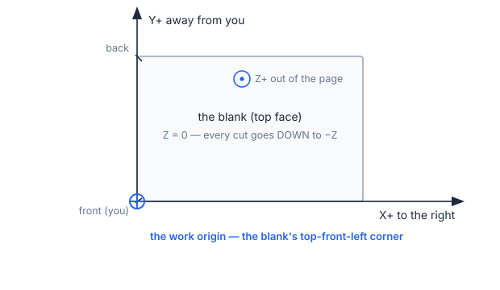

You do not type this origin into Case Maker as a machine position. On the machine you set
it with Studio and the probe; Case Maker's simulation carries it as an input, tagged with
where it came from (see *Provenance*, below).

**The cutter's radius decides what can be engraved.** The cutter can only reach the part of
a stroke its centre can enter. Anything thinner than the cutter's **diameter** vanishes
entirely, and inside corners come out rounded at the cutter's radius. This is the
morphological *opening* of the glyph. Measured on the bundled
bold sans with a 1 mm cutter: a 4 mm cap height keeps **3.9 %** of its area, 6 mm
keeps **88.9 %**, 10 mm keeps **98.8 %**. Small text does not "look a bit rough" — most of
it is simply gone.

| Cap height | Kept with a 1 mm cutter |
|---|---|
| 4 mm | 3.9 % |
| 6 mm | 88.9 % |
| 10 mm | 98.8 % |

**Depth per label.** Each label carries its own depth. Depth is what decides how deep the
floor of an engraved word sits below the top face. On a one-colour blank it is a look; on a
two-colour blank it is what reveals the lower colour (chapter 6).

**What "simulated" means here.** The app sweeps the cutter along the file's **own moves** and
subtracts the result from the stock. It is **exact for a flat end mill cutting at a constant
depth**. Material updates at a limited number of points along the program; between those
points the tool moves over a still picture of the stock. So the simulation is not an
animation of every chip — it is a set of correct snapshots with the tool moving between them.

**Provenance.** Every number the app did not compute itself is tagged with where it came
from, and "unmeasured" is not "measured". You will see badges like:

- **"unmeasured defaults"** — a shipped guess (a vise's jaw numbers, a starting feed). Fine
 to run with, but the app tells you it is a guess.
- **"from file header"** — read from the `.nc` file's own `;@MKR|` header. Untrusted input:
 it prefills a form, it does not decide anything.
- **"placement: stub"** — the part's position on the bed is **assumed, not measured**.

That last one matters most. A real placement comes from probing on the machine; Case Maker's
simulation works from an assumed one until you give it a better number.

---

## 4 · Simulate a G-code file — CNC-1

> **Status: Partly available** — the Simulate panel, its viewport layers, the
> playback and the browser end-to-end tests all shipped. The screenshots below
> are design mockups, and the cycle estimate's rapid speed is refined by measurement.

You have a `.nc` file — from Makera Studio, from another CAM tool, or from Case Maker's own
engraver — and you want to see what it does before it touches a blank.

The **Simulate** entry sits in the sidebar under a **CNC** divider, below Export. It plays a
program — this job’s, or any `.nc` file you open — and it is
present in rack mode too.

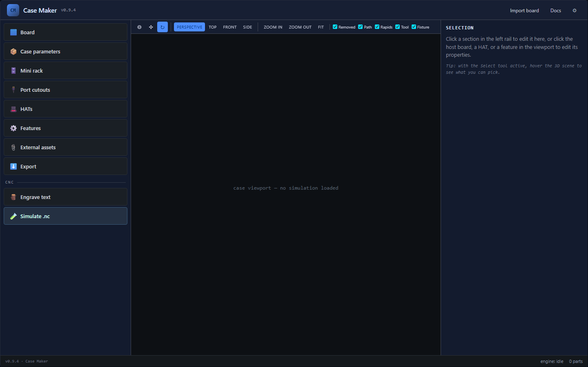

*Design mockup — not the shipped screen.*

**Opening a file.** Click **Open .nc…** or drop a file onto the panel. Accepted extensions
are `.nc`, `.gcode`, `.cnc` and `.tap`, up to 64 MB. The file is parsed, run and swept **in
the app** — nothing is uploaded, and nothing is sent to a machine.

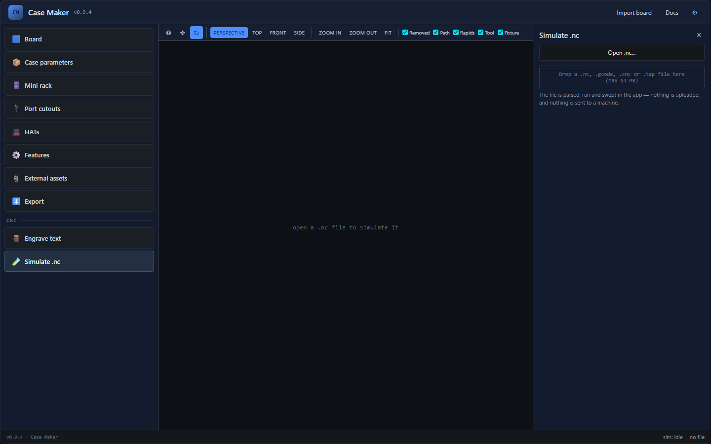

*Design mockup — not the shipped screen.*

**Confirming stock and tool.** If the file carries a `;@MKR|` header, the stock length,
width and thickness are prefilled from it, each tagged **“from file header”**. A `TOOL`
record is matched against your cutters and pre-selects the one it names, tagged as matched
from the header — but the geometry it states is not always reliable, so the dropdown is yours
to change and a cutter you already chose is **kept** when a file is opened. When the header's
`TOOL` record matches cutters in **two different tiers** — an owned cutter and the catalogue row it
was registered from carry the same id — the form does not pick one silently: it asks **which cutter
was this file cut with?**, one button per candidate, and applies the one you pick. **Simulate** stays
disabled until both a file and a tool are present. A file with no header is fine; you just
type the three stock numbers yourself. Whatever you have already chosen — a stock number you
typed, the cutter in your spindle — survives opening a file; **Reset** is the way back to the
file's own numbers.

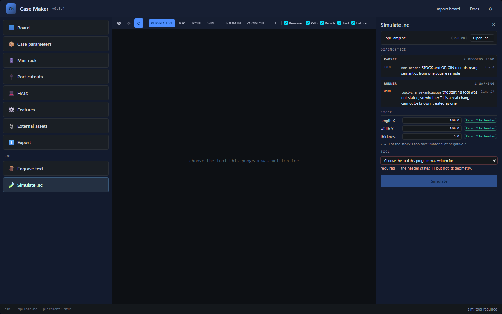

*Design mockup — not the shipped screen.*

An **Advanced** disclosure lets you state the **tool in the spindle at the start** (unknown,
empty, or T1–T6). A program cannot know the machine's starting tool, and on the Z1 an `M6`
to the already-active tool does nothing — no change and no length calibration. If you leave
it *unknown*, the runner treats the first tool change as real and warns that it cannot know
better.

**Running.** Press **Simulate**. Parsing and running finish quickly; the **sweep** — unioning
the cuts at each checkpoint — is the slow part, a few seconds on a dense job. A progress bar
shows `sweeping n / m checkpoints`, and **Cancel** terminates the worker and disposes the
session.

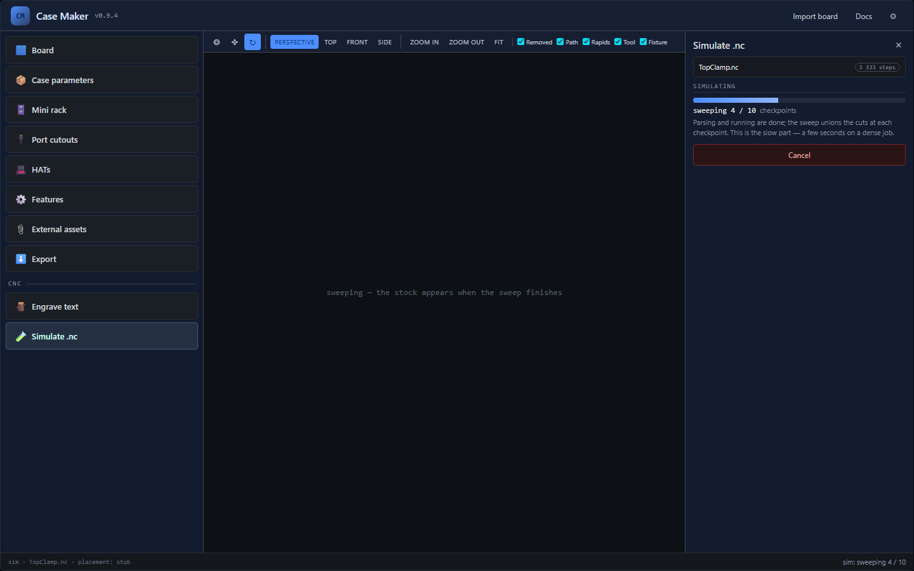

*Design mockup — not the shipped screen.*

**Reading the picture — shipped.** When the sweep finishes, the viewport draws the stock
as cut so far, the removed material as a translucent ghost you can toggle, the cuts as bright
paths (with the cuts still to come dimmed), the rapids dashed in a third colour, the tool as a
cylinder at its current position, and any **gouge** — a rapid that passes through material the
program has not removed yet — in the alarm colour. The toolbar's **Layers** control toggles
each one. The vise jaws and the sacrificial stack draw as translucent grey, labelled with their
source.

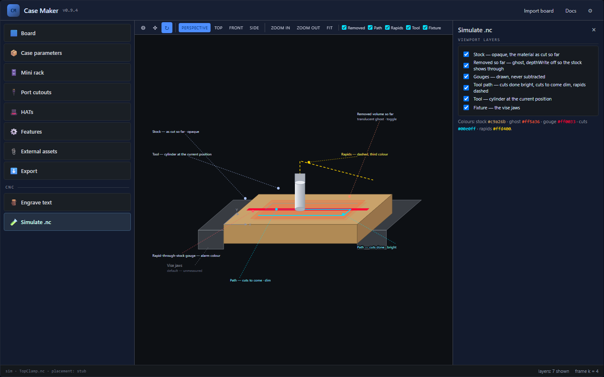

*Design mockup — not the shipped screen.*

**Playback — shipped.** A transport bar at the bottom of the viewport carries start,
step-back, play/pause, step-forward and run-to-completion, speeds of 1×, 5×, 20× and 100×, and
a scrubber whose only tick marks are the program's **pause points**. The read-out is
**simulated time**, not a measured cycle time — rapids are timed on the machine profile's rapid
model, the same model the printed estimate uses. Material updates at checkpoints, not
every frame, so the tool moves smoothly over a still stock between them. When the program
reaches a tool change, playback **stops at the pause**, names the change and waits: a virtual
tool swap is a pause, not an error, unless you said the starting tool was unknown. The default
speed is the shop's `sim.playbackSpeed` (20×).

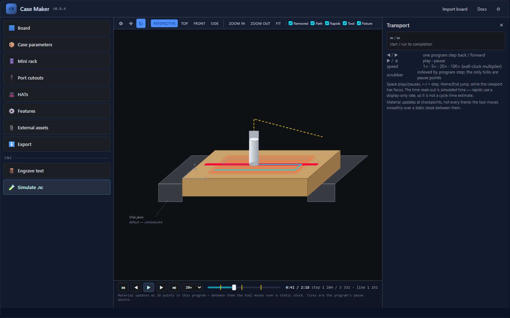

*Design mockup — not the shipped screen.*

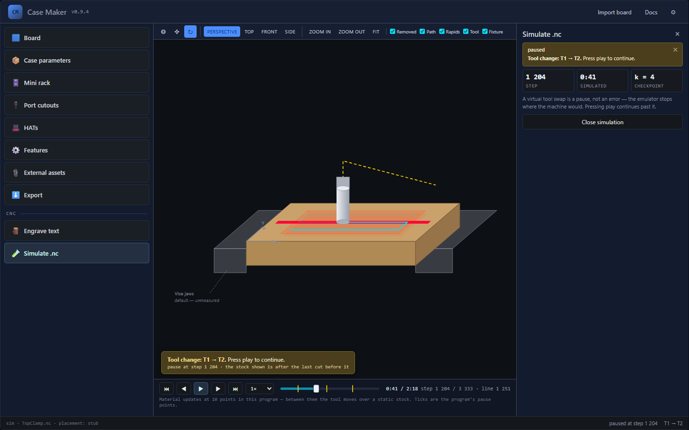

*Design mockup — not the shipped screen.*

When the run is done — or refused — the panel reports the result: volume removed,
checkpoint count, sweep time, a **placement: stub** badge, and the **diagnostics**, grouped
by source (parser / runner / sweep) with errors first and true per-code counts.

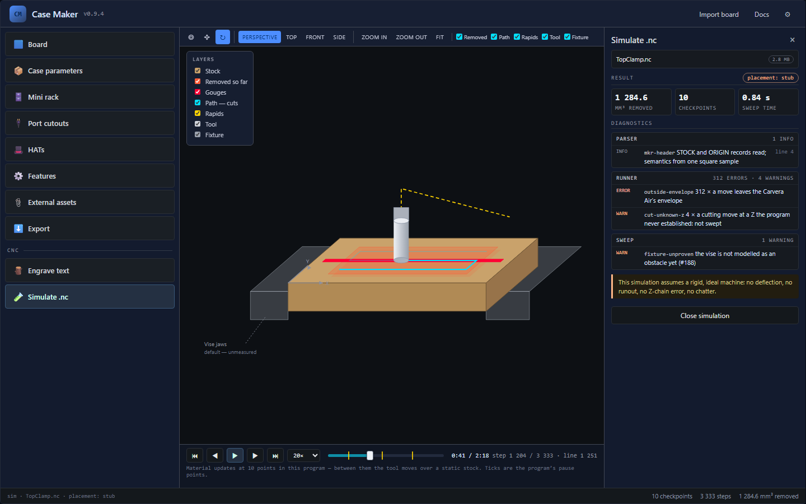

*Design mockup — not the shipped screen.*

**When the app refuses a file.** Some jobs the app will not sweep at all, and it says why
instead of guessing:

- **A laser job** (`M321`): a mill simulation refuses it rather than drawing a cut.
- **A rotary job** (an `A` axis move): the timeline's class routes it — a wrapped program to the column engine, an indexed one (A held per run) to the exact sweeper.
- **A 3D or dense job**: too many separate Z levels for the 2.5D sweep. When this happens the
 **tool path is still drawn** so you can inspect the file; the stock is not, because the
 sweep that would produce it was refused. A **Try again with a longer limit** button may
 appear.
- **A tool shape it has no model for**: the simulator sweeps a flat end mill, a V-bit or chamfer,
 a drill (its point cone on its cylinder) and a thread mill (as its neck and a 60° tooth, swept
 along the program's helix, labelled `thread-envelope`, with its neck checked). A ball or bull
 nose, or a cutter whose record lacks the tip, angle or
 diameter its model needs, is refused with `tool-refused`, and the message names what is missing.

Every refusal and warning has a short code. Chapter 8 lists all of them.

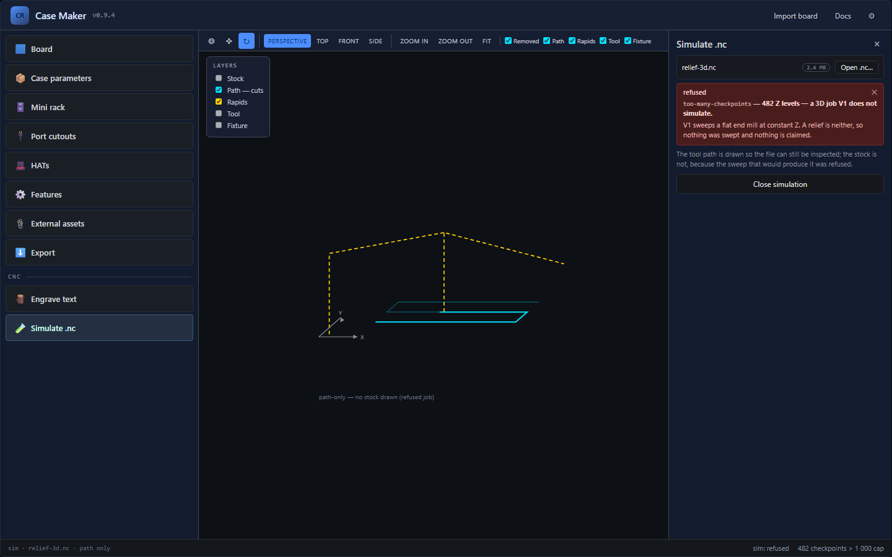

*Design mockup — not the shipped screen.*

**What it cannot tell you.** The six-word version sits at the bottom of every result: *"This
simulation assumes a rigid, ideal machine: no deflection, no runout, no Z-chain error, no
chatter."* Spelled out: it does not model how the cutter bends under load, how much the
spindle and collet wobble, how far the Z stack creeps between a probe and a cut, or how the
blank chatters when the cutter bites. It does not know about the fixture unless the fixture
has been given to it, and it does not know whether your blank is the size you typed. It
answers *"does this file's geometry overlap the stock where I think it does"*. It does not
answer *"will this come out clean"*.

**Try it on a sample.** The depth-ladder sample that ships with Case Maker is a real app-generated
program (a 2 mm flat end mill, stock prefilled from its `;@MKR|` header) and is the fastest way to
see the panel work:

1. Open the **Simulate** panel (sidebar, under the **CNC** divider).
2. Click **Open .nc…** and pick the depth-ladder sample (or drag it onto the panel).
3. The stock is prefilled **"from file header"**. The file's `;@CM|TOOL` line names a house cutter
 you may not have — the form says so; pick any **flat end mill** (the built-in one needs no
 service).
4. Press **Simulate**. Watch the sweep progress, then read the swept stock: removed material as a
 ghost, cuts as bright paths, rapids dashed, the tool drawn at its position.
5. Use the transport bar to play back; the result reports volume removed and the diagnostics.

*Victory:* the viewport draws the swept stock and toolpath and the result panel reports a
non-empty removed volume with no error-row diagnostics. If the tool is refused, pick the built-in
flat cutter and press Simulate again.

---

## 5 · The job, question by question — CNC-2

> **Status: Partly available** — the job runs in the
> app today: the Start wizard, the Design panel (Job / Hold / Cutter with the sticky Generate
> footer), the Cut preflight, the setups and registration steps, the release step,
> the as-cut preview, the run sheet, the status strip and Transcript dock and the
> desktop build's own upload and run. The open work is named where
> it appears: the day-1 runbook, the Z-chain and auto-level measurement, and the facing and
> registration questions that remain. **Milestone 1 runs one registration procedure** — the vise,
> the wired V2 probe, the datum path. The 3D probe as a registration instrument, corner and centre
> finding, a disc's rim, registration on tape or the bracket, the `G32` recipe and the facing
> re-touch are **Planned** until a bench session observes each: the app names the refusal.

This is a walkthrough of the default job, start to finish: a **hardwood blank** in the vise,
with the name plate's three words engraved to different depths. It is written in the order the
app asks the questions, because that is the order the answer is needed in — and every answer is
also a section of the **same job document**, so a job can be put down and picked up at any point.

A **new job starts with one question — what are you cutting?** — and the operation types are its
answer: **Engrave** (text or single-stroke lines), **V-carve**, **Pocket**, **Profile**,
**Chamfer the edge**, **Hole**, **Bore to size**, **Thread**, **Surface a mesh** (a goal mesh or
a picture relief), **Texture a surface** (a seeded pattern of short strokes), **Flute along a line**
(a groove that ramps in and out) or **Raise a prism** (a shape standing on sloped sides). Every operation added
afterwards is one row in the job's list, its type on the row, and its expert fields behind the
row's fold.

**Threads, internal and external, metric and imperial.** The picker offers **Thread** (a
threaded hole, milled inside a pilot the shop has already drilled) and **Thread a boss (external)**
(a thread milled around the outside of a boss or a rod standing in the vise). The thread's row
chooses the side, the system — **Metric** (ISO 261 coarse, M2 to M12) or **Imperial** (UNC and UNF
from ASME B1.1, #4 to 1/2") — and the size; an imperial size shows its threads per inch converted to
a pitch in millimetres (P = 25.4 mm ÷ TPI, so 1/4-20 is 1.27 mm). An internal thread orbits up
inside the pilot to the major diameter; an external one climbs clockwise down outside the boss, the
tooth tip landing on the external minor d3 = d − 1.226869 P (ISO 965-1). The boss, like the pilot,
is assumed: round stock standing in the vise, or a circle centred on the thread's axis, and **Add a
⌀D mm boss here** states one as a reference circle when none is there. When the job's thread mill
does not fit — its diameter, its flute reach, or the pitch its name states — the finding says so and
offers the nearest owned thread mill as one press.

**V-carve (variable depth)** is the same region cut by the V-bit, but its depth follows the
region's own WIDTH instead of one floor: every point is cut to its distance from the edge over
`tan(halfAngle)`, deepest at the region's centre, so the V's flank always meets the edge at the top
face. The program cuts the map as a ladder of level sets, shallowest first — each pass rides over
the groove the one before it opened — and the row's fold states the level pitch (the feeds row's
step-down or its step-over converted down the flank, whichever is tighter). Where the region is
wider than the chosen depth allows, the middle stands as a **core** the V cannot reach, and the
setup's flat end mill pockets it flat at that depth, in its own program after the V-carve — the
**flat bottom**. The pocket's wall is tangent to the V's sloped flank at the floor, so the
two programs meet without a step. A setup that names no flat end mill after the V leaves the core
standing, and `vcarve-variable-core` says so with its area. A flat end mill on a variable-depth
region is refused by name (`vcarve-variable-needs-cone`). An **Engrave text** row carries the same
V-carve depth choice — `plane` (the constant floor) or `variable` (the width-following map above) —
so lettering can be given the V-bit while another cutter pockets the blank around it.

**Image to relief** makes a picture into a 3D surface. The **Surface a mesh** picker takes
a **PNG** as well as a mesh: the file is embedded in the job by its bytes (never the sampled
heights), its tones become the goal's top-Z field, and the SAME goal pipeline roughs and finishes
it — the parallel finish, the scallop and pencil passes, the dexel check and the release are
the mesh goal's own. **2026-11-05:** Generate currently refuses a PNG relief by name until its own
picture-to-mesh path is restored; a mesh goal is unaffected. The row's Technical fold carries the map's two numbers — the **relief depth**
(default 1.5 mm, stated as the CAM's default until typed) and which end of the tones sits at the
**top face** (white as drawn, or black) — and the picture's placed **width** (the height follows
its aspect). The map is one function: `depth = relief × (1 − luminance/255)`, white at the top
face, Rec.601 luminance for colour; a picture's pixel pitch is stated beside the grid pitch and
the cutter's ⌀, because an image holds no detail finer than its own pixels and the cut holds none
finer than the ball. 8-bit greyscale or RGB(A) PNGs, non-interlaced; 16-bit, palette and interlaced
files are refused at import with the way out, and JPEG needs converting first.

**Inlay** cuts a two-colour design as a PAIR of blanks. The operation adds a region carrying
the **female** marker; its depth is the pocket depth and the row's **glue gap** (default 0.2 mm) is
the vertical clearance the plug keeps off the pocket's floor. A label's row carries the same marker
as a **female inlay half** checkbox, so lettering can be the pocket too: its plug is the
text's own glyph outline, mirrored in Y. **Save the male blank…** builds the
matching MALE job — its own document, its own copy of the blank, the design **mirrored** for the
glue-up flip — with ONE cutaway cutting the complement around every plug. Every marked item that is
cut is an island in that one cutaway, so a ring and the letters inside it are one pair of programs
and neither region clears the other's plug away. The female halves in one job must share one pocket
depth and one glue gap, because that one cutaway erodes every island by one inset; a mixed pair is
refused on its row with a sentence naming both, so save it as two jobs, one male per female. An
inlay is two JOBS
because a job is one blank: each is generated, simulated, packaged and run on its own blank, and
each run sheet says which half it is. The numbers all derive from the pocket depth, the glue gap
and the V-bit's half-angle: the plug is `pocket − gap` deep, its edge sits `gap × tan(halfAngle)`
inside the design (so the visible ring is that width) and its end is exactly the pocket floor's
extent, stopping the gap above the floor — the plug never reaches the floor and the two flanks
self-align when clamped. Both halves use the same V-bit (`inlay-needs-cone`); a gap that is not
above zero and below the pocket depth is refused (`inlay-gap`), and a variable-depth region cannot
be an inlay half (`inlay-plane-depth`). A mark no male can be made from is refused on its row in a
plain sentence naming the item — text with no glyphs, a combined region whose island is missing or
switched off, or an item set to reference only (it cuts no pocket for a plug to fit) — rather than
silently saving a male that is missing a region. After both runs, glue the male's machined face down
into the female's pocket and plane the male blank away to the plug's base.

**Texture a surface** cuts a decorative pattern of short strokes over a region instead of
pocketing it. The picker adds a **stipple**: a grid of cells one **pitch** apart (default 1 mm,
stated as the CAM's default until typed), each holding one short stroke (default 1 mm) at a seeded
direction. Switching the row's pattern to **scallop** lays rows of semicircular bumps of radius
pitch/2 instead. The **seed** (default 1) is stored in the job, and every stroke is derived from
it — the same document posts the same program byte for byte, and a new seed lays out a different
pattern with the same stroke count. Every stroke is a TRACE: the cutter's centre follows it at the
region's depth, clipped to the region's outline, so a V-bit's flank leaves the dimples and a flat
end mill leaves flat-bottomed strokes (`texture-tool` refuses a ball or bull nose — a ball-nosed
texture is a SURFACE, which is Image to relief's job). Every stroke of one texture is cut at the
one depth, so a stroke that crosses ground an earlier one opened meets air and can never bite
deeper — the removal order needs no other rule. The pattern is anchored to the blank's own grid:
moving or shrinking the region removes strokes rather than reshuffling the ones that remain row
by row. A border, frame or cutaway cannot carry one, and neither can an inlay half
(`texture-shape`); `through` is refused on a surface finish (`texture-through`); a pattern that
comes out empty is a warning (`texture-empty`); and past 4,000 paths — strokes, or a scallop's
row runs — the cap keeps the first 4,000 and reports the count (`texture-crowded`). The strokes themselves are derived at generate
time and never stored in the job.

**Flute along a line** cuts a groove that fades in and out. The cutter starts ON the surface
at the line's first point, feeds down along the path, holds the stated depth through the middle and
rises back to the surface at the end — no plunge, so no dimple, and no retract out of the groove.
The **ramp** is a length along the path (default three times the depth, about an 18° slope), cut as
a Z profile: the plan steps it at `depth/16` and both the simulation and the oracle read every move
at its own depth, so the file, the picture and the check describe one staircase. Tick **ramped
ends** on any line — an imported open path included — or pick **Flute along a line**. A path
shorter than its two ramps peaks short of the depth, and `flute-short` says so with both numbers. A
ball or bull nose is refused (`flute-tool`): a ball flute needs a ball groove model this CAM does
not have.

**Slot along a path** cuts a groove of a stated width along any line, open or closed. Type
the line row's **slot width** (or pick **Slot along a path** under Pocket, which starts at twice the
cutter's diameter). When the width is wider than the cutter cuts at the line's depth, the path grows
half the width to each side with round joins and round ends, and that region is pocketed at the
line's depth — the same contour-parallel rings, region findings and oracle as any pocket. The row
states the region and its passes in one line: the width, the path's length, the cutter, the rings
and their step-over, and the depth levels. At or below the cutter's width the line is traced one
cutter wide, exactly as without a width; the row says so and names the widest flat you own that is
narrower than the slot (with a button to make it the job's cutter), or the nearest one when none
is. A flute keeps its ramped trace and ignores a width. The three slot forms: the **Slot** shape (a
straight stadium pocket), a slot along a path, and a plain line (a cutter-width slot).

**Raise a prism** makes a shape stand. The shape's own depth is the standing height `H`, and
the row's **base** is the flat floor around it (default 1 mm). A V-bit cuts a RING around the
shape: its mouth runs from the shape's outline out to the **margin**, derived as
`base + 2·H·tan(halfAngle)`, and the floor is that mouth eroded by `H·tan` — so the shape stands at
full height with its sides sloping at the bit's own angle, on a flat base, with the untouched top
face beyond the margin. The base's flatness is the tip pad's overlap at the V-carve's own pitch, so
a tip diameter is required (`prism-tip`), the base must beat twice the tip (`prism-base`), and the
sides are a cone's flank (`prism-needs-cone`). The height is bounded too: a side is the flank only
up to the height where the flank meets the bit's body, so a taller prism is refused
(`prism-height`). The cut clears the base from its MIDDLE outward and
cuts the walls last, so the shape's flank is the final cut; the tip's path never comes nearer the
shape than its own radius plus the slope's foot, so the shape cannot be undercut. The ring is cut by
the SAME plane V-carve as any region — the difference from V-carve (variable depth) is that the
design stands untouched and the ring around it is cut at one flat depth, with no medial-axis ladder
inside. A prism cannot also be a texture, an inlay half, a variable-depth region or a through cut
(`prism-shape`).

**Chamfer the edge** breaks an edge rather than cutting a hole or a pocket: one flat bevel
along a rim, cut by the job's V/chamfer bit with its flank held against the edge. The row picks the
rim (a shape's, an imported outline's or a combined shape's own outline — often the part's
construction outline), the **side** — *outside* a part's edge, which is bevelled BEFORE the cut-out
frees the part; or *inside* a pocket's rim, bevelled AFTER the pocket opens it — and the **width**
on the top face. The bevel's depth is derived, `width / tan(halfAngle)`, and so is the widest
chamfer the bit can cut in one pass; a wider one is refused (`chamfer-too-wide`) rather than
stepped, because a cone's flank is tangent to one bevel plane and no second pass can extend it. The
chamfer is its own program — a cone cannot profile — so the row states the order against its rim's
cut, and `chamfer-order` refuses a run where the two programs are the wrong way round.

**Bore to size** is the hole the box of bits cannot make: a **Hole** row whose width is the
job's own — M3 to M6 clearance, a counterbore, a socket for a magnet — cut by helixing an end mill
down the wall. Pick it and the row opens on the hole ⌀ (a clearance hole over the job's cutter, and
any diameter wider than the cutter will do); the row's fold states the helix pitch, which is the
tighter of the feeds row's step-down and the shop's `bore.rampAngleDeg`. The cut ramps down the
wall a level at a time; at each level a spiral inward to the cutter's radius and a full hub lap
clear the core BEFORE the next descent, so a hole wider than the cutter never leaves a standing
centre — and a through hole is cleared to the blank's underside before the cutter crosses it, so
no loose core is ever side-milled. The last level ends with a full-depth lap of the wall. Through
or blind, with the Hole row's depth and through rules. A hole at or narrower
than the cutter is refused (`bore-narrow`), a cutter that cannot ramp is refused by name
(`bore-needs-end-mill`), and so is a bore with no diameter (`bore-no-diameter`). A counterbore over
a pilot hole is a drill row and a blind bore row at the same position.

**Peck every N mm** is a plunge hole's own peck, behind the Hole row's **Technical** fold.
With no number typed the fold states the source that binds and its provenance: a **drill bit** pecks
at `drill.peckDiameters × ⌀` (the shop's chosen setting), a **milling cutter's** plunge drill at the
feeds row's peck. Typing a number overrides whichever binds for that item — every hole in an array —
and the row then reads *typed in this job*, with **reset** back to the source. The run sheet names
which bound: a drill-bit program states the peck per hole with its source, and a milling cutter's
overridden peck is printed beside the feeds row's number. A bore is helixed, not pecked, and offers
no peck at all.

A **region row** (Engrave text, V-carve, Pocket, an imported outline, a cuttable primitive) also
carries its setup's **rest pass**: **Finish the corners with a smaller cutter** in the row's fold
pairs the rough cutter with a smaller flat one, and the second program cuts only what the first
program LEFT — measured from its simulated stock, not from an offset drawing of it. The row chips
the pair (`rest ⌀1 mm`), and the setups line and the run sheet name it as *“⌀3 mm rough · ⌀1 mm
rest”*. A Profile row has no rest region — a contour is a kerf, not a floor area — and says so.

**Import outline or lines… (SVG/DXF).** A drawing imports as what it is: the closed, filled
shapes become one Pocket-style region (the vector row), and every **path or polyline** becomes an
**Engrave (line)** row — one per path, at the same scale and position, cut by the trace rules
(a flat cutter's kerf, a V-bit's groove). A lines-only file — artwork drawn as strokes — is
addable on its own. A **stroke-only closed shape** is an *outline: on path* drawing of a
ring — a stroked rectangle, circle or outline — and imports as a **closed** line whose cut IS the
ring (a stroked ring longer than one line item's 5 000-point cap is split into open pieces that
meet end to end, the last returning to the first point, so the cut is still the ring). A filled
open path still does not import: SVG closes it to fill it, and the importer names it instead of
guessing. DXF has no stroke concept, so its closed LWPOLYLINEs stay regions and only its open
chains become lines. The dialog counts the closed shapes and the open and closed lines before you
accept, and the target width scales the lines with the shapes.

Two ideas hold the chapter together:

- **One job, two modes, three groups.** The CNC surface has a **Design | Cut** switch at the top of
 the panel. **Design** is where the job is described, in three groups — **Job**, **Hold** and
 **Cutter** — under a sticky **Generate** footer that is never below the fold.
 **Cut** asks the preflight gate what it thinks and puts the registration step beside the
 findings. Changing any Design answer marks a frozen Cut package **stale**, so the picture and
 the files cannot drift apart.
- **The rail is yours; the strip and the dock are the machine's.** Your answers live in the rail.
 What the machine is doing lives in the **status strip** under the viewport — state, position,
 spindle, tool and a Stop — and what it *said* lives in the dock's **Transcript** tab, out of the
 rail.
- **The app writes files; you are at the machine.** The work origin, the cutter's length and
 every physical act are yours. The desktop build can run the plan for you — upload, play,
 stop, home — but only after your presses, and the **physical stop is still the stop**.

The job document itself is one autosaved document (schema version 3). It carries the
stock, the mount, the items, the setups and the frozen package; the files a job was made from
(SVG, DXF, image, 3MF) are recorded by hash, and embedded when small enough, so a re-import
can prove it is the same file. The older v2 document opens unchanged; the app writes v3 from
then on.

**The Design rail: three groups, one footer.** The long scrolling column is
gone. Design mode's rail is three groups, each a heading with a one-line summary that stays
visible when the body is closed:

- **Job** — the stock, facing (one line when the material refuses it), voids, the item editor and
 the design target objects. The summary states the stock and the item count.
- **Hold** — how the blank is held: the vise card (one sentence: source · seat · proud/below, with
 the number fields behind **Edit**) and the sacrificial material. The summary is the one vise
 sentence.
- **Cutter** — the tool and its recommendation, the cutting feeds and the margin. The summary says
 "cutter chosen" or "no cutter chosen" plus the margin.

Below the groups sits a **sticky Generate footer** — the findings as a count that expands, then
**Generate** and the run rows. It is the one place the job's state is read, and it is never below
the fold. The **status strip** under the viewport and the dock's **Transcript** tab (§5.7, §5.9)
carry the live machine; nothing about the machine's state lives in the rail any more.

**1. Where, and on which machine?** The **Start** wizard's first screen is a **Machine** picker
on every build — one entry today, the **Makera Z1** — with the network **check** under it in the
desktop build. The picker writes the job's machine and nothing else. The work area, the spindle
ceiling and every clamp come from that profile, whether or not a machine is switched on. The
check never repoints the job: a machine that answers with a different profile is named as such,
and the picker is where you change it. A job can be authored, simulated and saved with no
machine reachable at all; the web build has no socket, so there the picker is the only answer
the question can have. The **location** behind the job — its machines, tools, stock shelf and
consumables — is managed under **Manage** (chapter 7), and a job binds to it by reference with
snapshots.

**2. What stock?** The wizard asks **what you are cutting** first, because the work sizes the
blank: a mesh gives its box, a board its outline, a line its measured width — each plus a stated
margin — and the stock step opens on those numbers. They are a starting point, not a rule: change
any of them and the sentence that said where they came from goes with the first edit. The stock
itself is asked **material first**, then where the piece comes from. Three doors are open today:

- **Off the shelf** — the location's own stock for that material: purchased sizes, offcuts with
 the job they came from, quantity and reservations. A piece is consumed by the job that takes
 it, so a shelf entry at zero is shown and refused.
- **Make** — type the form and its size, in mm: **sheet**, **plate** or **block** (length X ×
 width Y × thickness Z), **disc** (⌀ × thickness, cut on its flat face) or **rod** (⌀ × length,
 held standing on its end and cut on that ⌀ end). A rod longer than the vise's grip (20 mm) is
 the rotary's, and the form says so instead of offering it. A **tube** is refused by name — its
 hole leaves no face a job can cut. A piece made here can be put on the shelf in the same step.
- **Load** — an STL, 3MF, OBJ or STEP used as the stock. A prism (identical slices) cuts as a block of
 that outline; a PrusaSlicer 3MF with negative volumes is recognised and offered as **stock +
 design** in one step. A STEP/STP is a B-rep, not a mesh: the OpenCascade WASM
 kernel tessellates it at import, and the questions above read the triangles it produces —
 the kernel is fetched the first time a STEP is picked, never for an STL job.

Every entry states its **finish** — rough, finished, printed or not known — because that is what
the facing question reads (below). A purchased **two-colour engraving laminate** states its
**colour cap** as a stock fact: the cap's thickness and whether it is `assumed` or `measured`
. A laminate is not a print and carries no printed layers or filament; its colour plane
is the cap itself. A printed blank, by contrast, states its print — layer height, first layer,
and the two colours — and the app snaps the colour boundary to the printer's real layer grid
(chapter 6). A disc or a rod is cut on a **round** face: a cut that reaches the corner of the
square the job plans in is off the material, and the job raises a finding naming the item
instead of cutting air.

The badge is a **starter on the welcome door** — **Name badge** opens this wizard with the
badge's blank, its magnet pocket and its print already the job's, so nobody retypes
76.2 × 38.1 × 3.81 mm (chapter 6). A blank taken from the badge is **turned a quarter turn** to
sit in the vise: its 38.1 mm side runs across the jaws, its 76.2 mm side along them, so a name
reads along Y.
Taking a blank also brings the vise's **stock proud** with it — for the shipped default, half the
blank at most 4 mm, because a flat 4 mm stands taller than a 3.81 mm badge; and for a saved
or measured vise, from its SEAT: the seat (jaw ledge, body floor, or the board between) is
what its owner chose, so the proud is re-derived from it and the blank on every thickness or seat
change. A blank made thinner no longer keeps the proud its old thickness gave (46.9 mm on a 50 mm
stock became 46.9 on a 32 mm stock, and the blank floated). A proud you TYPED is a number you
stated: it stands exactly as typed, and one that a thinner blank makes impossible is stated with a
**Re-seat on the ledge** press rather than silently rewritten. The turned-over sides of a
two-side job follow the new thickness through the same flip.

A new blank re-works the **lines** on it where the job's set is still one the app laid out
itself. Those three demo words were laid out for the 100 × 60 mm default plank, so on a badge
they ran off its edges; taking a badge blank replaces them with **one** placeholder name,
centred and clear of the magnet pocket. A **bare** blank that is not that 100 × 60 plank
does the same thing one archetype over: one **Text** placeholder, sized to the blank. The
plank keeps them — 100 × 60 at any thickness, because a thinner slab of the same face does not
move a line, only its depth. Either way, the depth of every line nobody has claimed is then
recommended for the blank it is really on, and the two limits in that answer belong to
the line, not the blank: the void limit from the voids **the line's own extent** reaches,
and the jaw limit only from a jaw that extent comes within reach of. A line you typed or
placed is left exactly where it is; so is one an earlier take seeded once you have touched it —
taking a second blank re-lays only what the app still owns.

**The material list is the machine's list as well as this app's.** It offers the materials
the starting table has rows for — softwood, hardwood, MDF, PLA and the bought
plastic the engraving laminate is made of — and then every material the **machine profile**
declares, which on the Z1 is **ABS**, **Acrylic** and the four metals: **6061 aluminium**,
**7075 aluminium**, **brass** and **copper**. A *table* material is cut on this app's numbers; a
*profile* material is cut on **Makera's own numbers for that exact cutter and material**, from
the catalogue you synced. With no catalogue row for that cutter and material the job is
**refused**, and the refusal names the row that is missing. A material the app has no word for
(Delrin, polycarbonate, PCB and the rest of the vendor's list) is not offered at all, rather
than offered and then refused.

**3. How is it held, and which way round?** The wizard's **Holding** step asks how the stock is
held and which way round it sits, and its answers write as they are made. The cutter is not one of
its questions — the tool is the software's **recommendation**, made once the work is defined
(step 6), and a fresh job starts with none chosen. Only
the **low-profile vise** is selectable today (the rotary is written and disabled, CNC-5). The
vise holds the stock in X and in rotation, with the **fixed jaw on the left**; X runs between
the jaws, and the stock's front-left corner is the work origin. A turned badge blank has its
38.1 mm side across the jaws and its 76.2 mm side along them.

The jaws' dimensions are published nowhere, so the app ships **unmeasured defaults** and says
so — the Hold summary's badge reads `shipped · not measured here`. Two buttons record your own:
**Save as my vise** and **I just measured these**. The provenance is a fact, not a standing
warning: `vise-default` speaks only where an unmeasured figure could decide the job — a grip or
proud height within the vise's own uncertainty of the threshold it is judged against.

**Sacrificial material.** Alongside the vise you can say what else is in the setup: a
**board under the part**, and **strips beside it** — left and right, which sit between the jaw
and the part and are clamped with it, and front and back, which only make sense on a board
because nothing else holds them. The panel has the controls under *Sacrificial material*, with a
source badge and **Save as my setup**, and one-click presets for the two setups people actually
build: **"Part on a larger board"** and **"Strips between the jaws"**.

The work origin and Z = 0 stay on the **part's** top face, so the board's thickness can never
change a cut depth — and the run sheet says so in as many words when a board is in the stack.
Where material is declared beside the part, an item may run off the part's edge onto it — up to
the edge margin short of the sacrificial material's own outer edge — and the verifier's depth
limit follows the same supported footprint: `thickness − minFloor` over the part, the strip's
height over a strip, `thickness + breakthrough` over a board's overhang, and 0 over air. The
jaws move out to grip the strips or the board's overhang, so what the collider checks is what
the vise really holds.

The **Setups** section (question 5) is where a job that needs more than one hold says so, and
where each setup can name its own mount — vise, bracket or tape — and face. A one-setup job
shows one line; the section is read-only until you choose **Edit setups**.

**4. What do we cut away?** This is the **Design** panel's item list. Labels are the default
job, but the list holds more: **shapes**, **combined** shapes, single-line **traces**,
**vectors**, **plunge drills**, **threads**, and the **keep-outs** that are voids rather than
cuts. Every row is one line — show/hide and remove at the front, then
the item's kind, its name and its depth — and expands to its editor. A ⚠ appears on a row that
has a finding, and removing a row offers **Undo** beside the list. A click in the viewport
expands and scrolls to the matching row, and clicking the row selects it in the preview.

A **label** carries its own text, font, weight, cap height, position, rotation and **depth**.
Depth is a box you type a number into — never a slider: a slider cannot express 11.5 mm
reliably, and on a two-colour blank the choice is not continuous anyway (chapter 6). Labels at
different depths are normal: the default job is three words at 2.0, 1.0 and 0.5 mm. A **design
can also be imported as a job**: **Import a design (.3mf)…** reads a PrusaSlicer project
and turns its blank, its magnet pocket and every volume it cuts into this job; the cutter, the
vise and the margins are left as they are.

**Facing — skim the finish off before the cut.** Facing is offered on wood
and metal only. On any plastic it is never offered, whatever finish the blank states — printed
PLA or PETG, a purchased acrylic or ABS sheet, or a two-colour engraving laminate. The refusal
names the material: `facing is not offered on <material>: a flat cutter smears a plastic top`,
and turning facing off in the panel is the way out. For wood and metal the **Finish** the blank
states decides whether facing is offered and how deep it defaults: the panel fills in a depth
with a sentence saying why, and you can type your own. The default is the larger of the job's two
measured drops plus the shop's margin when the job has measured its surface (`stock.flatness`, one
drop per stock axis, written only by a measurement), else the shop's rough or unknown
figure. A bow is a property of the piece as clamped, so it is never assumed from the blank alone:
until this job's own surface has been touched, no bow is claimed.
A facing job is **two programs** — a facing pass with its own flat cutter,
then the program from the faced top — each with its own tool-length calibration and
its own Z0. The run sheet orders them probe → face → re-touch → cut.

The finish's default is a **seed**, and the plan can turn it off: when the goal's own cut
surface leaves none of the blank's original top at the top height, there is nothing to skim — the
Facing line reads "off — every part of the top is cut away" with the fact "No facing: every part
of the top is cut away", and no facing program is posted. Pressing **Face the top** is a person's
choice and is always honoured, even then. A goal that keeps any of the top (a smaller footprint,
or a surface at the top height) keeps the finish's default as before.

**Depth is bounded by every plane the job knows.** Each floor has to stay clear of a void's
ceiling, the stock's underside, a layer boundary or a laminate's colour cap by the **boundary
margin**. A two-colour blank's label chooses **surface** or **reveal** beside its depth, and
each writes the depth it means; a laminate's colour plane is its stated cap, with a floor below
it by the cap's own small margin. Where the split is known it is read off the printer's
real layers, not the nominal design height, so changing the layer height moves it.

**V-carve is a region, not a line.** A V-bit couples depth to stroke width, so the design
can only be right at one depth: the **colour plane** (the blank's film, or a laminate's cap).
The item's depth is the floor. With film `f`, depth `D` and half-angle `h`, the toolpath offsets
the design by `tipRadius + (D − f)·tan(h)` at the plane, the floor is `(D − f)·tan(h)` narrower
per side, and the opening at the top face is `f·tan(h)` wider per side. The panel offers the
V-bit and states the strategy; the step-over is a fraction of the groove's width at the plane,
and the CAM clamps the pitch to the tip radius because the floor is cleared by the tip disc
alone. The two named refusals and the merge warning are in §8.1.

**3D surfacing from a goal mesh.** A **design target object** can be marked
with role **goal** — "this is the shape to *make*", as opposed to a reference to position other
work against. A goal may be picked as STL, 3MF, OBJ, STEP/STP or — a picture relief — PNG; an OBJ
has no unit of its own, so a `# units:` comment (mm, cm, m, in, ft, um) is read and its numbers
scaled, every other OBJ is read as millimetres, and the door says which reading it got; a STEP is
tessellated to a mesh at import by the OpenCascade WASM kernel, so the surfacing below
reads the same heightfield every mesh goal gives. A job whose only work is a goal mesh generates a two-operation surfacing program: a
**raster roughing** in step-down layers that clears the stock above the goal (leaving the
roughing allowance), then a **ball-nose finishing** raster that follows the goal's top-Z
heightfield gouge-safely. A goal with undercuts is sampled to its topmost surface — the honest
3-axis answer — and the run sheet says so.

The row's three turn fields — **rot** (about Z), **rot X** and **rot Y** — turn
the mesh about its bounding-box centre before it is placed; the order is Z, then Y, then X, and a
turn of 180 about X is how a part's other side is put face up for a later setup. The placed
object's size, the blank-fit check and the drawn mesh all read the same turn, so the heightfield
cut and the picture agree. The fields are absent by default, and a job that states none round-trips
and cuts exactly as before; the rotary relief does not read them (its seam is the Y position).

**The part's Underside.** A goal mesh says where the part's underside comes from. Not
chosen is the cut as the mesh is; the row proposes one of three from the mesh itself and the press
stores the choice:

- **flat on the stock's bottom** — the part stops at its own bottom plane and keeps the blank's
  flat bottom (the elephant that is designed to lie flat). One setup. Its **skin** leaves that
  much material between the part and the surrounding stock in the clear band, so the part comes
  out held and is freed by breaking the skin out; tabs on the footprint are the other freeing
  (the run sheet lists them).
- **flipped, held by tabs** — two setups split at the part's widest line, each cutting its own
  band; the tabs joining the part to the surrounding stock survive both setups and are cut off by
  hand after, and the run sheet says so (the panther that is shaped all over).
- **on a plinth** — the cut stops a stated height above the blank's bottom, leaving a base the
  part stands on. One setup.

The proposal reads two numbers: the share of the footprint that is one flat face at the mesh's
lowest Z (0.35 and up proposes flat), and the area that faces down above that lowest Z (2% and up
proposes the flip). The row says which number decided it; nothing is written until the operator
chooses.

Two more finishing passes can be switched on in the goal's Technical fold, and they run in this
order after the parallel finish:

- **scallop pass** — offset contours of the goal's outline, each projected onto the same
 gouge-safe tip field, spaced so the step measured ALONG THE SURFACE is the finishing step-over
 (`step-over / sqrt(1 + slope²)`, band by band; past about 82° a wall crowds the spacing at most
 8× and the run sheet says when that bound was reached). It cleans the ridges the parallel raster
 leaves on slopes. It reuses the finishing step-over — there is no separate number.
- **pencil pass** — one path along every concave crease sharper than the **pencil crease** angle
 (default 20°, stated as the CAM's default until typed): the heightfield's second difference
 across x, y or either diagonal marks a corner line, and each traced line is cut at the same
 gouge-safe drop. A dome and a ramp mark nothing; a wall's foot marks a line.

Both are off unless the fold says otherwise, so a job that states neither cuts exactly as it
did. The program's check (the material sweep on the flat dexel) records the passes it judged as
well as the grid it ran on, and the run sheet states the contour and crease counts.

**Two cutters, two programs.** A goal may rough with a **flat end mill** and finish with
the ball — real 3D practice, and the only way the adaptive clearing engine, which sweeps
flat end mills only, reaches a goal at all. The measured cutter search offers both shapes for the
goal's plan — the ball alone, and the same ball after a flat (each candidate sized nearest the
ball's diameter first) — and the run's own measured cost, plus a stated allowance per tool change,
decides. When the split is chosen the goal posts **two programs**: program 1 is the flat's rough,
with its own feeds row (a flat takes a deeper step-down and a wider step-over than the ball),
its own `surfaceCheck`, and its own `T`/`M6` — it is swept and judged like every file; program 2
is the ball's finish, unchanged — the rim laps, the parallel raster and the scallop and
pencil passes ride the FINISHING cutter. The rough leaves the roughing allowance above the
surface, which is what the finish (and a later rest pass) lifts. The goal row and the run
sheet state both cutters, the tool change, and which roughing pass ran and why — adaptive with
its engagement cap, or the raster with the reason the adaptive route was not taken. A stated
rough the shop cannot use (not in the library, not a flat end mill, or not feedable for the
material) leaves the goal cut by one cutter and a warning says which. Surface **primitives** stay on a single cutter: the split is the goal's.

The goal row's **Technical** fold carries the operation's own numbers: the **cutter** (unless the
goal is split into a flat rough and the ball's finish, above, one cutter cuts both passes — a ball
or bull nose finishes the surface round; a flat cutter finishes it faceted), the **roughing
step-down** and **step-over**, the **finishing step-over**, the
**heightfield grid pitch** and the **stock to leave**. Each is prefilled from the default the
engine would otherwise use — the feeds row's step-down and step-over for the passes, the shop's
`finish.stockToLeaveMm` for the allowance and `sim.columnFlatPitchYMm` for the grid — and the row
says which default it is showing. A typed number overrides it for this goal alone; the reset
returns the default. The feeds are the job's ordinary 2.5D feeds reused unchanged, a labelled
placeholder until the bench measures 3D engagement; a ball resolves its feeds through a
flat proxy of its cutting diameter. The heightfield is **sampled**, so a goal program is
simulated on the FLAT dexel and the run states the grid it ran on — "simulated on a 0.1 mm
grid" — rather than the exact sweep's tolerance band. The exact 2.5D verifier cannot judge a 3D
program, so the goal program's check is that material sweep: it is the program's check on the
Cut screen, in place of a verifier report, and the program is a release source like any other —
the package freezes it, its row and the run sheet print its numbers, and the Cut step's one
press uploads it. Three findings guard it:
`goal-object-oversize` refuses a goal that is flat, warns — naming the sides and amounts — when a
goal extends past the blank, and is an error only when nothing of the goal is over the blank at
all; a goal that extends past the blank is refused at Generate as well, before any toolpath is
built, because a clipped goal's finish would run along the stock edge where the mount holds it; `goal-reach-short` refuses a goal deeper than the
reach the chosen cutter is KNOWN to have (its own flute, or Makera's catalogue number for the same
cutter), naming both numbers and offering the one-click top-band cut; `goal-cut-top-band` is the
warning of that choice — the goal is cut as the stock's top band and the sentence says what is left
in it; `goal-reach-unrecorded` is the info that stands in the refusal's place when no reach is
recorded at all (an assumption stated, nothing blocked — the sweep's holder gate is the guard); and
`goal-object-no-toolpath` is the info a *mixed* job (a goal beside ordinary items) gets — the item
program cuts, the goal is validated and previewed, and no 3D cut is posted for it.

**5. From which directions?** A 3-axis tool comes straight down. Material on the back, a side or
the far end is reachable only after the part is turned — and turning it is a re-clamp and a
re-find. The **Setups** section is the job's ordered list of holds:

- A **setup** is one held position: a mount and orientation, the items reachable from above in
 it, their tools, and a registration plan. The stock entering setup N+1 is the simulated result
 of setup N.
- **Re-plan** groups the job's cuts by the face each opens to and offers the directions that
  reach the most volume first. A direction the mount cannot hold is `unholdable` with the reason.
  A **goal mesh is one of those cuts**: its surface program is the setup's work, so a
  goal job is not "empty" and Add setup offers the face its material is still reachable from —
  the flipped side when the part does not reach the blank's bottom.
- **Use this plan** writes the list; **Edit setups** materialises a one-setup job into an
 editable list. A saved list is authoritative: an item removed after it was saved is reported
 (`setup-item-missing`) and never silently rewritten.
- Each row names its **face up**, its **mount**, the items and tools, the estimated cut time,
 and — for a later setup — the remount and re-registration cost. Changing a mount, an
 orientation or an item clears the approvals that were made against the old answer.
- The **remount page** draws before and after, gives the physical steps for that mount, and
 asks a landmark question whose answer must match the planned orientation before it records
 **It is mounted**. The **registration plan** is shown in the engine's own words, with its
 touches, its expected accuracy and the two approvals the run needs.

The planner and its checks are engine code today; the section is the reader and the approval
path. The run plan's own phase list is not yet wired into the app, so the times in the rows are
the engine's estimates, labelled as estimates.

**6. Which cutter? It is a recommendation, not a setup question.** A fresh job starts
with **no cutter chosen** — the Cutter group's summary says so, and the tool select reads
"Choose a cutter…". Once the work is defined, the app works out which cutter keeps the most of each
glyph and offers it in the Cutter group as a **recommendation**, named in the one display form
every screen uses and tagged: `⌀ 0.3 mm V … · recommended`, then the reason in the panel's words —
*"the largest cutter that keeps every label intact"* — and a **metal** tag when the vendor's line
says so. A **Use it** button appears only when pressing it changes the job's cutter: a
recommendation already applied has none. You can pick another cutter instead; the app keeps your
choice and offers the recommendation back.
The recommendation is per-job arithmetic on this blank, not a setting, and a job that already
chose its cutter is not re-asked. A **Why?**
disclosure lists only the cutters rejected for a reason you can act on — a broken copy, no feeds
for this material, or no catalogue row for it — one line each; a cutter ruled out only for being
the wrong kind is not listed. When a
label loses detail, a warning under that row says what to do — *"‘Maker' at 4 mm loses 96 % of
its area with a 1.0 mm cutter — increase to 6 mm or more."* When a label breaks through the
floor, it is an error, not a warning, and Generate stays disabled until it is fixed. The
cutter the job settles on is **confirmed at the run**, not in setup: the upload asks "Which
cutter is fitted?" (§5.9).

The list holds every cutter a job can name: the app's two built-ins always, and — once the
**house** (§7) is reachable — **the cutters you own** beside them. The recommendation ranks all
of them, including the ones you added yourself, and it reads the shop's feeds table and the
catalogue's own rows. A V-bit on a region job is recommended as a V-carve, not measured as a
flat. A facing job gets a facing cutter of its own, chosen from the flat end mills the catalogue
recommends for the material; a cutter with no usable copy (every one broken) is not eligible,
and the run sheet says which cutter was chosen and why.

**Cutting parameters.** Spindle speed, feed, plunge, step-down and step-over are shown
with **where the number came from**, and none of it is a recommendation. Where Makera's own
library has a row for your cutter and material, the panel starts from **their** numbers, tagged
`Makera` and labelled **"Makera's catalogue — not measured"**, clamped to the Z1. A row
stating a number this job cannot use does not fail the job: that field comes from the app's
starting table instead, and `catalogue-ignored` names the row and the number it passed over
. Where the library has no row — PLA has none — the panel keeps **"starting values —
unmeasured"**. Step-over is the app's own 45 % for a flat cutter, never the catalogue's 63 % of
the tip. You can override each one. The location's seeded feeds table is the
source for the app's own rows, and a row is marked measured only when you choose it and say who
measured it.

**7. Switch to Cut — the preflight.** The **Design | Cut** switch is the deliberate act between
describing a job and running it. Pressing **Cut** re-asks every preflight owner about the job and
shows what they say. The page is grouped by **setup and cutter**, in the order the gate collected
them, and every row prints the owner's own code and sentence — the app adds no judgement of its
own. Above the groups are the run-policy rows (the things that are true of the run rather than of
a program), and a red row is marked as the **first blocking** one. **Back to Design** is never
dead: it leaves Cut and expands the item the first red row names.

The Cut page also carries the **registration step**. It runs the setup's **approved
registration plan** — home, fit the wired probe, `M491`, the surface seek, the edge scans, home
again — and shows what every touch found. While it runs, the machine's state shows in the
**status strip** under the viewport, and the touches and the machine's own lines live in the
dock's **Transcript** tab — nothing about the live machine renders inside the rail.
It is deliberately **not re-derived**: a location
setting can move after approval, and re-planning would silently replace the steps you approved.
A job with no approved plan says so and runs nothing. The origin is written only from a
measurement that is usable and inside the plan's margin: `G10 L2 P1 X Y Z`,
after the cutter's own `M491`, and only after you press the button. An unusable or out-of-margin
measurement writes nothing and records nothing, so the release stays blocked. The measured
outcome is session state and is the one record the release gate reads; it is not written into
the job document.

When every row is green, Cut **freezes the cut package** — the programs, the frame files, the
plan, the hashes — and reserves the stock on the shelf. Any Design edit marks the package
**stale**, and a stale package is not uploaded or printed. The run sheet refuses a stale result
for the same reason: it would describe a job you have since changed.

**8. Preview as cut, and the plan.** The as-cut preview draws the stock after every setup and
tool, cumulatively: floors by depth or by layer colour, the **lost layer** (design − as-cut,
hatched and counted per item), the **registration band** across setups, the fixture and the
sacrificial stack, and a design ↔ as-cut slider. Beside it are the numbers: removed volume
per tool, lost area per item, deepest floor against its bound, and the oracle's verdict. What it
does not model is said on screen: deflection, runout, Z-chain error, the cone mesh (a cylinder is
drawn, provisional), and placement until the registration phase has run.

The **run sheet** is the paper half. It lists, on one page, the cutter, the work origin,
the stock, the feeds and the steps to follow at the machine, derived from how the part is held
 rather than written out by hand. Its sections are the plan's phases in order:

- **What you need** — the blank, the cutter, the probe and the cutter's side profile drawn from
 its own record, so the paper names the cutter it means.
- **What each cutter reaches**, and, for a two-tool job, the rest pass.
- **Mount the vise**, **load the blank**, and the **side view** of the sacrificial stack.
- **Set the work origin with the probe**: the method the stock and mount call for, the edge
 touches in physical words, and the **surface touches** across the cut's extents. Z0 is
 measured, not a point: the sheet prints the band the readings must fit, the stop rule, and,
 when readings were supplied, the measured verdict — the plane the touches fit and its residual
 against the band. A top that merely TILTS is followed (the program is posted against the plane);
 a DOME still writes the origin, and the machine levels it with G32 or the operator accepts the
 named miss.
- **Fit the cutter and measure its length** (`M491`), then the **dry run** (the frame file, 20 mm
 up), then the **cut**, the carried warnings, and the record afterwards.
- On a **facing** job the order is probe → face → re-touch → cut: the probe sets Z0, the
 facing cutter is fitted first, and after the skim the change step fits the **engraving**
 cutter and re-touches the faced top. The re-touch is a measurement, not a fixed depth: it
 checks the reading against the top the skim was posted to leave, ± the shop's
 `facing.retouchToleranceMm`, and writes nothing when the reading is outside that band.
- On a **V-carve** job the sheet states the cone, the **colour plane** it resolved from the
 print or the laminate's cap, each item's plane radius, floor inset and surface outset, and the
 **effective pass pitch beside the requested one**. A pitch the CAM had to clamp prints
 in the same warning words as the app's note, so paper and program cannot disagree.
- A **thread** job states the pilot's ISO minor diameter, the threaded length and the shop's
 pilot-tip clearance; an external thread states its boss's major diameter instead. The thread line also names the cutter beside the thread — its name
 and cutting diameter — so a wrong pairing is caught by eye. A **laminate**
 sheet quotes the cap its plane came from, and whether that cap is assumed or measured.

**Saving writes four files, not one**: `<job>.nc` (the program),
`<job>-frame.nc` (the same toolpath 20 mm up, with the height baked in), `<job>-face.nc` (the
facing pass, when the job has one, with its own flat cutter), and `<job>-run.json` (the run
record, with the measured half blank for the bench). Nothing is re-derived at save time: the
frame is the one the verifier passed and the facing file is the one it checked.

**9. Run it.** The order that has been walked at the machine is: home (`$H`) before anything
touches a cutter; fit the cutter and run its **tool-length calibration** (`M491`) from the app's
console or from Studio; fit the blank and confirm it stands proud of the jaws; set the work
origin with the wired probe, or run the registration step on the Cut page. The run sheet prints
the sequence for the job you generated.

**The desktop build can take it from there.** A job that produced **more than one program** is
handed to the **release step**: it uploads the frozen list (a first press lists the
target, every file and the total bytes; only a second press sends), plays the programs in cut
order, and stops at the **bit change** with the next cutter, its `M491` reading and the Z0
difference named. Each program needs its own "I am at the machine" tick. Before anything is sent, the upload asks
**"Which cutter is fitted?"** — a selector that defaults to the cutter this file was posted for
(named the way the bench names it: case colour, label, box code). Naming a *different* cutter is a
mismatch and **Send stays disabled** until you pick the one the file was written for. The **vacuum stays on
across the bit change** and is closed only when the run stops; a stop always sends `M332`. A
one-program job keeps the single-file upload. Either way the machine is named before anything is
written, and **Stop** is the app's abort — the machine's own button and the plug remain the real
stops. The app does not switch the machine on or off: the plug is a physical act.

**Pause** sits beside Stop while a program runs: it sends the controller's own `suspend` at
the run's next status poll, the strip reads **Paused**, and the transcript records the line and the
line number it paused at. The same button **resumes** it (`resume`); the controller restores the
position and carries on — no restart file and no re-probe. What the firmware does to the spindle, the
vacuum and Z across a suspend is being established on the bench; the run record keeps both lines
either way. **Stop** remains the abort, and the generated `<file>-from-L<n>.nc` restart is the
recovery after a real stop.

The **web** build cannot reach a machine at all. It ends at the file, which you upload with
**Makera Studio**; the work origin is set by hand there too.

**The laser options.** Two settings, both off by default: **frame** traces the
program's rectangle in the air so you can see where the job sits, and **point to origin** moves
to X0 Y0 at the machine's clearance height. Neither cuts, and neither replaces a check by eye.

Both motions lift the head to the machine's own travel height, and the lift is **checked against
the surface your registration measured** on this machine, plus anything standing above it on the
mount: the vise's jaws around a blank seated below their tops, a bracket's arm, a clamp. The panel
names the surface, when it was measured and what the height has to clear; if the fixed height
cannot clear it, the laser is refused and nothing is sent. A job with **no registration on this
machine** says so instead — the lift is the fixed height and the top of the stock is not checked,
so register first if the blank is thin or the mount crowded.

**The vacuum is the program's own business.** The post writes `M331` before the first cut and
`M332` after the last for the span the job declares; the run panel's sentence says which of
those this file does, and a stop always sends `M332`. A **tilted** top can be levelled at the
console with a `G32 R1` pass instead of relying on the re-posted program (the sheet prints the
line and the reset), because the upload gate refuses a file carrying `G32`/`M370`; a **domed**
top is refused outright — face it or choose a flatter blank. Run the job with your hand on the
stop.

**After the cut.** Measure the actual depth of each floor and compare it with what you asked
for; the run record's blank lines are for exactly this. The difference is the Z-chain error the
simulation cannot see — the sum of probe repeatability, `M491`
tool-length repeatability and how the collet seats. Writing it down is how the assumed numbers
become measured ones. The run record also carries the wall clocks per phase, so the next
estimate is compared with the last measured run.

**Try it on a sample.** The single-barrel sample job that ships with Case Maker is the same job
the headless round-trip check pins, so it opens in the app and
generates the program you can compare against the receipt committed beside it. The run itself needs a
machine on the network; everything up to the upload works in the desktop build without one.

1. Open the **Cut** surface and press **Open…** in the job file bar; pick
the single-barrel sample (the picker accepts `.json`).
2. The Design rail shows the three groups. **Job** states the stock (38.1 × 76.2 × 3.81 mm PLA);
 **Hold** states the vise seat; **Cutter** says **no cutter chosen** if your library lacks the
 key the file names — that is expected.
3. In **Cutter**, read the recommendation and press **Use it** (or pick any flat cutter the panel
 offers).
4. Press **Generate** in the sticky footer. The run rows report "Toolpath generated · Verified ·
 Simulated", and the footer's findings count reads **0 errors**.
5. Switch to **Cut**. The gate is clear; the **status strip** under the viewport stays dark until a
 machine answers.
6. On a desktop build with a machine reached: the run step's upload asks **"Which cutter is
 fitted?"** — leave it on the recommended cutter (a different one disables Send with a mismatch
 warning) and press the confirmation to send.

*Victory:* step 4 generates the `.nc`, its frame and the run sheet with no blocking findings, and
(step 6, hardware permitting) the upload's cutter confirmation accepts the fitted cutter and sends.

## 6 · Two-colour badges — CNC-3

> **Status: Partly available** — CNC-3. The badge blank is in the app: **Use the badge
> blank** on the Cut panel takes the stock and the magnet pocket from the project's badge.
> The surface/reveal depth choice is in the label rows — on a blank that states how it was
> printed. The badge template and a badge made from the app's own defaults both state a
> **provisional** print (0.2 mm layers); measuring a real print replaces the provisional
> numbers with its readings.

A **two-colour badge** is a blank printed in two colours stacked in Z — the lower colour
underneath, the top colour above. Where the engraving cuts deeper than the boundary between
them, the lower colour shows through. Shallow labels stay in the top colour; deep labels
reveal the bottom one. That is the whole effect.

**What must be measured before it can be trusted.** The badge's blank is printed, so its
thickness carries print error, and the height of the colour boundary is what a label's depth
is measured against. Until that boundary is measured on a real print, no depth means
anything: the app's numbers are the print spec's defaults, and they say so.

**Why depth is two choices, not a slider.** On a two-colour badge, a label's
depth is not free: it either stays in the top colour (**"surface"**) or goes through to the
bottom one (**"reveal"**). A continuous slider would imply a continuous set of outcomes that
the two-colour stack does not have. So the label row offers those two states beside the
number, and typing a depth is the override for anyone who wants one.

**What is on screen today, and what is not.** One button: **Use the badge blank**, at the top
of the Cut panel's *Stock* section (chapter 5, step 1). It reads the project's badge —
76.2 × 38.1 × 3.81 mm PLA by default — and sets the stock to that blank and declares its
magnet pocket as a void the depth limit respects, then states back in a sentence what it set.
The blank is **turned to sit in the vise**: its 38.1 mm side across the jaws (X), its 76.2 mm
side along them (Y), so the stock reads 38.1 × 76.2 and the name runs along Y. Nothing
else in the job changes.

**The two-state depth choice.** On a blank that says how it was printed, every label row
carries **surface** and **reveal** beside its depth field. Each one writes the depth it means —
clear of the colour boundary by one printed layer, or by the **boundary margin** where that is
further, so a blank running on a margin of its own (a domed badge, say) still gets a floor the
checker accepts and the recommendation beside it quotes the same number — so the choice is a
colour, not a number to work out. The depth field stays: type in it and the
number is yours (the app marks it as your own, and neither state stays lit over it). The preview
follows the COLOUR wherever a boundary is known — every floor is drawn in the colour it lands in,
and the legend names the two, calls them stand-ins (the app cannot know which filament you
loaded), and says where the boundary sits.

A badge says how it was printed through its **print** specification — layer height and first
layer height — and the badge template and a badge created from the app's own defaults
both state one (0.2 mm layers, marked **provisional**: the print spec's default, not a reading of
your slicer, until the measurement lands). It is edited on the badge's **Part** panel, where the
layer height is the control that matters: the colour boundary lands on that grid, so moving it
moves the split, every recommended depth, and every colour reading — and a depth measured at the
bench was measured against the print it was cut on. The change reaches an existing job when you
press **Use the badge blank**, which takes the new grid across and re-reads the label depths
against it. A badge that states no print still loads, and this whole half is then off for its job:
the blank is a shape the app knows rather than a job it knows the depths for, the depth limit stays
analytic, and the label rows show the depth field alone.

**Every floor keeps clear of a plane it must not cross.** A depth in this app is never "as
deep as you like": each floor has to stay clear of the planes the job knows about — a void's
ceiling, the stock's underside, and on a two-colour blank the colour split. ONE number, the
**boundary margin** (0.2 mm by default; while the house setting is still the shipped default it is
re-read as one printed layer of the blank in hand, so a badge with 0.3 mm layers gets 0.3 without
anyone typing it — and for the blank in hand the app works out a recommendation it will put on the
job for you in one click), is how far every floor stays from every one of them — except a void's
ceiling on a blank that states no print, where the layers are unknown and the job's own
minimum-floor rule stands in instead. The stock's
underside keeps that minimum-floor rule because it is a different quantity — material that must
remain, not a Z-error allowance. WHICH check reports a broken bound depends on the plane: the
colour split and a void's ceiling are both judged per item as `item-depth-bound` (chapter 8.1),
naming the plane and which side the floor belongs on; a void's ceiling is ALSO a moving target —
the cutter reaches it part-way through a move — so `cut-too-deep` catches it per move as well, the
backstop for a cut the item's own check never saw; and the stock's underside is
`depth-exceeds-stock`, the minimum-floor rule that was always the per-item answer there. The colour
split is one example of that rule, not a special case: a label's depth intent only chooses WHICH
SIDE of the split its floor must be on — *surface* above it, *reveal* through it — so a blank that
states no split, and a label that states no intent, have no bound between them and are left alone.
Where the split IS known, it is read off the printer's real layers rather than the nominal design
height when the blank states how it is sliced, so changing the layer height moves the
boundary — and the refusal says where it actually is. A void's ceiling follows the same rule: it is
taken off the layer stack when the blank states its print, and off the design's own membrane (the
material left over the pocket) when it does not.

**A floor is only as good as the surface it is measured from.** One Z0 touch at the centre
assumes the top is one plane, and a printed blank's top is not: the colour line is a plane, and the
dome is extra material above it, so the top can sit a few tenths higher at one end of a line than at
the other. The app therefore plans `registration.surfaceTouchCount` surface touches (5 by default)
across the cut regions' union extents — the centre first, then both extents on each axis — and works
out the depth BAND the regions leave from the same planes the depth checks use: the colour line plus
the boundary margin below, and a void's ceiling (or the blank's underside) above. The band is the
tightest region's. A least-squares PLANE is fitted to the readings, and the verdict is the
RESIDUAL — how far the touches still miss that plane — against the band, not the raw spread. Z0 is
the **lowest** touch either way: the programmed floor is then `depth` at the low point and deeper by
the lift elsewhere, which is what each plane is checked against. A top that TILTS fits the plane and
is FOLLOWED: the Cut step re-posts the program against the fitted surface, so the floor stays at the
programmed depth under the tilted colour line. A top whose residual outlasts the band is a DOME — a
curved top a plane cannot follow. It is no longer a dead end: the origin is still written from the
lowest touch, the machine's own G32 grid levels the curved top (the program uploads flat), or the
operator writes the origin anyway and accepts the miss the row names. On the badge in hand the band
is 0.2 mm — colour split 0.8 mm plus the 0.2 mm house margin below, the magnet pocket's ceiling at
1.2 mm above — and the residual measured across the cut is 0.208 mm: a dome by 0.008 mm. Levelling
the CUT is not the fix: the colour line is a plane under the dome, so levelling the surface
would tilt the floor through it.

### Cutting printed plastic

> **Status: Available** — a statement of fact, shown once on a PLA or PETG job.

A printed part is cut for a different reason from a wooden one — a badge is printed so it can be
engraved, not bought as a blank — and the material behaves differently under the cutter. **PLA
softens from cutting heat.** A warm chip welds itself back onto the cut, so the same feed that
leaves a clean groove in hardwood can leave a smear of re-melted plastic on a printed part.

Cut it light:

- **A shallow step-down.** The cutter spends less time in contact and makes less heat per pass.
- **A sharp, single-flute cutter.** One flute clears its chip on every turn instead of packing the
 chips back into the groove.
- **Air blast on**, so the chip leaves the cut rather than sitting in it and re-melting.
- **Keep the cutter moving.** A dwell — a plunge left standing, a path that stops and restarts in
 the same spot — is where a printed material burns or welds.

The app says this once on a job whose blank is PLA or PETG, and does not stop the cut. The same
materials also carry print error in their thickness, which is what the measurement steps above
handle: a printed top is measured, not assumed.

---

## 7 · Your cutters — the house (CNC-6)

> **Status: Partly available** — the **Manage** screen, the house service
> behind it and the three **Register** doors are in the app, so you can see and
> register the cutters you own today. In CNC-4 (§7.1) the desktop bridge has shipped; the
> camera and V-carving questions are what remain.

**What this is, first.** Your cutters are not a property of the case you are building, and not a
property of the Z1: they belong to the **house**. They outlive the machine they were bought for and
get shared between machines, so they live in their own place — and that place opens with **no
project open**.

**Where it is.** **🧰 Manage** sits in the toolbar beside **✨ New**. It is a **mode**, not a
sidebar section: a sidebar section belongs to a project, and there is no project here. Opening it
replaces the working area; closing it puts you back where you were.

**The rail.** Three scopes today — **House → Tools** (the cutters), **House → Materials** (the
stock shelf: what material is on hand at this location, with its own feed rows) and
**Machines** (the Z1's connection and profiles). The foot of the rail states the service in
one line.

**House → Tools: the list.** Every cutter a job could name, **grouped by where it came from** —
**Owned**, **Yours**, **Makera catalogue**, **Built-in** — so a shipped assumption is never sitting
beside a cutter you own without a label between them. Each row carries shape, tip ⌀, shank, flute,
shoulder, stick-out, quantity and its tier. A length nobody stated prints as **—**, never `0`. A
search box and one chip per tier narrow the list, and the counts line says how many definitions
there are and how many fall in each tier.

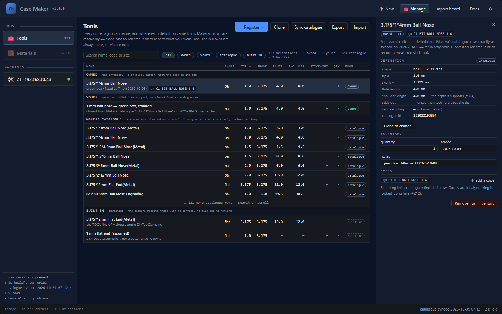

*Design mockup — not the shipped screen.*

**The four tiers, and why they are labelled.** **Built-in** is the two cutters the app has always
had, and they are permanent — they are in the list with no service running, because a simulation has
to have something to run with. One of them is literally named *"1 mm flat end (assumed)"*: its
geometry is an assumption, and the name says so rather than dressing it up as a measurement.
**Makera catalogue** is Makera Studio's own cutter library, imported read-only; you **pick** from
it, you never edit it. **Yours** is a cutter you own whose definition you changed — a slower speed,
a different reach out of the collet. **Owned** is a physical cutter in your drawer, with a quantity
and the code printed on its box.

**Changing a vendor's cutter: clone, never edit.** A catalogue row states what Makera says about
that cutter, and that is not yours to rewrite. Changing anything makes a **clone** — a *Yours* row
that keeps the numbers it was copied from and records, in a sentence, what it was cloned from. The
cutter in the drawer stays a separate **Owned** row pointing at a definition, so one physical
cutter can show up twice, once owned and once yours, by design: one is the thing you hold, the other
is the numbers you chose for it.

**The detail rail.** Selecting a row shows the definition read-only, with the catalogue id it came
from when it came from the catalogue; **Clone to change**; the inventory (quantity, when it was
added, your notes); and the codes printed on the box. **Codes are never looked up online** — a code
is matched against what has already been recorded on this machine.

**The actions.** **Register ▾** opens the three ways to add a physical cutter. **Scan** takes a
barcode scanner's keystrokes or a typed code — the field has the focus, and Enter is the read. What
a code names is shown rather than guessed: a cutter you already have becomes a **count** (a code
names a possession, so scanning one you own adds one rather than making a second row); catalogue rows
that fit the reading are offered for you to pick the one on the label; a code nothing fits is read
back and offered to the other two doors. The reading is **provisional** — the format is fitted to one
label, and the panel says so. The camera is an addition where the browser can drive one, and never
the only way in. **Catalogue** is a search over the synced rows. **Type** is the form, where a blank
length means *unknown*, never `0`. A blank **quantity**, by contrast, means **one** — in all three
doors and in the inventory editor alike: a person holding the box owns at least one cutter, and the
screen that shows the rule is the screen that would otherwise refuse the blank it produced itself
. Registering makes an **Owned** row and leaves the definition
Makera's. **Clone** copies the selected row.
**Sync catalogue** re-reads Makera Studio's library on this PC. A sync can succeed and still
have something to say — a library file it could not read and replaced, feed rows whose cells Studio
left empty — and those sentences are listed under the result, below the counts, where they stay
until the next sync. Each carries its weight: a sync that **lost** something (a replaced
file, an emptied feed matrix) is marked in amber, information is not. The service remembers the
last sync's notes, so they are still there after a restart, dated. **Export** and **Import** move the location — its machine, your tool definitions and the inventory — as one `location.json` file. An older `house.json` still imports: it replaces the two tool tiers and leaves the machine.

**No service: the Tools scope is absent, not broken.** The cutters live in a small service the
desktop app runs. With nothing running, the app does not show you an empty list or a broken one — it
says why, in the service's own words, and reminds you that the two built-ins need no service at all.
**Check again** asks the origin a second time. This is the same treatment the Start wizard gives a
machine it cannot find.

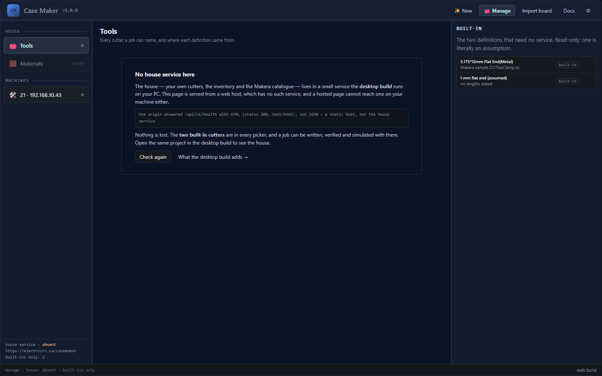

*Design mockup — not the shipped screen.*

**Machines.** The Z1's card is the record of a moment: the connection state in the machine's own
words, when it was checked, and the profile it resolved. **Check for a machine** and an address
field sit in the header — the same probe the Start wizard uses, two doors onto it — and **Check
again** re-runs it. The **"my machine" file** (Export / Import) moves here. A card for printers is
drawn muted, claiming no connection, because Machines reads as everything that makes a part.
**Forget** is the only thing here that writes. Bench power is deliberately *not* here: switching
the machine on is a physical act, not a setting.

**The Bed block.** The machine's card also holds its **bed** — the machine's *active
bed profile*: its name and date, a one-line summary of the surface (bare bed / wasteboard /
fixture plate / vacuum bed) and every fixture placement on it (the vise's jaw top, a bracket's
seat, a rotary module's axis — each with its measured value and when), an **unmeasured** count
linking to the calipers list, and the profile's history. Three actions, none of which ever
sends a machine command: **Switch** picks another saved profile and makes it active; **I changed
the bed** copies the active profile into a NEW dated profile with its dependent datums cleared and
listed to re-measure; **Measure…** lists the four datums (surface top, jaw top, bracket seat,
rotary axis) with their state. This is where the vise's and the bed's *measured* numbers live — the
same ones the job's Hold group and the run sheet read (§2).

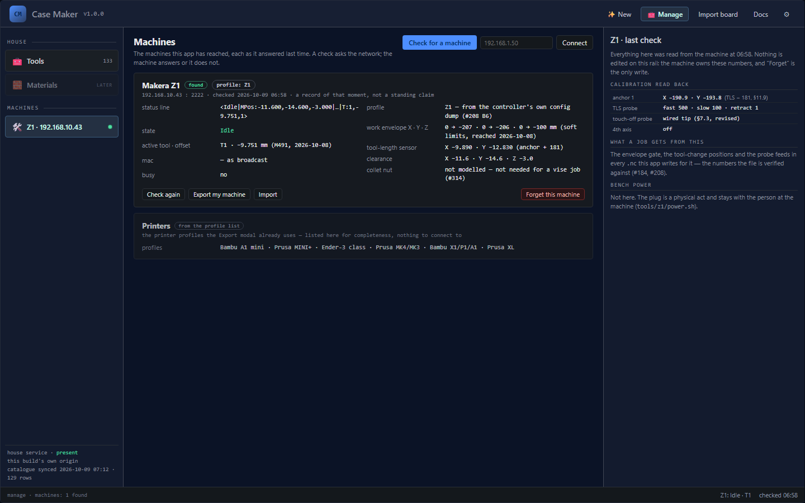

*Design mockup — not the shipped screen.*

### 7.1 · The rest of CNC-4

> **Status: Partly available** — the desktop bridge has shipped; what remains is the
> camera.

**Sending the job to the machine — shipped.** The desktop build's bridge uploads the
`.nc` to the Z1 over your network and plays it from the Cut panel (§5.9): a confirmation
naming the machine and the file before anything is written, a Stop while it runs, and a Home
after a confirmed stop. It does not probe or set the work origin — those stay yours.

**V-carving small text — shipped for regions.** The V-groove reach test ran at the
bench, and the colour-plane model followed. A V-bit still cuts
single-line traces and stroke labels; it now also opens a **region**, pocketing the design at
the colour plane, with the floor `e·tan(halfAngle)` narrower per side and the top-face opening
`f·tan(halfAngle)` wider. The preview draws all three outlines, and the two named refusals, the
merge warning and the step-over note are in §8.1 (`vcarve-above-colour-plane`,
`vcarve-groove-too-narrow`, `vcarve-surface-merge`, `vcarve-stepover-clamped`). The feeds row
asks for a step-over at the plane, but the floor is cleared by the tip disc alone, so the CAM
clamps the pass pitch to the tip radius and `vcarve-stepover-clamped` states both numbers — the
pitch it runs and the one that was asked for.

The film `f` in those formulas is the colour boundary the **print** has, read on the printer's
layer grid (§6) — not the model's raw subtraction. The thick acceptance blank's model is 3.81 mm
with the colour change at 3.0 mm, a raw 0.81 mm; printed in 0.2 mm layers its 19 layers put the
change at layer 15, so the film is 0.80 mm. The resolved value is the material; the app raises no
diagnostic for the difference, and the depths are measured against the printed film.

**Using the camera to find the part — open.** The Z1 has an integrated camera. It cannot
measure Z, and Studio does not use it for origin-setting, so today it is a webcam you can
watch. The plan is to calibrate it against the machine's own motions — the machine is a far
better ruler than a printed sheet — and use it as a coarse datum so a probe starts from a
confident position instead of a blind one. Not started.

---

## 8 · Reference

> **Status: Available** — reference. The rows marked *planned* inside §8.4 are the one exception, and each says so.

### 8.1 Every diagnostic the app can raise

> **Status: Available** — every code the engine raises today is listed. A new code gets its row here in the same change that adds it to the engine.

You will see these short kebab-case codes in the diagnostics list and in the refusal banner.
The severity is **error** (the app refuses or the cut is unsafe), **warning** (it proceeded,
but something is assumed or unmeasured), or **info** (worth knowing).

**Reading the file** (parser):

| Code | Severity | What it means in plain words | What to do |
|---|---|---|---|
| `bad-number` | error | A word's number is not a number the machine would accept. | Fix the line the message names. |
| `stray-text` | error | A line holds text the dispatcher cannot read as G-code. | Fix or delete the line. |
| `console-line` | error | A line starting with a lowercase letter or `$` went to the controller's console, not the G-code dispatcher. | Nothing happened; if you meant G-code, fix it. |
| `n-line-ignored` | error | An `N`-numbered line whose command follows the number is **ignored** by the firmware — confirmed on the machine (`N10 M5` → `ok - ignore: [M5]`). | Put the command on its own line, or drop the `N`. |
| `lone-f-switches-g1` | warning | A line starting with `F` becomes `G1`, and that makes `G1` the modal motion — following bare moves now cut. | Check the program's intent. |
| `comment-contains-g90-g91` | error | A comment mentioning `G90`/`G91` is hoisted out of the comment and applied by the firmware. | Remove `G90`/`G91` from comments. |
| `paren-comment-truncates` | error | Text **after** a `(` comment is discarded by the firmware, not run. | Move it out of the line. |
| `unterminated-comment` | warning | A `(` comment has no closing `)`. | Close it. |
| `ignored-line` | warning | A line starting with a character the firmware ignores. | Remove or fix it. |
| `ignored-text` | warning | Text in a G-code command that is neither a word nor a comment — the firmware scans for an uppercase letter, finds no word, and drops it. A whole run of lowercase characters is reported once, not once per letter. | Remove it, or move it into a `(` comment. |
| `lowercase-word` | error | A lowercase letter followed by a number looks like a word the author meant (`x5`). The firmware matches letters case-sensitively, so the word is silently dropped and the line runs without it. | Write the word in uppercase. |
| `multiple-codes` | error | One command holds both a `G` and an `M` word. | Split them onto separate lines. |
| `t-without-m6` | warning | A `T` word without `M6` on the same command does nothing. | Add `M6`, or remove it. |
| `m6-without-t` | error | `M6` with no `T` word does nothing on this firmware. | Put the `T` in the same command. |
| `unknown-code` | error | A `G` or `M` code the app does not know. | Check the code against §8.2. |
| `unsupported-code` | error | A known code the app will not model (inverse-time feed, canned cycles — the Z1 translates drill cycles instead). | Rewrite it as plain moves. |
| `unsupported-g10` | warning | Only `G10 L2`/`L20` sets a work offset; another `L` is ignored. | Use `G10 L2`. |
| `g10-without-p` | warning | `G10` with no `P` word is ignored by the firmware. | Add `P1` (G54) or `P0`. |
| `g53-invalid` | error | `G53` must be followed on the same line by `G0` or `G1`. | Put them on one line. |
| `g53-params-ignored` | warning | Axis words on a `G53` followed by `G0`/`G1` are discarded. | Remove the extra words. |
| `bad-feed` | error | A feed rate that is not positive. | Give a positive `F`. |
| `no-feed` | error / warning | A cut with no feed rate defined; an arc with none raises a firmware alarm. | Add an `F`. |
| `arc-zero-radius` | error | The arc's `I`/`J`/`K` offsets give a zero radius. | Fix the offsets. |
| `arc-from-unknown` | error | An arc starts or ends somewhere the program never established. | Establish the position first. |
| `arc-r-unsupported` | error | The firmware has no radius-form (`R`) arcs; only `I`/`J`/`K`. | Convert to `I`/`J`/`K`. |
| `arc-radius-mismatch` | warning | The arc's start and end do not sit at the same radius from its centre. | Check the offsets. |
| `no-arc-centre-mode` | error | `G90.1`/`G91.1` are the arc-centre-mode pair, and this firmware has no arc-centre mode: `I`/`J`/`K` are always incremental. The distance mode is left unchanged, not reinterpreted. | Use plain `G90`/`G91`; this is not our post's output. |
| `unknown-g28-subcode` | error | `G28.<n>` carries a subcode, and the dialect records only plain `G28` (the clearance position, not home). Whether the firmware matches the plain code's prefix on it is unverified, so the position is left unchanged and the file is treated as foreign — the same shape as `G90.1`/`G91.1`. | Use plain `G28`; this is not our post's output. |
| `atc-self-check` | warning | A bare `M490` is the ATC motor self-check, which this machine (no ATC) does not have. | Remove it. |
| `rotary-axis` | — | Retired: rotary work is simulated, so the parser no longer warns on an `A` word. | — |

**Running the program** (runner):

| Code | Severity | What it means in plain words | What to do |
|---|---|---|---|
| `tool-change-noop` | info | `M6` to the tool that is already active does nothing — no change, no length calibration. | Confirm the tool in the spindle. |
| `tool-change-ambiguous` | info | The starting tool was not stated, so whether this is a real change cannot be known; it is treated as one for the picture. If it is in fact a no-op the head never moves, so the height the change's macro ends at is **not** counted as an established Z: a `M3` after it still reports `spindle-at-unknown-z`, and an X/Y rapid after it still reports `rapid-too-low`. A program Case Maker writes states its starting tool itself (`;@CM|START|tool=`), so this is a file from elsewhere. | State the starting tool, or open a file that does. |
| `g92-4-manual-home` | warning | `G92.4` redefines the machine position; the setup no longer holds and positions are unknown from here. | Avoid it, or re-establish the origin. |
| `wcs-set-unmodelled` | warning | `G10 L…` writes an offset other than G54, which the app does not model; ignored. | Use G54. |
| `wcs-unmodelled` | warning | `G55`–`G59` selects an offset the app was not given; positions are unknown until G54 returns. | Stay on G54. |
| `outside-envelope` | error | A move leaves the machine's work envelope. | Fix the coordinates. |
| `cut-unknown-z` | warning | A cutting move at a Z the program never established — not swept, so the picture has a gap here. | Establish the Z first. |
| `cut-unknown-xy` | warning | A cutting move to an X or Y the program never established — not swept. | Establish XY first. |
| `cut-from-unknown-xy` | info | A cut starting from an unknown X,Y is swept as a plunge at its end point only. | Expect a small gap at the start. |

**Verifying the program** (verifier). These are the codes the *verifier* raises when it reads a saved
program back — what the **Verified** row in the job flow is: the parser, the dialect whitelist,
the runner and the depth checks run over the file itself, and every error any of them finds is
carried under one of these names. Two of them (`parse-error`, `runner-error`) wrap the reading and
running passes above; the rest are the checks the runner does not do on its own.

**It runs on what the app produces, and is not a gate on imports.** The three callers are the job
run, a restart, and the bench file generator — so a file you open or import is read and simulated,
never verified, and nothing below checks a foreign program's depths, feeds or spindle starts. What a
simulation does report about one is the sweep's own list, next:

| Code | Severity | What it means in plain words | What to do |
|---|---|---|---|
| `parse-error` | error | The file could not be read as G-code and was not simulated: either the parser refused a line, or the program could not be lowered to moves at all. The message carries the inner reason. | Fix the line the message names, then generate again. |
| `runner-error` | error | The runner refused the program — a move that leaves the machine's envelope, an arc with no feed rate or in a form it cannot read, or an arc from a position the program never established. (A *warning* the runner raises — an unknown Z, an unknown X,Y — is not carried here.) The message names the runner's own code and what it found. | Fix the move the message names. |
| `not-our-dialect` | error | A word in the file is not one this post writes (`G0 G1 G21 G28 G53 G90`, `M2 M3 M5 M6 M7 M9 M331 M332`, and only G/M/T/S/F/X/Y/Z words). The file did not come from the app, or was hand-edited. | Re-post it, or fix the word. |
| `numbered-line` | error | A line carries an `N` word. The firmware strips the number but keeps testing `N`, so it answers `ok` and **runs nothing on the line** — a numbered program runs as a stream of silently skipped lines (confirmed on the bench). The post writes no line numbers. | Remove the `N` words (or the numbers' line), then re-post. |
| `cut-too-deep` | error | A cutting move reaches Z deeper than the material permits at that (X, Y): past the stock floor, through a colour or void ceiling, or into material the job says must remain. The message names the limit and, when the job can say, why. | Reduce the depth, move the cut clear, or switch the label's intent. |
| `cut-outside-stock` | error | The cutter's *edge*, not just its centre, reaches a point where this job's own limit says no cutting is allowed — a keep-out zone or a restart bound. Cutting air beside the blank is not refused: the blank's physical bottom is the floor at every XY. | Move the cut out of the keep-out. |
| `feed-missing` | error | A cutting move has no feed rate set. | Add an `F` before the cut. |
| `feed-too-high` | error | A cutting feed is above the machine's ceiling. (The planner's softer `feed-clamped` is a different code, raised earlier.) | Lower the feed. |
| `spindle-off-cut` | error | A feed move reaches below the top face with the spindle off. | Turn the spindle on with `M3` — it is the dialect's only spindle-on word (`M4` is not one of them). |
| `spindle-at-unknown-z` | error | The spindle starts with no Z established: nothing placed the tool in Z first, so the cutter comes on **wherever the head was left** — after a manual `M6` that can be inside the part. Read on every start, so a later `M3` is judged where the head is then, not on the file's opening lift. | State the Z first: a `G53` lift in the machine frame (what the app's own post and restarts write), or an absolute Z move. |
| `rapid-too-low` | error | An X/Y rapid runs below the permitted rapid height, or at a Z the program never established. | Raise the rapid height, or state the Z first. |
| `rpm-too-high` | error | A spindle speed is above the machine's ceiling. (The planner's `rpm-clamped`/`rpm-refused` are separate.) | Lower the speed. |
| `multi-tool` | error | The program uses more than one tool; V1 is single-tool. Raised for an `M6` to a new tool after the first cut, or for more than one distinct tool anywhere. | Post the job with one tool. |
| `bad-preamble` | error | The first motion is not preceded by `G90` and `G21`. | Open the program the way the app's post does. |
| `bad-ending` | error | The program does not end with `M02`/`M30`, or the spindle is still on at it, or no `M5`/`M05` turns it off first. | End with `M5`, `G28`, `M02`. |
| `rotary-y-off-axis` | error | A WRAPPED rotary program (one whose cutting moves change A) carries a Y word that is not 0, or an INDEXED program carries one on a move that changes A. The stock turns only with the cutter over the axis; while A is held, an indexed run is an ordinary 3-axis cut and its face pocket may step over in Y. | Keep a wrapped program's Y at 0, and take every turn at Y 0. Inside a held index, Y may move. |
| `stock-exceeds-module` | error | The job is cut in the rotary chuck, but its cylindrical stock is outside the module's published envelope ⌀80 × 150 mm — too fat or too long to turn. | Use stock inside ⌀80 mm × 150 mm. |
| `rotary-rapid-engaged` | error | A rapid turns the stock (`A`) or traverses along the axis (`X`) while the cutter tip is still inside the cut — below the stock's surface plus the 3 mm clearance Makera requires above it. A rapid may only turn the stock once the cutter is clear. | Lift to the clearance (radius + 3 mm) before the turn or the traverse. |

**Sweeping the cuts** (sweep):

| Code | Severity | What it means in plain words | What to do |
|---|---|---|---|
| `stock-unsupported` | error | The stock model is a rectangular (prism) block or, for an indexed rotary job, a cylinder; the setup's part is neither. | Use a rectangular blank, or a round one for rotary work. |
| `stock-invalid` | error | Stock thickness is not positive. | Type a real thickness. |
| `machine-unknown` | error | The simulation was asked for a machine id it has no profile for; the message lists the ids it knows. Nothing is swept, because a frame it cannot find is a frame it would have to guess. | Pick the machine in the Start wizard, or re-run the machine check. |
| `machine-frame-unread` | error | The simulation was asked for a machine the app knows as a vendor row but whose controller frame has never been read. Every framed model this build ships (the Z1, the Carvera Air and the Carvera) carries one; the refusal stays for a model added without it. Its anchors, toolrack, clearance and soft endstops are the machine's own, and none has been read, so nothing is swept. | Connect the machine once: the configuration read fills its frame. |
| `prior-removal-invalid` | error | A rest pass was told what material a previous program left, and that material is not a closed solid — so the sweep has no starting material to subtract from. | Simulate the first program and pass ITS result. |
| `prior-removal-column` | error | A rest pass was asked for on a job the COLUMN engine sweeps — a rotary job, a V-bit (whose cutting width changes with depth), a drill or a thread mill. Only the exact 2.5D sweep can start from the material a previous program left, so the pair is refused by name rather than swept from the blank. | Measure the rest with a flat cutter, or cut the second program as a program of its own. |
| `air-moves-unchecked` | error | Some air moves that pass near the stock were not verified. The exact sweep tests at most 4000 such moves one by one (each test is a solid boolean); moves above the stock or straight up out of their own cut are settled without a test and do not count. The column sweep tests every one, and stops only when the simulation's time budget runs out. An unproven air move blocks Upload — a gate that passed with a rapid below the stock top left unchecked would not be a gate. | Split a very long job, or raise the simulation budget. |
| `efficiency-air` | warning | A program spends a larger share of its cycle in rapid (air) moves than your shop allows — over the air-time fraction in `location.json` (`efficiency.maxAirFraction`). The sentence names the airiest operation. The figure uses the same trapezoids as the cycle estimate shown in the panel and posted in the file, so it is the clock the program is actually timed with. | Shorten the hops, or order neighbouring cuts so the tool enters next to where it stopped. |
| `spindle-off-near-bed` | error | A feed move with the spindle off comes within a hair of the bed. | Turn the spindle on, or move it away. |
| `rapid-below-bed` | error | A rapid goes below the bed. | Fix the Z. |
| `spindle-off-near-stock` | error | A feed move with the spindle off comes within a hair of material still present. | Turn the spindle on, or move it away. |
| `rapid-through-stock` | error | A rapid passes through material the program has not removed yet — a gouge. | Slow/insert a feed move, or reorder. |
| `holder-unproven` | warning | The cutter's reach past the collet is unknown, so holder clearance cannot be proven. | Record the cutter's shoulder/flute length. |
| `holder-collision` | error | The cut is deeper than the cutter's shoulder/flute length: the shank would rub. | Use a longer cutter or a shallower cut. |
| `laser-job` | error | A laser job (`M321`); a mill simulation refuses it. | Simulate it elsewhere. |
| `rotary-job` | error | The exact 2.5D sweep was handed a WRAPPED rotary job — one whose cutting moves change A, following a helix the hull of two tool placements cannot represent. An INDEXED job (A held through every run, changed only between them) is taken by the exact sweep, each run on the stock turned by its own angle. A wrapped job is swept by the column engine instead. Only a direct caller of the exact sweep sees this. | Nothing to do — the session routes the job to the engine that takes it. |
| `rotary-turn-in-stock` | error | An index turn (A changing on a rapid) was taken with the tool tip below the stock top. The sweep tests both end positions exactly, but the sector between them is neither, so clearance cannot be proven. | Retract above the stock before an index turn — the app's own post does. |
| `rotary-into-chuck` | error | A rotary program moves the cutter past the jaw face (X 0, the rod's chuck end) below the height the jaws reach (half the jaw diameter above the axis, or the rod's top if higher) — a cut or a rapid, anywhere along the move, that would reach into the jaws. The jaws are checked as the space beyond the jaw face; the chuck body above them is not modelled, and the tailstock is modelled when the job states it is in. | Start and end every pass at least a cutter radius clear of the jaw face, and move over the chuck only above the jaws. |
| `rapid-into-chuck` | error | A rotary program's rapid moves the cutter past the jaw face (X 0) below the rod's top plus the rotary clearance, anywhere along the move: it would drive into the jaws. | Move over the chuck only above that height; retract before travelling toward the jaws. |
| `rotary-cut-before-a` | error | A program that turns the rotary cuts before it ever states the A angle. On the machine A is wherever the last job left it, so that cut lands on an unknown face. | State A on a rapid before the first cut — the rotary post does. |
| `rotary-into-tailstock` | error | An indexed rotary job whose tailstock is in moves the cutter into the tailstock body behind the live centre — a cut or a rapid, tested along the whole move with the cutter's edge. The body's length, radius and centre-to-body are PROVISIONAL (unmeasured), so the refusal names them. | Keep the pass clear of the stock's free end, or turn the tailstock out for this job. |
| `rapid-into-tailstock` | error | A rotary program's rapid drives the cutter into the tailstock body, anywhere along the move, where the job says the tailstock is in. The cutting-move twin is the tailstock band (`wrap-into-clamp`); this is the rapid's own check. | Keep the rapid clear of the stock's free end, or turn the tailstock out. |
| `prior-removal-rotary` | error | An indexed rotary job was asked for a rest pass. The material a previous program left would have to be read in the stock frame the faces are turned back into, so the pair is refused by name rather than swept from the blank. | Measure the rest with a flat job, or cut the second program as a program of its own. |
| `sacrificial-rotary` | error | A cylindrical stock was given an under-board. The sacrificial model is a rectangular blank's (it is expressed against its length, width and thickness), and a rotary job has none. | Remove the sacrificial declaration for the rotary job. |
| `thread-flat-only` | error | A rotary job includes milled threads. A thread is simulated on a flat face only: the rotary column grid is a single-valued radius per (θ, X) column, which has no form for a thread, so nothing is claimed about this job. | Nothing to do — no picture is claimed; simulate a thread on a flat job. |
| `rotary-stock` | error | A rotary job needs cylindrical stock; the setup's blank is not a cylinder, so neither engine can hold it. | Use a cylindrical blank for a rotary job. |
| `flat-stock` | error | A flat (3-axis) program was handed a cylindrical blank. On a cylinder the work Z is the radius above its axis, not a depth below a top face — the program and the stock describe different planes, so both engines refuse the pair. | Use a rectangular blank for a flat job. |
| `axis-crossing` | error | A rotary cut reaches the axis deeper than the tool radius (the cutter tip at radius Z ≤ −r); a single-valued radius column cannot represent a cut that crosses the axis. A straight drill that plunges along Z at one X, Y and A and exits the far side of the rod is a cross-hole, not this fault. | Keep the cutter off the axis, or use a shorter tool. |
| `goal-rotary-oversize` | warning | A goal mesh on the rotary reaches a radius larger than the stock rod. Generate cuts the relief only where the rod's surface is, so the outermost part of the goal is not reproduced; the sentence states how much. | Use a larger rod diameter, or scale the goal down. |
| `axis-clamped` | warning | A rotary cut dipped just past the axis (within one tool radius) and was clamped to it; the far-side hollow is not modelled, and the cut did not come out the depth the program asked for. | Keep the cutter off the axis, or accept the clamped picture. |
| `tool-refused` | error | The simulator has no model for this cutter, or the cutter's record does not state what its model needs. The exact sweep takes a flat end mill. The column engine also takes a V-bit or chamfer with a stated tip and angle, a drill with a stated diameter, a ball or bull nose with a stated diameter and corner, and a thread mill with a stated cutting diameter. On a rotary job the column engine sweeps a flat end mill, a ball nose or a V-bit; a drill, a bull nose and a thread mill are refused there. The message names what is missing, for example a chamfer box code that states no tip, or a thread mill whose only size is its thread. A cutter the simulator refuses is handed to the measured search, whose plan replaces it with one the simulator models, and the replacement is stated on the cutter line and as a finding. | Type the missing number on the cutter, or let the smart pick's substitute cut the job — it is named, not silent. |
| `drill-point-angle` | info | A drill is simulated as a cone point on a cylinder. The message names the included point angle used and where it came from: the drill's own record, or the shop default `drill.pointAngleDeg`, which is *chosen*, not measured. The drilling CAM plans the hole's tip depth from the same rule and hands the simulation the angle it planned with. A drill with no angle of its own is refused (`tool-refused`) when no default reaches the simulation. | If the drill's point is not the default, type its angle on the cutter. |
| `thread-envelope` | warning | A thread mill's removal is an **envelope**. When the sim is given the thread's own dimensions (a job's thread item), the cutter is modelled as its neck plus a 60° tooth on the item's basic form and swept along the program's helix, so the floor carries the thread's pitch and flank. A column holds one height, so the crests between the grooves are not left: the picture over-removes by at most the annular band π/4 (D² − D1²) L, and the message states that volume. The neck traces the ⌀D1 pilot in the solid blank, where the shop drills it first. A program loaded without the dimensions (a foreign file, the QA harness) falls back to a plain cylinder of the cutting diameter, widened by half a grid cell. Either way the wider shank above the neck is **not** modelled: `holder-collision` past a stated flute or shoulder length, `holder-unproven` when the cutter states neither. | Read the drawn hole as the mill's reach, not as the finished thread: crests are absent and the pilot is assumed drilled. Type the mill's flute length so the neck can be checked. |
| `probe-fitted-cut` | error | A cutting move was made with `T0` active — `T0` is the **probe**, and a probe is contact, not removal. No cutter is modelled for it, and nothing is drawn as removed. The post never writes a probe cut, so the file is foreign or broken. | Check the tool numbers; re-post the job. |
| `dense-3d-refused` | error | Too many separate cut runs at one (segment, Z): a 3D or dense job the 2.5D sweep will not take on. | — |
| `sweep-stalled` | error | The simulation stopped making progress: no checkpoint arrived inside the stall window (`sim.loadStallMs`, 30 s unless the shop says otherwise). The run is a fault — the worker or the shape it was sweeping stopped advancing — not a program that is slow to cut: a healthy sweep resets the window at every checkpoint and runs as long as it takes. Never downgraded and never acknowledged away — it blocks Upload. | Simulate again, and save the report beside the sentence if it repeats. |
| `ramp-over-removed` | info | A plain V-bit's checkpoint changes Z; the V is swept at its lowest Z, removing more than the machine would (every other cutter follows Z along the move, so this speaks only for a V's per-segment groove model). | Expect a slightly pessimistic picture on a ramped V cut. |
| `gouges-truncated` | info | Only the first few gouges are drawn; the rest are reported, not drawn. | Read the other diagnostics. |
| `fixture-unchecked` | info | The workholding is not modelled as an obstacle and it puts something over the part, so the cutter's proximity to it is **not** checked. The message names what is in the way — the vise's jaws, a clamp. Nothing is reported for a fixture that puts nothing over the part (tape-down, a nest wall outside the outline), and a ROTARY job's chuck and tailstock are the map's keep-out bands: the result states that fact once and no such info is raised for every rod. | Model the vise (chapter 5). |
| `tool-into-fixture` | error | The cutter's own swept column at a checkpoint drives into a modelled obstacle. The message names WHICH box — a jaw, a clamp — and the volume removed. | Move the cut clear of it, or correct the fixture's declared size. |
| `rapid-into-fixture` | error | A rapid move drives the tool body into a modelled obstacle. | Fix the clearance height, or reorder the moves. |
| `feed-into-fixture` | error | A feed move with the spindle **off** drives the tool body into a modelled obstacle — the same test as the rapid, with nothing being cut away as it goes. | Turn the spindle on, or move the move away. |
| `holder-into-fixture` | error | The collet nut (its declared diameter), placed at the lowest it can sit at any seating, overlaps a modelled obstacle. | Use a shorter seating or a shorter holder, or move the work clear. |
| `holder-vs-fixture-unproven` | warning | A modelled obstacle rises above the stock top while the collet nut's size is unknown, so the clearance to it cannot be proven. The message names the obstacle and how far it rises — and, when the rise is really the unmeasured band around a box that is declared below the stock top, says that instead. | Declare the holder's nut size, or keep the fixture below the stock top. |
| `nothing-to-sweep` | warning | The program has no cutting moves at a known position. | Check the program. |
| `gaps` | warning | Some cutting moves could not be placed and are missing from the picture. | Read the `cut-unknown-*` rows. |
| `item-empty` | warning | An item has nothing the cutter can reach: a label has no text, or a shape (a hole, a slot) is smaller than the cutter. Formerly `label-empty`. The item cuts nothing and the rest of the job still posts. | Type text, enlarge the shape, choose a smaller cutter, or disable the item. |
| `item-chars-lost` | warning | A label loses whole characters to the cutter's radius; the sentence names each lost character and its index. The rest of the text and the rest of the job still post. Formerly `label-chars-lost`. | Increase the size or use a smaller cutter. |
| `item-detail-lost` | warning | An item loses detail (thin strokes, inside corners) to the cutter's radius. Formerly `label-detail-lost`. | Increase the size, enlarge the shape, or use a smaller cutter. |
| `raised-text-fused` | warning | A cut-away leaves construction labels standing as raised text, but the cutter is too wide for the gaps between the letters: clearing the field joins two letters into one shape, or fills a letter's counter. Measured from the same tool opening the CAM cuts. The sentence states the text, its size, the measured narrowest gap, and the cutter width that clears it (a V-bit's width at the cut-away's depth) or the cap height. | Use a cutter no wider than the measured gap, or raise the text to the size the sentence states. |
| `item-outside-stock` | warning | An item cuts past the supported material inset by the edge margin: the sentence states the area. The edge margin is a preference, and the part beyond the stock's edge passes over air — Generate cuts it as it is, and the sweep's fixture and bed checks judge any real contact. Formerly `label-outside-stock`. | Move it back inside the edge margin to cut the whole part, or declare a strip or board under the overhang. |
| `item-over-void` | warning / error | An item cuts over a declared under-surface void, whose membrane has nothing under it. True at any depth — even a shallow cut there will chatter and finish rough. A single-line trace is warned about the same way; a plunge drill is not, because a drill into a void is a breach `cut-too-deep` refuses, and a drilled hole has no pocketed floor to finish. A cut that goes THROUGH the blank — a `through` region or a cut-out's kerf — is an ERROR instead: it leaves the blank and breaks into the cavity, and the membrane is the only material holding the freed piece. | Move the cut clear of the void. A BLIND cut deep enough to break through is refused separately by the verifier as `cut-too-deep`. A through cut is not: `stackDepthLimit` returns the blank's own floor wherever the through mask says the cut leaves the blank, so the void limit never binds it. For a through cut over a void, this error is the only guard. |
| `item-depth-bound` | error | An item's floor lands on the wrong side of a plane it must stay clear of. Raised for the colour split on a two-colour blank — a label's `depthIntent` chooses which SIDE of the split its floor belongs on, *surface* above it, *reveal* through it — and for a void's ceiling under the item's own footprint: the label cut over a magnet pocket is told where that ceiling is and how far above it the floor must stay. Only a plane the job knows about can be broken, so a blank that states no split and a label that states no intent (or *custom*) are left alone. Where the split is known it is read off the printer's real layers, not the nominal design height, so changing the layer height moves it; a void's ceiling is read off the layer stack when the blank states its print and off the design's own membrane when it does not. `cut-too-deep` is the per-move backstop for both these planes — the cutter reaches a void's ceiling part-way through a move — and is the only check for an item that is not a label (a drawn shape, a traced path). An item past the stock's minimum floor is `depth-exceeds-stock`. Formerly `item-wrong-colour`. | Set the depth to the other side of the plane, or switch the label's intent. The message names the plane, where it is in mm, and which side the floor must be on. |

**Checking the job** (job):

| Code | Severity | What it means in plain words | What to do |
|---|---|---|---|
| `depth-exceeds-stock` | warning | An item cuts deeper than the job's PREFERRED floor — the floor left under it is below the minimum, or it breaks through the blank when it already has. The sentence states the floor left, or the breakthrough, with numbers; on a rotary job the floor is a RADIUS above the axis, so the limit is the rod's radius — or a tube's wall, whichever is smaller — less the minimum floor, not the stock's thickness. Generate cuts it as it is; the physical limit is the blank's bottom, and the board, fixture and sweep checks judge contact beneath. | Make it shallower, use thicker stock, or on a tube a thicker wall. |
| `facing-too-deep` | warning | The job asks to face its stock's top, and the depth asked leaves less than the preferred minimum floor under the skim. The sentence states the floor left; Generate cuts the skim as it is. Facing also LOWERS every item's own floor, because it is measured from the faced surface — those items get their own `depth-exceeds-stock` warning. | Ask for a lighter skim, or use thicker stock. |
| `printed-plastic-melts` | info | The blank is PLA or PETG, which softens from cutting heat: a warm chip can weld back into the cut. One line on the job says so and names the ways to keep it cool; it is a fact, not a refusal, and it does not repeat per program. | Use a shallow step-down, a sharp single-flute cutter and air blast, and keep the cutter moving rather than dwelling. The material is still fine to cut. |
| `facing-plastic` | error | The job asks for a facing pass on a material that cannot take one — every non-wood, non-metal material, i.e. any plastic (PLA, PETG, ABS, acrylic and the rest), not only a printed blank. A flat cutter smears a plastic top instead of cutting it, so no finish, depth or cutter choice makes the pass work. The job is refused before any program is written: every later program is posted from the top a skim would leave, and there will be no such top. | Turn facing off in the Cut panel and generate again. |
| `item-off-round-stock` | warning | A cut's swept extent reaches outside the round face of a disc or a rod. The job plans in the square around the round stock, and that square's corners are air: the sentence states how far past the face the cut reaches, and Generate cuts it as it is. The face is the circle of the stock's diameter, less the job's edge margin. | Move the cut inside the circle to cut the whole part, or start from square stock when a cut needs the corners. |
| `item-off-board` | warning | A board's hole lies outside the outline its cut-out follows: the sentence states how many holes and names the items, and the part off the board cuts air. The outline is read from the document (a vector, polygon, rectangle or circle); a reference-following outline is left to its own checks, and the check then says nothing. | Check the drill file's placement against the outline file, or widen the outline. |
| `hole-no-cutter` | warning | A board's drill states its HOLE's own size (a Gerber import does), and no owned drill or flat end mill can make it — drill it within +0.1 mm, or bore it. The rest of the board still posts; the sentence states the size, how many holes, where they are, and the smallest drill or flat end mill the library holds, and says the holes are left out of the programs. | Add a drill of that size, or a flat end mill that can bore them. |
| `isolation-short` | warning | Two pieces of copper the design separates are closer than the isolation cut's width at the copper's underside, so the band between them is not cut and they come out joined. The board still cuts, and the operator may bridge the gap by hand or accept it on a test board: the sentence states the gap at the copper, the cut's width and up to five places, and offers the owned engraver whose tip would open it. The topology check still reports the short, so "matches the design" stays unticked. | Use the finer engraver the sentence offers, or widen the gap in the board's design. |
| `thin-trace` | warning | A trace is narrow enough that the job's Z budget moves the isolation's cut edge a large share of its width into it, leaving it finer than the cutter's own tip. It is still a trace; the warning names its width, its place and what the budget leaves. | Check the trace before soldering, or use a finer bit or a wider trace. |
| `wrap-into-clamp` | error | A rotary job's item wraps into a clamped end: the jaws' band (the first 3 mm of the stick-out) or the tailstock's band (the last 10 mm while the tailstock is in). Both are Case Maker's own defaults — Makera publishes neither. | Move the item into the free span between the bands. |
| `wrap-off-free-end` | warning | A rotary job's item reaches past the free end of the rod while the tailstock is OUT. The map's width is the stick-out — the length of rod standing out of the jaws — and past it the cut passes over air: the sentence states the reach against the stick-out, and Generate cuts what is on the rod. With the tailstock in, the same reach is `wrap-into-clamp`'s tailstock band, which is an error. | Move the item back inside the stick-out to cut the whole part, take a shorter grip (a longer stick-out), or use a longer rod. |
| `feed-at-radius` | warning | Something about this rotary cut's feed is wrong for the cut: the firmware treats `F` as a surface speed over a perimeter of `2π·r + 30` mm per turn and caps the A axis at its 60 °/s (10 rpm), and either that cap binds, or a simultaneous path asks 80 % or more of the Z axis's 600 mm/min. The finding states the radius, the A rate and the real surface speed. The ordinary perimeter shortfall — present on every wrapped job — is a fact on the run sheet's rotary section, not this warning. | Nothing to fix: this is the speed the firmware will run at. Set `F` with it in mind, and read the run sheet's surface-speed line. |
| `rotary-unsupported` | error | A rotary job carries work the wrap CAM does not cut: a through cut, an inlay, a raised prism, a cut-out, a chamfer, a trace, a drilled hole, a milled thread, an under-surface void or a facing pass. A single-valued map has no form for it, so it is named rather than silently dropped. | Remove that work for this job, or cut it on a flat blank. |
| `neck-thin` | warning | The neck for parting is thinner than Case Maker's safe minimum for the stock's material and the piece the saw frees. The check treats that piece as a round cantilever fixed at the neck's ROOT — its chuck-side edge, the edge nearest the load's support — and loaded at its free end: the peak moment is at the root, not at the saw line, so the length counted is root to free end. The load is 10 N sideways — about 1 kg leaning on the part, standing in for a hand, the saw's side pressure and a knock — with an allowable bending stress of 15 MPa for wood, 30 MPa for plastic and 100 MPa for metal: `d = cbrt(32·F·L / (π·σ))`. With the tailstock engaged its centre holds the carried piece's far end, so the check counts half that length (the bending is shared); with the tailstock out it counts the whole length. Every number is a labelled default, not a measurement: the neck is cut last, with the part still held, so this is a rough check and the minimum is a guess until it is checked on the machine. The neck is a strength estimate against Case Maker's minimum; the cut proceeds with the numbers stated, and the saw step is the operator's. | Make the neck thicker, shorten the part, or choose a stronger stock. |
| `neck-in-band` | error | The neck for parting runs into a clamped end of the free span — the jaws' keep-out band (the first 3 mm of the stick-out) or the tailstock's band (the last 10 mm while the tailstock is in) — the same `rotaryFreeSpan` bands the item checks use. The neck grows inward from the end it is set to, so a neck longer than the free span crosses the other band. | Shorten the neck, or move it to the other end of the free span. |
| `neck-cuts-item` | error | A design item's opened region overlaps the neck's [from, to] span, so the cut that leaves the neck would erase that item — the neck is cut after the engrave, and the default X 70–75 mm tailstock-side neck would wipe a label at X 72 mm. | Move the item clear of the neck, or shorten or move the neck. |
| `neck-wider-than-part` | error | The neck's diameter is the part's diameter at that end or wider, so there is nothing for the cutter to cut down and the part would not be held on a neck at all. | Make the neck narrower than the part at that end. |
| `neck-too-short` | error | The neck is shorter than the saw can cut off cleanly: less than 0.5 mm of kerf plus 1 mm clear either side, i.e. under 2.5 mm. The kerf and clearance are Case Maker's defaults, not measurements, and the minimum is a guess until it is checked on the machine. | Make the neck at least 2.5 mm long, or turn the neck off. |
| `neck-jaw-clearance` | warning | The neck for parting is on, and the clearance beside it is NOT checked: Case Maker keeps the cut clear of a keep-out band it assumes — its own guess — the jaws for a chuck-side neck, the tailstock for a tailstock-side one, and the sweep models neither as a solid. Nothing in the app can promise the cut clears the fixture beside it, so the warning stays until the rotary is measured on the machine. | Air-cut the neck first, and keep checking the clearance by eye until the rotary is measured on the machine. |
| `neck-too-narrow-for-cutter` | error | The neck is no longer than the last program's cutter is wide, so a pass along the neck cuts the whole band away instead of leaving a flat floor — a 5 mm neck and a ⌀6 mm cutter do it. It has its own code so the refusal names the length, not the cutter's shape. | Make the neck longer than the cutter is wide, use a narrower cutter for the last cut, or turn the neck off. |
| `neck-not-cut` | error | The neck for parting is set, but no posted program cuts it. That is either the program's last cut being unable to leave the flat floor a saw needs — no usable cutter, a drill (its point leaves a cone) or a V-bit/chamfer (its point leaves a groove) — or the run's last rest program being dropped because it had nothing to rest-machine, leaving no file that carries the neck. | Use a flat end mill for the part, keep a program that cuts the neck and leave it last, or turn the neck off. |
| `face-needs-chuck` | error | The job cuts on the stock's FACES — a flat, a ring of flats or a cross-hole — but it is not round stock held in the rotary chuck. A face is an indexed rotary cut: turn, hold, cut. | Change the holding in the Holding step, or remove the face operations. |
| `face-needs-flat-tool` | error | A face is a flat pocket at a depth, and "no flat width" means the job's cutter cannot cut one — a pointed or rounded cutter leaves a groove or a crown, not a plane. | Choose a flat end mill for this job. |
| `face-too-deep` | error | A face's depth reaches the axis or passes it (a flat keeps its floor above the axis, so its depth is under the stock's radius), a ring's across-flats is not below the stock's diameter, or a cross-hole states no diameter. The sentence gives the number asked and the limit. | Make the cut shallower, the across-flats smaller, or state the hole's diameter. |
| `face-no-room` | error | The free span between the jaws' keep-out and the tailstock's band has no room left for the face and the cutter's own edges: a face runs between those lines at least one cutter radius clear of each. | Take the tailstock out, use a longer stick-out, or a smaller cutter. |
| `cross-hole-cutter` | warning | The cross-hole asks for a diameter the job's cutter does not have, so the hole comes out at the cutter's size. The job still cuts; the sentence states both sizes. | Use a cutter of the diameter you asked for, or accept the size the sentence gives. |
| `face-item-off-face` | error | A cut on a face — an engraving, a pocket or a hole — reaches past one of the face's edges: the face is only as wide as its chord and as long as the cuttable span. | Move the cut onto the face, or make it smaller. |
| `face-item-too-deep` | error | A cut on a face, added to the face's own depth, reaches the rod's radius — the axis the stock turns on — or passes it. | Make the cut shallower. |
| `face-hole-cutter` | warning | A hole on a face asks for a diameter the job's cutter does not have; the hole comes out at the cutter's size. | Use a cutter of the diameter you asked for, or accept the size the sentence gives. |
| ~~`neck-with-faces`~~ | — | Removed: a mixed job with a neck is no longer refused. Its wrapped program is posted as two files — the map items, and the neck alone — and the run plays the items, then the faces, then the neck (`neck-after-faces`). | — |
| `neck-after-faces` | info | The job cuts map items and faces and leaves a neck for parting, so it is cut in this order in one mounting: the map work, then the faces, then the neck alone in its own last file. Every face is cut on the whole part, and each file is posted, verified and judged on its own. | Nothing to do: run the files in the order listed; the saw step follows the neck file. |
| `face-cuts-neck` | error | A face cut reaches into the neck's own section: inside the neck's X span and deeper than its floor (a flat or ring deeper than the neck leaves, a cross-hole through the span, or a cut on a face that reaches below the neck's floor there), so less than the neck's stated diameter would hold the part. A face cut that stays above the neck's floor is turned away by the neck itself and is not refused. The sentence gives the depth, the span and the neck's diameter, in mm. | Keep the cut shallower than the neck's floor, move it clear of the neck's span, or move the neck. |
| `face-cut-finer-cutter` | info | A cut on a face is finer than the job's cutter — text thinner than it, or a pocket smaller than it — so a finer owned flat end cuts it in a program of its own, at the same index, after the face. | Nothing to do: the finer program runs after the face. |
| `face-cut-uncuttable` | warning | A cut on a face is finer than every owned flat end can make, so it is left uncut and the rest of the job posts. The sentence names the cut, the finest cutter tried and the way out. | Use a finer flat end for that cut, or make the cut larger. |
| `no-items` | error | The job has no enabled item to cut: no label with text, shape, trace, drilled hole, thread or cuttable 3D primitive. Formerly `no-labels`. | Add one. |
| `primitive-not-vertical` | warning | A 3D primitive opens along X or Y instead of Z, so it is a side-opening undercut. The top-face CAM does not cut it: **that part of the stock stays**, and the sentence names the setup face that could reach it (or says no setup has it up). The rest of the job is generated. | Set its axis to Z, or add a setup with that face up. |
| ~~`primitive-cone-needs-cam`~~ | — | Removed; a cone is an analytic heightfield cut by its own 3D surface program (`primitive-surface-program`). | — |
| ~~`primitive-sphere-needs-3d`~~ | — | Removed; a sphere is an analytic heightfield cut by its own 3D surface program. | — |
| `primitive-surface-program` | info | A cone or sphere primitive is cut by a 3D surface program of its own: the shape becomes an analytic top-Z field on the shop grid, and the 3D CAM's roughing and finishing passes cut it. The program carries a `surfaceCheck` (grid pitch, roughing layers, passes, bbox) instead of a 2.5D verifier report. With a flat cutter the finish is a stepped approximation; a ball follows the curve. A primitive is always ONE cutter: the goal's flat-rough/ball-finish split is the goal's, not the primitive's. | Nothing: the program is cut and checked. Use a ball nose for a true finish (the app offers the largest one that fits). |
| `primitive-surface-ball-offer` | info | A cone or sphere is being cut by a flat end mill, whose finish is stepped, and the shop owns a ball cutter whose radius fits the surface's smallest curvature (the cone's tip radius, the sphere's own radius). The app proposes the LARGEST that fits, so the better cutter is one press away rather than something the operator has to search for. | Press "Cut the surface with …" on the primitive's row; it assigns the primitive to the ball and leaves every other item on its cutter. |
| `target-object-not-cut` | warning | The job carries a target object — an imported STL, 3MF or STEP that the cut-aways are positioned against. It is a REFERENCE and is never removed from the stock: no program cuts around it, and the simulation draws no material taken away for it. | Nothing if you only need the reference. Cutting the stock out around the object is the profile cut-out work. |
| `target-mesh-missing` | error (goal) · warning (reference) | The job names an imported mesh whose BYTES this browser no longer holds. The open job persists to localStorage, whose quota is small, so a mesh's bytes live in the app's IndexedDB store keyed by the file's SHA-256 and the document keeps only the hash, the size and the name; clearing site data, a different browser profile, or a mesh store write that failed leaves the job without them. | Import the mesh file again — the SHA-256 will match and the job picks the bytes back up. |
| `target-mesh-loading` | error (goal) · warning (reference) | The job names an imported mesh and this browser's mesh store has not answered yet: the bytes are being read back by their SHA-256 after a reload or an open. It replaces `target-mesh-missing` until the store answers, at the same severity, so a goal cannot be generated before its shape is here. | Wait a moment; it becomes ready, or `target-mesh-missing` if the store does not hold the mesh. |
| `target-mesh-unstored` | warning | The open job holds the mesh's bytes, but the browser refused to keep a copy in its mesh store (storage full, or a private window), so a reload would lose them. | Save the job to a file — the file embeds the mesh — or free browser storage and import the mesh again. |
| `goal-object-oversize` | warning (error when nothing of the goal is over the blank) | A target object marked as the shape to MAKE (its role is "goal", not a reference) extends past the blank. The row names, per axis and side, exactly what lies outside. Generate then REFUSES the goal before building the toolpath: a goal clipped to the stock would run its finish along the stock edge, where the mount holds it, and the refusal names each side's overhang. It is an error already when none of the goal is over the blank at all. | Move the goal inward, scale it down (the row's size fields, its percent, or **Fit to the stock**), or use a larger blank. |
| `goal-reach-short` | error | A goal is deeper than the reach the chosen cutter is known to have — its own stated flute, or Makera's catalogue number for the same cutter — so the holder would enter the part before the tip reaches the bottom. The sentence names the goal's depth and that reach (and the longest reach you own, when it is another cutter), and names the top-band cut's depth when one is safe. | Scale the goal to that reach or less, cut it from both sides (a flip, one setup per side), choose a longer cutter, or press **Cut the top N mm only**: the goal is cut as the stock's top band (the reach less 1 mm clearance) and the result states what is left. |
| `goal-overcut` | error | The plan would cut into the part: the plan's swept cutter — the rough, the finish or the rest pass — reaches below the goal's own surface at the worst point, and the sentence names the pass, the depth and the place. A reading on a vertical step's face is excused only on proof — the step over that spot is at least as deep as the reading and the tool stayed at the step's low side — and the sentence then says how many such cells and the tallest step, never silently. The simulation-versus-plan check cannot see this — it compares the result with the plan — so the run is refused before any program is posted: material cut from the part cannot be put back. | Change the cutter, its step-over or step-down, or fix the goal mesh; then generate again. |
| `goal-cut-top-band` | warning | The one-click top-band cut is in effect: the goal is deeper than the chosen cutter's known reach, and you chose to cut the stock's top band the cutter reaches safely. The sentence states how much of the goal is left in the stock. | Nothing — this is the cut you chose. Cut the other side as a second setup, scale the goal, or choose a longer cutter to remove the rest. |
| `goal-unreached` | warning | The top setup does not reach the whole of a goal's surface: the sentence states the share it reproduces, how much faces away from the tool (downward faces and undercuts) and how much lies in an overhang's shadow, and — when one is worth a setup — the flip plan with its sides and the locating holes the first setup drills. The remainder is a flat face on a relief, so no plan is offered there. | Press **Add the N setups**: the sides become saved setups with the goal placed in each one's work frame, setup 1 drills two locating holes in the margin, setup 2 registers on them, and Generate runs — or leave it, the program posts and runs as it is. |
| `goal-reach-unrecorded` | info | The chosen cutter states no flute length and no Makera catalogue row supplies one, so the depth it can reach is unchecked. It is a stated assumption, not a block: the sweep's holder gate (`holder-unproven`) judges the run. | Record the cutter's flute in Manage › Tools. |
| `goal-mold-rim` | warning | A goal mesh set to **Make a mould of it** leaves less than the job's edge margin of stock round its cavity on at least one side. The sentence names each short side with its number (and any break-out); Generate cuts the cavity clipped to the blank, so the casting has no wall there. | Move the part inward, scale it down (the row's size fields or **Fit to the stock**), or use a larger blank. |
| `goal-mold-floor` | warning | A mould's cavity is the part's height deep, and it leaves less than the job's minimum floor of stock under it. The sentence states the floor left, or the break-through below the blank; Generate cuts it as it is, and the sweep's fixture checks still catch real contact. | Scale the part down, use a thicker blank, or put a sacrificial board under it. |
| `goal-mold-one-sided` | info | A mould is cut from the top only: the cavity is the part's top surface, turned over so the casting reads the right way round, and the casting's underside is the flat pour face. Undercuts and a shaped underside need a two-part mould — two setups. | Nothing for a one-sided part. For a two-sided one, cut two moulds and register them (manual rotation). |
| `goal-mold-no-draft` | warning | A mould's steepest cavity wall is past 85° from horizontal (a labelled default), so it has little or no draft and may hold the casting. | Give the part tapered sides, or cast in a flexible material. |
| `goal-finish-finer-than-grid` | warning | A 3D goal's finishing step-over is finer than the heightfield grid the run settled on: the sampler follows the step-over, but its 4 000 000-cell cap can coarsen the pitch, and passes finer than the pitch buy at most the grid's own accuracy. The finding states both numbers. | Set a step-over at or above the settled pitch, or surface a smaller blank. |
| `goal-object-no-toolpath` | info | A target object is marked as the shape to MAKE and fits the blank, but this job is the **mixed** path — a goal beside ordinary items — so only the item program cuts. The goal is validated and previewed; the roughing and ball-nose finishing passes are generated only for a **pure-goal** job, whose only work is the goal mesh. | Cut the goal in a job of its own (no items): the goal's row then carries the surfacing operation and its own controls. |
| `surface-primitive-removed` | error | A cone or sphere surface primitive has no CAM path right now — nothing uses primitives today, so restoring one is its own, separate piece of work. The 3D preview still draws the cavity; Generate refuses before building any toolpath. | Remove the primitive (or disable it) and generate. |
| `goal-chamfer-no-cutter` | warning | A goal asks for its edges to be chamfered (`chamfer` on the target object) and no V program was posted: no V-bit has been chosen for it, the chosen key is not in the tool library, the record has no cone, or the V cannot be fed for this material. The goal is still surfaced; its edges are left square, and the sentence names which of those it is. | Choose a V-bit for the chamfer on the part’s row — the measured search fills this in when the library holds one. |
| `goal-chamfer-no-rim` | warning | A goal asks for a 3D chamfer and the mesh has no TOP RIM to bevel — no edge where an up-facing top meets a wall (an open sheet, or a mesh whose edges are all between walls). The goal is surfaced; the edges are square, and the sentence carries the extractor’s own note. | Use a closed part mesh: the rim is the boundary of the surface the part stands on. |
| `goal-rest-pass` | info | A 3D goal’s finish left material where the finishing ball could not enter a concavity tighter than itself, and a smaller OWNED ball cuts it as its own program after the finish. The pass is the same finishing raster over just the residual region, cut with that ball; the sentence names the ball, the volume the finish left, the moves and time, and the material the rest still leaves. | Nothing — the rest program follows the finish and loads its own cutter. |
| `goal-rest-uncut` | info / warning | A 3D goal’s finish left material in a concavity tighter than the finishing ball, and no rest program was posted: no owned ball is smaller than the finishing one, the post refused the rest pass, or the only pass on offer was ABSURD — more than a minute of cutting for each mm³ it would take (the demo wolf’s ⌀0.5 pass wanted 6 h 53 min to take 803 mm³ to 717 mm³, about 4 min 48 s a cubic millimetre), so it is skipped rather than run. A rest pass is chosen by its outcome — the material it takes, the seconds it spends taking it, and whether the leftover it would leave would still show — never by the residual alone. INFO when the leftover would not show — no deeper than the shop’s `rest.visibleDepthMm` (0.1 mm seeded) and no more than `rest.thirdToolPct` (2 % seeded) of the material the goal removes; WARNING when either is past that (a ridge that reads as a step), or when a planned rest pass was refused by the post. The goal still posts; the sentence states the volume left, its depth and either the ball diameter that would reach it or the pass that was skipped, its time, what it would take and its rate. | Add a smaller ball to the tool library (Manage › Tools), or accept the finish as it is. |
| `goal-rough-no-cutter` | warning | The goal names a flat roughing cutter (`roughToolKey`) and it could not be used. A key the library does not hold gives the rough back to the app’s own choice (the plan’s sequence picks a flat); a record that is not a flat end mill, cannot be fed for this material, or states no usable tool station leaves the goal cut by one cutter — the ball both roughs and finishes. The sentence names which of those it is. | Pick a flat end mill the shop holds for the goal’s material, or leave the field empty and let the app choose. |
| `goal-rough-ball-alone` | info | The operator chose the ball alone for this goal: `roughToolKey` is explicitly null, so one program cuts the part — the ball both roughs and finishes — and no flat rough is planned. | Pick a flat end mill for the goal’s rough if a separate roughing program is wanted; clearing the field instead lets the app choose one. |
| `goal-not-freed` | warning | A plan that should release the part does not: the freeing contour — the outer profile cut that separates the part from the stock — planned no moves, or the shop holds no flat end mill to cut it. The part stays attached to the stock, which is safe for the cut but means the job is not finished; the sentence says which of the two it is. | Add a flat end mill (the freeing cut is a flat's), clear what blocks the contour, or cut the profile in a separate job. |
| `goal-region-uncut` | warning | A region the plan demanded was not cut: a pocket, a through hole or the facing stage could not be planned, so its material stands. One finding per cause, with a count and the regions behind it. The rest of the job posts. | Fix the region (a cutter that fits it, a shallower step-down, a simpler pocket), or accept the material left standing. |
| `goal-cutter-substituted` | warning | A cut is made by a fallback the job did not ask for. Two causes: a cutter is cut with another tool's numbers (no catalogue row answers it for this material, so a proxy or fallback feed row answered — the cut is real, its feeds are an assumption), or the set holds no cutter for the job it asked and the one it does holds takes over (the ball cuts the pocket floors when the shop holds no flat, leaving a wall-foot fillet; a flat finishes the curved surface as a raster when it holds no ball). The sentence says which. | Add the missing cutter or its feeds row, or check the stated substitution before cutting. |
| `goal-skin-standing` | warning | Stock skin stands above the part top and no rough tool is chosen for the goal — a ball alone removes nothing above the part — so it is left standing. The sentence states the thickness. | Set a rough tool, or turn facing on, to remove it. |
| `goal-rim-unbroken` | warning | The V stage left rims unbroken, one finding per cause with a count: a rim COVERED FROM ABOVE (its air side does not drop, so the edge lies under a land), or a rim whose own loop is not closed (a straight bridge there would be a phantom edge across real material, so no chamfer is cut rather than gouging). | Nothing for a covered rim. For an open-loop rim, re-check the mesh, or cut that edge by hand. |
| `goal-fixture-unmodelled` | warning | The plan does not yet model the fixture envelope: the region obstacles carry none, so a pocket near the jaws is planned as if the jaws were not there. The posted program is still swept against the same envelope by the check afterwards. | Check the program's moves near the jaws in the dry run; this finding goes when the envelope is wired into the plan. |
| `goal-relief-edge` | info | A goal sheet that was closed as an open-surface relief: its edge is the stock beside it, so nothing is freed and no outline is cut. The relief is exactly as deep as the imported surface. | Nothing — this is how a relief is cut. |
| `goal-finish-mode` | info | Which finishing mode ran, and at what scallop: a flat-following raster on shallow ground, a ball at the stated scallop elsewhere, with the slope range and the flat threshold. | Nothing — a record of the finish. |
| `goal-no-edge-break` | info | The job asks for no edge break — no chamfer is stated — so the part's rims stay sharp. | Nothing, or choose a V-bit for the chamfer to break them. |
| `goal-plan-tradeoff` | info | What the plan chose and what it costs: the owned-versus-ideal tradeoff line, a pocket cut by the V floor (with the land per side the flanks take), and the crease and scallop numbers. | Nothing — a record of the plan's own choices. |
| `plan-setup` | info (run sheet) | How a second setup was registered to the first: the datum the plan found (two holes or a long straight edge) and the offset it produced. Printed on the run sheet, never in the panel's findings. | Check the stated offset against the fixture before running that setup. |
| `plan-run` | info (run sheet) | A fact of this run, printed on the run sheet: the facing passes and any clamp at the part top, the freeing contour's order and its depth bound, the curved pipeline's summary, and the stages that emitted no moves. Never in the panel's findings. | Nothing — the sheet states them in their own steps. |
| `setup-no-tool` | error | A saved setup names no cutter, so there is no program to write for it. Every setup is one program, and a program is one tool. | Name a cutter on that setup. |
| `setup-items-unassigned` | error | A saved setup states a per-cutter item assignment, but an item in the setup is not assigned to any of its cutters — so that item would not be cut at all. | Assign the item to a cutter, or remove it from the setup. |
| `setup-items-duplicated` | error | A saved setup assigns one item to more than one cutter. An item is cut once; two programs would both cut it. | Give the item to one cutter. |
| `setup-tool-unknown` | error | A saved setup's assignment names a cutter the setup does not list, or an item that is not in the setup — a stale assignment the document no longer supports. | Re-assign the item to one of the setup's cutters, or remove the stale entry. |
| `setup-tool-no-items` | error | A saved setup's first cutter has no items assigned, so there is no clearing program to measure the rest pass from. | Assign the first cutter at least one item, or remove it. |
| `setup-programs-split` | info | A setup names more than one cutter, so it is cut as one program per cutter. When one of them is a drill or a thread mill, the sentence names each cutter and the work it owns — e.g. "Split into 2 programs: the drill for the holes, the ⌀ 3.175 mm flat end for the pocket." — so Generate's program count is stated before it happens. | Nothing: the split is how the job is cut. |
| `setup-rest-unavailable` | error | A setup names more than one cutter, but its rest pass cannot be planned: the first program's simulation refused it, a later cutter is not on the bench, or a V-bit was named as a flat rest cutter. No honest second file can be written. A later cutter key the library no longer holds is answered by the measured search: the plan keeps the operator's program-1 cutter and replaces the dead key, and the replacement is stated. | Fix the named cutter or the program that could not be measured; a V-bit on a region job is the whole V-carve, so remove the later cutter. |
| `setup-rest-nothing` | warning | A setup's later cutter is real and measured, but the first program already removed everything that cutter can open, so no second program is written for it. | Nothing: the first program is the whole job. Remove the unused cutter if the setup should say one cutter. |
| `rest-swept-from-blank` | info | A rest program could not be started from the earlier program's material — a V-bit's (the column engine that sweeps a cone has no seeded start), or a flat one with more runs of cuts than the exact sweep takes on (it goes to that same column engine) — so it was checked from the blank: its own cuts, the fixture and the stock were checked, and the rest regions themselves were measured against the first program's removal. | Nothing: the program is checked and the rest geometry measured; only the cumulative simulation of that one file is not shown. |
| `setup-no-cuts` | error | A saved setup names no item the job still cuts — every id it holds was removed, disabled or is not a cut — so the setup has no work and no program to write. | Remove the setup, assign an item to it, or re-plan. |
| `setup-item-missing` | error | A saved setup names an item the job no longer has, because the item was removed after the setups were saved. The saved list is left exactly as it is until you choose. | Remove the missing item from the setup, or re-plan. |
| `polygon-self-intersecting` | error | A polygon shape crosses itself, so the outline is not a simple region. | Fix the points so the outline does not cross itself. |
| `item-reference` | error | A frame or cut-away names an item that is missing, disabled, or part of a cycle, so the ring or pocket cannot be built. | Point it at a real, enabled item that does not depend on it. |
| `trace-self-overlap` | warning | Two strokes of a single-line trace come closer than the cutter is wide, so the cut fills in. For a V-bit the width is the groove the cone opens AT THAT TRACE'S DEPTH — `tip + 2·d·tan(halfAngle)` — not the tip. | Space the lines apart, or use a smaller cutter. |
| `vcarve-above-colour-plane` | warning | An item's depth is shallower than the blank's film, so the floor would sit inside the coloured layer and the design would never reach the plane where it is correct. The cut still runs; the sentence names the depth it needs. | Cut at least as deep as the film, or use single-colour stock. |
| `vcarve-groove-too-narrow` | warning | The groove the cone opens at the colour plane is narrower than the machine's minimum X/Y step (its steps-per-mm record), so some grooves come out narrower or vanish in the cutter's footprint. The cut still runs; the message gives both widths in µm and names the grooves. | Cut deeper (a wider groove at the plane) or widen the stroke. |
| `machine-steps-unread` | warning | The machine's controller configuration has never been read, so its steps per millimetre — the width a V groove must clear at the colour plane — are unknown. The check cannot be made either way, and this says so rather than passing. | Connect the machine once: the configuration read that fills the frame also supplies the steps. |
| `vcarve-surface-merge` | warning | Two strokes of one item, or two items, come closer than `2 × f·tan(halfAngle)` at the top face, so their surface openings merge even though their colour-plane designs do not. The colour line at the plane is still correct; the wall between them is not. Raised only on a two-colour blank (one that states a colour plane): on a one-colour blank there is no top-colour ridge to see. | Space the strokes or items apart, or accept the merged wall. |
| `vcarve-stepover-clamped` | warning | A note, not a fault: the feeds row's step-over asks for a pitch wider than the floor allows. The floor is cleared by the tip disc alone, so the CAM runs the smaller of the requested pitch and the tip radius; a wider pitch would leave a ridge of the top colour down every stroke narrower than two passes apart. The message states both numbers. | Nothing: the cut is correct. The request still governs a cutter whose tip radius is wider than it, or an override under the radius. |
| `vcarve-depth-beyond-cone` | warning (cone) / error (stated flute) | A V-carve or inlay item asks its cutter's cone for more MATERIAL than the cone reaches. A V-bit's flank is a cone only up to the height where it meets the cutter's cylindrical body — `(diameter − tip) / (2·tan(halfAngle))`, e.g. 1.5375 mm for a 3.175 mm 90° chamfer and 4.9916 mm for a 30° × 0.5 mm engraver — and the material is measured from the surface the item SITS ON (`depth − floor`), never from the blank's top: a carve 14 mm deep inside a pocket floor 10 mm down asks the cone for 4 mm, not 14. **The cut runs to the material the cone reaches** (`floor + reach`), and the sentence states how much of the design is left in the stock. When a STATED FLUTE is shorter than the cone, there is no cutting edge past it and the shank would enter the material: that stays a refusal. The message names the item, its material (and the floor, when it sits on one), the cutter, the cone height and the deepest cut the bit can make. Where the house owns a V-bit whose cone reaches, the row offers it as one press. | Cut no deeper than the height the message names, take the V-bit the row offers, or use a cutter whose cone reaches the item's material. |
| `item-left-uncut` | warning | An item the run leaves UNCUT: it sits at or under the floor it was placed on, so there is no material for its cutter to open, or its V-carve is narrower than the bit's tip at every level (`left uncut — use a smaller bit`). The job still posts; the row says what was not cut, in the same words the CAM's own report uses. Nothing refuses and nothing throws on one item's numbers. | Raise the item's depth above its floor, or use the smaller bit the sentence names. |
| `surface-hop-raised` | warning | The blank was measured tilted, and the fitted plane lifts its highest corner more than 1 mm above the zero the program was posted from. Every between-loops rapid has been raised with that lift for this program, so it is safe to cut, but it runs higher than a flat program's. | Nothing: the raise is already in this program. To keep the nominal 1 mm hop instead, level the top from the console with G32 and generate again. |
| ~~`region-v-carve-unavailable`~~ | — | Removed; a V-bit now opens a region under the colour-plane model. | — |
| `drill-outside-stock` | warning | A plunge-drilled hole's rim reaches past the edge of the blank: the sentence names the edge and the overhang, and the part off the blank passes over air. Generate cuts it as it is. | Move the hole back inside the stock to cut the whole hole. |
| `plunge-unproven` | warning | A plunge drill needs a CENTRE-CUTTING cutter, and nothing recorded for this one says so — or says it cannot. The hole is left out of the programs and every other cut still posts; the sentence asks the one question, in place, with Yes/No. The answer is written to the cutter's own record (provenance "stated by you"), so it is asked once per cutter, ever. A drill bit is centre-cutting by its point and a bore is helixed, so neither is asked. | Answer the question on the finding. A centre-cutting end mill plunges straight down; otherwise use a drill bit for the holes or add a pilot. |
| `drill-too-deep` | error | A hole is deeper than the cutter's flute, so chips cannot clear. | Drill shallower, or use a cutter with a longer flute. |
| `through-needs-board` | error | A through cut — a through shape, a through drill or a cut-out — has no sacrificial board under the blank, or one thinner than the breakthrough plus 1 mm, so the cut would reach the vise. ON THE BED the wasteboard counts as the board under when it is that thick, and a bare bed needs a board put under it — the sentence says which and names the house board. ON THE VISE the rule is the geometry: only a cut whose swept footprint reaches a soft-jaw ledge — or a blank seated on the vise body — is refused, and the sentence names which. | Fit a board at least the breakthrough plus 1 mm thick under the part, or stop short of the bottom by the job's floor (both offered as one-click fixes). |
| `through-into-air` | info | A through cut on the VISE with no board under it whose swept footprint stays inside the soft jaws' ledges: the breakthrough passes into the open centre between the jaws, with no vise surface under it. Nothing is wrong with the cut; the row states where the material goes and offers the two precautions. | Nothing is required. Add a board under the part, or stop short of the bottom by the job's floor, if the breakthrough into the open centre is unwanted. |
| `board-too-small` | error | A bed job's through cut needs the house board under it, and that board is smaller than the stock (either way round — a board may be turned), so the stock would overhang it. | Tape it to the wasteboard, or choose a larger board. |
| `wasteboard-depth` | error | A bed job's through cut goes deeper into the wasteboard than the shop's wasteboard depth limit: the breakthrough would sink past what the board is kept for. The depth judged is what really ENTERS the wasteboard — the breakthrough plus a drill bit's point, less the operator's own board. | Reduce the breakthrough, or put a board under the part. |
| `bed-changed` | warning in Design, error before a cut | The job was set up on a bed profile that is not the machine's active bed any more — a different profile, or one of its numbers moved (moved, re-measured, or unmeasured) since the job was planned. Design shows it as a warning with two presses beside the sentence; the Cut gate shows the same words as an error, because no program is cut against a bed that moved. | Press **Re-plan on the current bed** to bind the job to the bed the machine has now, or put the old bed back and press **Switch the bed back**. |
| `mount-not-on-bed` | warning | The job holds the stock in the vise or the bracket, and the machine's active bed profile has no such fixture on it. The geometry is not in question; the bed is. | Switch the bed profile to the one with that fixture, or change the bed (Machines → I changed the bed). |
| `stock-off-surface` | warning | The stock is larger than the surface under it, so the part beyond the edge is held by nothing and sits on whatever is below (the bed, or the bench). On a taped job the app knows where the blank sits (`tape.where`, machine XY) and says which edge it leaves, and by how much; on a bracket job it compares the two sizes. | Move the blank in (drag it in the Holding step), trim it, or use a larger board. |
| `cut-leaves-board` | warning | The same overhang as `stock-off-surface`, on a job that CUTS THROUGH the blank: a through cut near that edge breaks through past the board's edge and into the bed. The breakthrough has nowhere safe to go, so it is said as the hazard it is. | Move the blank in, trim it, or use a larger board — or keep the through cuts in from the edge. |
| `fixture-overlap` | error | The bed profile places two fixtures on the same locating pins — the vise and the 4th-axis module share them, and only one can be fitted at a time. The record is physically impossible, so nothing is cut from it. | Change the bed (Machines → I changed the bed) so it names the fixture that is really fitted. |
| `surface-top-unmeasured` | warning | A taped job, or a bracket job with no bracket seat, needs the surface top, and the active bed profile has not measured it. Registration on that bed refuses by name until it is. | Measure the surface top (Machines → Measure…), or register on the bed's own datum. |
| `through-tool-reach` | error | The cutter cannot reach the through depth without its shank or holder touching the blank: a profile is judged by its shoulder length (else flute length), a drill by its flute length. | Use a cutter with more reach, or make a shallower cut. |
| `cutout-empty` | error | A cut-out has no path to follow: the item it references resolves to an empty region, or its inset plus the cutter radius consumes the outline (a `stock-inset` larger than half the blank, for example). Without this finding `profilePath` would return nothing and the cut-out would vanish silently. | Reduce the inset, choose a larger or resolvable outline, or remove the cut-out. |
| `cutout-needs-flat` | error | A cut-out follows its outline with the SIDE of the cutter, so it needs a flat end mill; the job's cutter is another shape. | Choose a flat end mill for the job that cuts the part out. |
| `tab-unplaceable` | warning/error | A cut-out asks for more or wider holding tabs than its cut path can hold: each tab needs its own free stretch of a straight run (a traced side's short collinear segments count as one run) or of a smoothly curved edge, long enough for the tab plus the cutter's radius at each end, and a tab never crosses a corner. A requested tab is not cut, so the part can be released there. The cut proceeds with the tabs that fit; the loose-piece check then says whether the part is freed. When SOME tabs fit, the cut proceeds with them and the sentence states the missing ones; when NONE fits, nothing holds the part and it is refused — along with the loose-piece check, which reports the freed part. | Reduce the tab count or width, or use a larger outline. |
| `released-onto-board` | warning | A cut-out has no holding tabs, so the part is freed onto the board at the end of the cut and held only by the tape, glue or screws that fixed the blank. | Add holding tabs, or make sure the blank is held firmly enough that a released part cannot move. |
| `loose-piece` | error | The through cuts leave a piece of the blank disconnected from the material the mount holds, so it can move under the cutter once freed. | Leave a connecting bridge of material, move the cut away from the blank's edges, or add holding tabs. |
| `tape-hold-stock` | error | A job taped to the bed has too little tape under the STOCK for the cutter's bite: the taped area (the footprint 2 mm in from every edge — `tape.insetMm`) is below the hold ratio (`tape.holdRatio`, 100 until the tape coupon measures it) times the cutter's ⌀ times the step-down. A cutter pushes the stock sideways, and tape resists with its area. | Clamp it in the bracket, or cut it with a smaller cutter. |
| `tape-hold-piece` | error | A piece a through cut frees was cut with no tabs, and the tape under THAT PIECE is too small for the cutter's bite (the same rule, on the piece's own footprint). The piece's bite is the PROFILE pass's step-down — the slot resolves the feeds row with the slotting context — not the pocketing one. | Leave two tabs, or cut it with a smaller cutter. |
| `tape-tall-stock` | warning | A taped block is taller than its narrowest width: the same side load levers it off the tape at its top. A note, not a blocker. | Hold it in the bracket and clamps. |
| `drill-mixed-tools` | error | A drill bit is the cutter of a drill-only program, and the job (or the setup) assigns it work a drill cannot cut — a region, a trace or a thread. One program has one tool, and a drill bit cuts drilled holes only. | Assign the other work to an end mill, or put it in its own setup. |
| `chamfer-needs-cone` | error | A chamfer is one flat bevel cut by a cone's flank, and the job's cutter is not a cone (a flat end mill, a ball nose, a drill bit or a thread mill). | Use a V-bit or a chamfer bit. |
| `chamfer-needs-edge` | error | A chamfer names no rim, or names an item with no closed edge to follow — a text label, a hole, a cut-out. A chamfer follows a shape, an imported outline or a combined shape. | Choose a rim on the chamfer row. |
| `chamfer-too-wide` | warning | The chamfer is wider than the cutter's cone reaches in one pass — `(DC − D1) / 2` for a 90° bit. **The bevel is cut to that reach**, and the sentence names the requested width, the reach and the shortfall. A single flat bevel cannot be stepped across, so the cut is the reachable bevel rather than an approximation of the full width. A GOAL's 3D chamfer is judged by the same rule, chain by chain. | Use a wider chamfer bit for the full width, or a smaller chamfer. |
| `chamfer-too-deep` | warning | The bevel would reach below the pocket's floor (an inside edge), through the blank (a part's edge), or past the part's own base (a GOAL's 3D edge — the tip stops where the wall under that edge ends). **The tip stops at the floor**, and the sentence states the width that leaves instead. | Use a smaller chamfer, or cut a deeper pocket. |
| `chamfer-reach-unproven` | error | The cutter states no cutting diameter, so the width its cone reaches cannot be worked out. | Record the cutter's cutting diameter on its record — the chamfer row asks for it in place, and Makera's catalogue row for the same `g_ID` supplies it when it states one. |
| `chamfer-order` | error | The chamfer's program runs on the wrong side of the cut that leaves its edge: a pocket's rim must be chamfered AFTER the pocket opens it, and a part's edge BEFORE its cut-out frees the part. The two never share a program — a cut-out profiles with a flat end mill, a chamfer needs a cone — so the setups' order is what decides it. | Move the chamfer's setup earlier (a part's edge) or later (a pocket's rim). |
| `vcarve-variable-needs-cone` | error | A region asks for a variable-depth V-carve (the medial-axis depth map) and the job's cutter is not a cone — a flat end mill pockets one constant depth and would drop the request. | Use a V-bit. || `bore-no-diameter` | error | A bore to size has no hole diameter stated. A bore makes the hole the job asks for, not the cutter's own width, so without the diameter there is nothing to helix the wall to. | State the hole's diameter on the row. |
| `vcarve-variable-core` | warning | A variable-depth V-carve leaves a MIDDLE the V's width cannot reach at the stated depth: the V follows the design's width down, and where the width needs more than the depth allows, the floor stands as a core. The carve itself is sound and the flat bottom is a flat end mill's own program — this is raised only when the engine cannot clear it: the setup names no flat end mill after the V, or the one it names is wider than the core. The message states the area and the depth. | Add a flat end mill after the V in the setup — it pockets the core at the same depth in its own program. If the named cutter is wider than the core, use a smaller one. || `bore-needs-end-mill` | error | A bore to size is cut by helixing an end mill down the wall of the hole, so a V-bit, a ball nose or a drill bit cannot make it. | Choose a flat end mill for the job that bores. |
| `inlay-needs-cone` | error | An inlay half is a V-carve inlay — the plug's slope and the pocket's wall are the same cone's flank, and that wedge is what self-aligns — but the job's cutter has no cone. | Use a V-bit. |
| `inlay-gap` | warning/error | The glue gap must be above zero (it is the clearance the plug keeps) and below the pocket depth (a plug that reaches the floor has no gap to glue into); a male half also carries the numbers it was built for — its cut depth and the inset its plug island is eroded by (the tip's, `pocket × tan(halfAngle)`) — and a male whose numbers no longer match its cut cannot close. A FIT (the glue gap at or above the pocket depth) is a warning that states it and cuts; a non-positive depth or gap, and a male half whose stored numbers disagree with the item, stay errors. | Put the gap between zero and the pocket depth, or save the male blank again from the female's job. |
| `inlay-plane-depth` | error | A variable-depth V-carve has no matching plug — the male is the PLANE V's mirror, so the pair would not close. | Set the V-carve depth back to plane. |
| `inlay-cone-mismatch` | warning | A male inlay half is cut with a V-bit other than the one its pair was built for. The plug mates with the female’s wall only because both are the same flank, so the sentence states both angles and the horizontal miss at the plug’s base — inside her wall (a gap) or outside it (the plug would not enter) — and the job cuts as it stands. When the tool library holds the pair’s bit, the warning carries the one-press offer that assigns it. The computed pick already respects the pair’s cone — a cone of another angle is set aside by name in the cutter list — so this warning concerns a cutter named by hand, or one chosen before the pair’s angle was known. | Use the pair’s bit, or save the male blank from the female’s job again. |
| `inlay-plug-face` | info / warning | A MALE inlay half’s plug is the design eroded twice: at its BASE face — what planing reveals after glue-up — by the glue gap’s slant `g·tanθ`, and at its TIP face — the one that meets the female’s floor — by the pocket’s `F·tanθ`. The sentence states each island’s measured share at both faces, why the tip’s loss is not a defect (the pocket’s floor has the same shape, so thin strokes close above it and the plug meets them as a wedge), and the measured offers: a glue gap under `g` keeps the base face whole, a V under `X°` the tip. INFO while the visible base face keeps the shop’s detail bar; WARNING when it loses more. | Rebuild the male from the female with a smaller glue gap or a narrower V-bit, or accept the plug as measured. |
| `texture-shape` | error | A texture sits on a rectangle, circle, slot or polygon — one exact inside test with no holes. A border, frame or cutaway has holes, so the pattern has no one region to fill; a region carrying an inlay marker is a pocket half, not a pattern. | Draw the textured area as its own shape, or clear the marker it conflicts with. |
| `texture-through` | error | A texture is a surface finish: a pattern of short strokes at one depth, not a cut through the blank. | Turn `through` off and state the pattern's depth. |
| `texture-tool` | error | A texture is cut as traces, and the trace path takes a V-bit or a flat end mill; the job's cutter is one it refuses by name — a ball nose, a bull nose, a drill or a thread mill. | Use a V-bit for dimpled strokes or a flat end mill for flat-bottomed ones; a ball-nosed texture is a surface, which Surface a mesh relief cuts. |
| `texture-empty` | warning | The pattern derives no stroke inside the region at the stated pitch — a pitch wider than the region is a pattern that misses it. | Widen the region or narrow the pitch. |
| `texture-crowded` | warning | The pattern wants more than the 4,000-stroke cap, so the program cuts the first 4,000 in generation order. | Widen the pitch so the whole region is cut. |
| `flute-tool` | error | A flute is cut as a trace, and the trace path takes a V-bit or a flat end mill; the job's cutter is one it refuses by name — a ball nose, a bull nose, a drill or a thread mill. | Use a V-bit or a flat end mill; a ball flute would need a ball groove model this CAM does not have. |
| `flute-short` | warning | The line is shorter than its two ramps, so the ramps overlap and the groove peaks below the stated depth. | Shorten the ramp or lengthen the line. |
| `vcarve-trace-beyond-cone` | warning | A single-stroke V trace is deeper than the cutter's cone — the height where its flank meets the bit's cylindrical body. The line is the design, so the trace is still planned, but above the cone the bit's body has no cutting edge and rubs the groove instead of cutting it. The message names the trace, its deepest point, the cutter and the cone height (and the stated flute, where the record gives one). | Cut no deeper than the cone height the message names, or use a cutter whose cone reaches the trace's depth. |
| `vcarve-trace-beyond-flute` | error | A single-stroke V trace goes deeper than the flute length the cutter's record states, so below that height there is no cutting edge at all; unlike the cone warning, no part of the requested depth can be cut. | Cut no deeper than the stated flute, or use a cutter that reaches the trace's depth. |
| `prism-needs-cone` | error | A prism's sides are a V-bit's flank, and the job's cutter has no cone. | Use a V-bit. |
| `prism-height` | error | A prism stands taller than its cutter's cone. Its sides are the cone's flank only up to the height where the flank meets the bit's cylindrical body, so above that the body would cut the wall instead of the flank — the same defect as a V-carve deeper than its cone. The message names the prism, its height and the cone height. | Lower the shape's depth to the cone height the message names, or use a bit with a taller cone. |
| `prism-tip` | error | A prism's base is cleared by the cutter's tip flat; a point tip leaves the base as ridges. | Use a V-bit with a tip diameter. |
| `prism-base` | error | The base is narrower than the tip's flat twice, so the tip has no path between the shape's slope and the base's outer bevel. | Widen the base, or use a smaller tip. |
| `prism-shape` | error | A prism sits on a rectangle, circle, slot or polygon, and only on a region that is nothing else: a border, frame or cutaway has holes, and a region cannot also be a texture, an inlay half, a variable-depth carve or a through cut. | Draw the shape as its own region, or clear the other marker. |
| `bore-narrow` | warning | A bore's hole is not wider than the cutter, so there is no centre path to helix on: the hole would come out at the cutter's own diameter. The sentence states both diameters and offers "Plunge it at ⌀X" in one press, which turns the bore into that drill. | Take the plunge offer, cut a bigger hole, or use a smaller cutter. |
| `thread-wrong-tool` | error | The job has a thread, but the tool is not a thread mill. A thread is cut by orbiting a small cutter inside the pilot; a flat end mill cannot cut one. | Pick a thread mill. |
| `thread-mixed-tools` | error | A thread mill is the cutter of a thread-only program, and the job (or the setup) assigns it other work — a label, a shape, a trace or a drill. One program has one tool, and the toolpath has no way to describe a change part-way through. | Cut the thread in a program of its own, after the pilot and the other work — or let the app's split (the drill/thread mill plus a flat) name the cutters. |
| `thread-cutter-fit` | error | The thread mill's cutting diameter does not fit the thread: it is at least as wide as the thread's minor-diameter pilot (it cannot enter), or it spans less than the thread's radial depth, (major − minor) / 2, so the tooth cannot reach the major diameter. An external thread has no pilot to enter, so only the radial depth to its external minor applies. | Press the offered button to use the nearest owned thread mill that fits, or use a thread mill narrower than the pilot and at least as wide as the radial depth. |
| `thread-off-stock` | warning | The thread's rim reaches past an edge of the blank: the sentence names the edge and the overhang, and the part off the blank passes over air. The check is the orbit's outermost point — the major-diameter radius, which is the widest the cutter travels — not just the thread's centre. Generate cuts it as it is. | Move the thread back inside the stock to cut the whole thread. |
| `thread-too-deep` | error | The thread plus its run-out (one pitch, the smallest the CAM may use) either leaves less than the job's minimum floor under the hole, or needs more flute than the cutter records. | Thread shallower, or use a cutter with a longer flute. |
| `thread-through-unavailable` | error | The thread asks to cut through the blank, which needs a sacrificial board and the through-cut rules; neither is in yet, so the thread is refused rather than cut into the vise. | Thread to a floor instead, or wait for the through-cut work. |
| `thread-pilot-unproven` | warning | Every thread assumes a pilot of the thread's basic minor diameter, at least the thread depth plus one pitch deep, is ALREADY in the blank — this program cuts the thread only and never the pilot. No program in the app cut that pilot and no document proves it, so the assumption is stated rather than assumed away. | Drill and measure the pilot first. |
| `thread-flute-unproven` | warning | Nothing recorded for the thread mill states its flute length, so the run-out below the last full thread has not been shown to clear the flutes. | Record the cutter's flute length. |
| `thread-pitch-mismatch` | warning | The thread mill's name states a tooth pitch (for example `M3` reads as ISO coarse 0.5 mm, `1/4-20` as 1.27 mm) and it is not the thread's pitch. A single-form tooth cuts its own flank: one named for a finer pitch is too short for the thread, one named for a coarser pitch is shaped for another form. Generate cuts it as it is. | Press the offered button to use the nearest owned thread mill named for this pitch, or keep the cutter knowingly. |
| `thread-boss-missing` | warning | An external thread is milled around a boss, and nothing centred on its axis is one: neither round stock standing in the vise nor a reference (or raised) circle there. Generate cuts it as it is. | Press **Add a ⌀D mm boss here** (a reference circle the program leaves alone), or move the thread onto the boss. |
| `thread-boss-size` | warning | The boss the external thread is cut on is not the thread's major diameter: wider, the crests stand proud of the form; narrower, they are short of full. The sentence names the size nearest the boss. | Turn the boss to the major first, or press **Use M8 (⌀8 mm)** (the size nearest the boss) on the thread row. |
| `thread-boss-unproven` | info / warning | An external thread assumes its boss already stands, at least the threaded length plus a pitch tall — this program cuts the thread only and never the boss. Info when the boss is the round stock itself; a warning when it is a reference circle nothing in the job cuts. | Cut and measure the boss first, or let the job raise it (a cutaway around the circle, a frame on it, or a raised prism). |
| `thread-boss-raised` | info | The job itself raises the boss the external thread is cut on: a cutaway whose island is the boss circle, a frame on it (the boss is then the circle plus the frame's gap each side), or the circle's own raised prism. The plan cuts it as its own program, with the cutter the measured pick chooses, and the thread mill follows; the split is stated in one line (`setup-programs-split`). | Nothing to do. |
| `thread-boss-short` | warning | The cut that raises the boss is shallower than the thread plus one pitch of run-out, so the thread mill's tooth cuts into the floor around the boss. Generate cuts it as it is. | Deepen the cut around the boss, or shorten the thread. |
| `thread-boss-order` | warning | A hand-built setup cuts the thread before the program that raises its boss, so the thread would be cut into stock that is not a boss yet. | Put the thread mill after the cutter that raises the boss — the app's own plan always does. |
| `tool-missing` | error | The job names a tool that is not in the library. | Pick a real tool. |
| `tool-tip-unrecorded` | error | The job cuts a region with a pointed cutter (a V-bit or chamfer bit) whose record states no tip diameter, so there is no width to judge the region's strokes or holes against. For an engraver and a chamfer the `diameter` field is the SHANK Makera writes, not the tip, so no reach sentence is written and none of the shank is read as the cutter. Makera's catalogue row for the same `g_ID` fills the tip when it states one (a row that states 0.1 mm is used, not asked about). | Record the cutter's tip ⌀ (mm) on its record — the panel asks for it beside the finding — then generate again. |
| `tool-tip-assumed-point` | warning | The job's variable-depth, inlay or prism cuts use a pointed cutter whose record states no tip diameter. Those cuts follow the cone's flank, so the plan assumes a sharp point (a 0 mm tip) and will cut slightly deeper than a cutter with a real tip; the assumption is stated rather than silent. The plane-model items, if any, carry the `tool-tip-unrecorded` error instead, so no item is described twice. | Record the cutter's tip ⌀ (mm) on its record — the panel asks for it beside the finding — then generate again, to plan the real tip. |
| `tool-geometry-from-catalogue` | info | The cutter's own record leaves its tip ⌀, its cutting diameter (a V's cone base) or its flute length blank, and Makera's catalogue row for the SAME cutter — matched by the `g_ID` the tool carries — states it. The run fills the blank with the catalogue's number and cuts with it (the V-carve's width, a chamfer's reach, the reach the holder rule reads), so the program and the sentence agree. The message names the field, the number and the catalogue record. | Nothing: the value is used and its source stated. Record the field on the cutter in Manage → Tools to make the record self-contained. |
| `cutter-substituted` | info | The cutter the operator CHOSE could not be used — its key is not in the tool library, it has no feeds for this material, or no CAM here can cut the job with it — so the measured search replaced it. The sentence names their cutter, why, and the cutter now in the spindle, e.g. "Your ⌀ 3.175 mm ball nose has no feeds for PLA; the ⌀ 3.175 mm flat end is used instead." A SETUP's cutter is answered the same way, measured on THAT setup's own work, and the sentence names the setup: "Setup 2: your ⌀ 2 mm ball nose is not in the tool library; the ⌀ 1 mm flat end is used instead." A replacement of someone's own choice is never silent. | Nothing is required — the job cuts with the named substitute. Choose another cutter (the button beside the sentence) to override it; that clears the sentence. |
| `tool-metal-line` | error | The cutter is on Makera's "for Metal" line — its name says so (the `(Metal)` suffix a catalogue row uses, or the phrase `for Metal` the printed label carries), or its box code holds the `-M-` segment — and this job cuts wood or plastic. Its geometry and its coating are ground for metal, and no feed row was written for it on this material, so the pass is refused. | Use a wood/plastic engraving bit for this blank, or change the stock to a metal before cutting. |
| `vise-jaw-collision` | error | A cut's swept extent comes inside the job's jaw clearance of a jaw face (the extent is an operation's own outline — a pocket, or a label's glyph outline, both cut with the toolpath held inside it — a trace's stroke plus its radius, or a drill/thread disc), or the cut works so far below the jaw tops that the cutter's flute cannot reach it with the clearance kept. A blank below the jaw tops is not refused by itself: what matters is where its cuts are. A thread whose tool tip stays the clearance above the jaw tops works wholly above them and is not refused for its plan-view nearness — threading the top of a rod standing proud of the jaws. | Move the cut in from the jaw, or raise the blank on a packer and state how far it then stands proud; for the depth case, use a cutter with a longer flute. (The job's jaw clearance is the same number the clamps and the bracket's arms are grown by on a bed job — the fixture clearance.) |
| `vise-default` | warning | The vise is the shipped set, not measured on this machine, and an unmeasured figure could decide the job: the sentence names the grip or proud height that sits within the vise's uncertainty of the threshold it is judged against. The provenance itself is a one-line fact in the Hold summary (`shipped · not measured here`), not a warning on every job. | Measure your vise. |
| `vise-stock-not-proud` | warning | The blank sits at or below the jaw tops. This is a note, not a refusal: the job's cuts were measured against the jaw faces and every one keeps the jaw clearance, so no packer is needed. | Nothing, unless a `vise-jaw-collision` names the cut that does not clear. |
| `vise-seat` | info | Which seat the blank's underside rests on — the soft jaws' ledge (3.1 mm below the jaw tops) or the vise body's floor (20 mm, PROVISIONAL until the bench calipers it) — and how far that leaves the blank standing proud. It is a statement about the setup, not a fault in it. | Nothing, unless the proud it states is not what you see; then change the seat on the vise row or state the proud yourself. |
| `vise-stock-proud-exceeds-thickness` | error | The blank stands proud by more than its own thickness; the numbers do not add up. A SEAT-derived proud cannot reach this on a seated blank, so this is a typed (or stale) number that a change to the stock left impossible. | Press **Re-seat on the ledge** in the vise card: the proud is re-derived from the seat and the current thickness. Or type the proud the blank really has. A new thickness on a seat-derived vise re-derives on its own. |
| `vise-grip-shallow` | warning | The jaws grip too little of the blank to hold it safely. | Seat the blank deeper, or use thicker stock. |
| `vise-jaw-short` | warning | The jaws are shorter than the blank, so part of it is unsupported. | Check the jaw length. |
| `side-strip-unsupported` | error | A front or back sacrificial strip has no board under the part to rest on. | Add a board under the part, or remove the strip. |
| `strip-taller-than-part` | warning | A sacrificial strip rises above the part's top face. The first pass cuts it down to the part's height — that is what sacrificial material is for — and the cut proceeds. | Make the strip flush with the part or shorter if the extra cut is unwanted. |
| `under-too-thin` | error | The board under the part is too thin to absorb the breakthrough a through-cut allows. | Use a thicker board. |
| `under-loose` | warning | The part is only resting on the board and may move. | Tape, glue or screw it down. |
| `sacrificial-default` | warning | The sacrificial dimensions are unmeasured defaults, so cut depths onto them cannot be trusted yet. | Enter your own board and strip sizes. |
| `feed-clamped` | warning | The requested feed is above the machine's ceiling and was clamped down. | Expect a slower cut. |
| `rpm-clamped` | warning | The requested spindle speed is above the Z1's 13 000 RPM and was clamped. | Expect a slower spindle. |
| `feed-refused` | error | The requested feed is so far above the ceiling it was refused rather than clamped. | Use a sane feed. |
| `rpm-refused` | error | The requested spindle speed is so far above the ceiling it was refused. | Use a sane spindle speed. |
| `catalogue-ignored` | warning | Makera's own table states a number this job cannot use — a `0` (Studio writes one into a column it never filled) or a speed past the ceiling — so that one field comes from the app's starting table instead of from Makera. The job cuts; it does not fail. | Nothing. If every cut of this material reads this way, the vendor's row is not the one you want — set your own value for that field. |

**Adaptive clearing of a metal pocket** (CAM). A **shape pocket in
metal** cut by a flat end mill is planned by this strategy: the cutter enters on a helix (or a ramp where
the pocket is too narrow for one) and then walks the pocket at a capped engagement instead of following
contour-parallel rings. It cuts the **rough** half when the shop's finish allowance splits the pocket; the
finishing pass stays the ideal outline in rings, and so do wood, text engraving, a V-cut and a through
cut-out. A refusal from the planner is **not a refusal of the job**: the pocket falls back to those rings
(and the straight plunge they always used) and `adaptive-fallback` says why. Here
*engagement* means the new material a move removes per mm of travel. On a straight cut it is the width
of cut; into a corner or round a small bore it is more than the stepover would say. The cap is the
location default `adaptive.engagementFraction` × the cutter's diameter. Entry moves (the helix or the ramp)
are bounded by `adaptive.rampAngleDeg` instead.

| Code | Severity | What it means in plain words | What to do |
|---|---|---|---|
| `adaptive-clearing` | info | The pocket is cut by the adaptive strategy. The message carries the plan's own numbers: the engagement cap, the levels, the helix or ramp, and which row supplied the feeds and the step-down. | Nothing. This is the cut. |
| `adaptive-fallback` | warning | The pocket is a metal shape pocket, but the adaptive planner declined it — the message says why (a grid too fine for the pocket, a slot, no entry that fits, a setting out of range) — so it is cut with contour-parallel rings and a straight plunge, as it was before. | Nothing, if the metal cuts well as it did before; otherwise fix what the message names: a smaller cutter, a wider pocket, or the `adaptive.*` setting. |
| `adaptive-not-flat` | error | Adaptive clearing needs a flat end mill. A ball, V, chamfer, drill or bull-nose cutter is refused by name. | Choose a flat end mill. |
| `adaptive-bad-settings` | error | The pocket has no depth, or an adaptive setting is out of range. For example, a helix wider than the cutter would leave a core of material standing in the middle. | Fix the depth or the `adaptive.*` setting the message names. |
| `adaptive-no-room` | error | No part of the pocket is wide enough for the cutter at all. | Use a smaller cutter, or widen the pocket. |
| `adaptive-region-too-large` | error | The pocket would need a material grid beyond what the planner holds at this engagement. A light cut on a big pocket means a fine grid. | Raise the engagement, or split the pocket. |
| `adaptive-helix-refused` | info | The helical entry's bore does not fit at the roomiest point of the pocket, so the cutter ramps in along a straight line instead. The message gives both sizes. | Nothing. The ramp is the planned fallback. |
| `adaptive-no-entry` | error | Neither a helix nor a ramp at least the cutter's diameter long fits, and a metal pocket is never plunged straight in. | Use a smaller cutter, a smaller helix fraction, or a wider pocket. |
| `adaptive-engagement-exceeded` | error | Part of the pocket narrows to a slot the cutter could only cut at full width, past the cap. The message says where and how much. Another entry there would be slotting under another name. | Use a smaller cutter, or widen that part of the pocket. |
| `adaptive-step-limit` | error | The clearing path ran past its step bound. This is a fault in the planner, refused rather than cut from a half-made plan. | Report it, with the pocket. |

**Planning the probe** (probe plan). The run sheet's work-origin section is this plan,
printed; the codes below are raised by no screen yet — a refusal reaches the sheet as the
step's text:

| Code | Severity | What it means in plain words | What to do |
|---|---|---|---|
| `no-outline` | error | The part's outline needs a geometry kernel to evaluate (a boolean or offset shape), and the planner is kernel-free, so it has nothing to measure against. | Nothing you can do from the app — this is a wiring gap the caller closes by evaluating the outline in the worker first. |
| `no-reachable-edge` | error | On an axis the fixture leaves open, that axis still has a straight edge long enough and clear of the fixture. The message names the obstruction. | Move or remove whatever the message names — that is what is sitting on the edge. |

**Checking where the blank really is** (material-position scan). **No screen and no run
sheet raises these yet.** The plan is written and tested, but its operator-facing steps are held
while a review's findings stand, so `planMaterialScan` is called by nothing that prints: a refusal
below reaches no one until that changes. They refuse the *check*, never the job — the check is
optional, so a refusal would cost the operator the sentence and nothing else.

| Code | Severity | What it means in plain words | What to do |
|---|---|---|---|
| `not-proud-enough` | error | The blank stands so little proud of the jaw tops that the probe cannot tell the blank's own top from the jaw's — every reading would sit within the dial's own tolerance of both. | Seat the blank higher, or set the origin as usual and check the blank against it with a rule. |
| `dome-covers-the-jaw` | error | The bow the job MEASURED is as deep as the height the blank stands proud, so the top of the bow and the level of the jaw tops read the same. Raised only after the surface has been measured; a job with no measurement has no bow claim to check. | Face or plane the top, seat the blank higher, or check with a rule instead. |

**Reading the file header** (form prefill only; these never change the sweep):

| Code | Severity | What it means in plain words | What to do |
|---|---|---|---|
| `stock-multiple` | warning | More than one `STOCK` record; only the first is read. | Keep one. |
| `origin-multiple` | warning | More than one `ORIGIN` record; only the first is read. | Keep one. |
| `stock-shape-unsupported` | warning | The `STOCK` record is not a cuboid, so its geometry is not prefilled. | Type the stock yourself. |
| `stock-field-missing` | warning | A stock dimension is absent from the header. | Type it yourself. |
| `stock-field-invalid` | warning | A stock dimension is not a positive number. | Type it yourself. |
| `stock-axes-unverified` | warning | Length and width differ, and which runs along X is unverified (the one known sample is square). | Check the orientation. |
| `stock-incomplete` | warning | The header lacks a usable length, width or height. | Type the stock yourself. |
| `origin-preset-unverified` | warning | The `ORIGIN` corner is not one with any evidence behind it. | Set the origin on the machine. |
| `origin-unchecked` | warning | The origin cannot be cross-checked without a valid stock. | Type the stock first. |
| `origin-semantics-unverified` | warning | The origin's numbers do not match the expected corner for this stock. | Set the origin on the machine. |

**Which coordinate frame is in force** (machine calibration). Raised by the app rather
than by a program: the machine's own `coordinate.*` positions decide where the head parks and where
the tool-length probe is predicted to touch off, and a stock machine's shipped defaults are not
what a machine on a bench has been trammed to:

| Code | Severity | What it means in plain words | What to do |
|---|---|---|---|
| `machine-calibrated-frame` | info | Positions come from this machine's own configuration, read from it, with the date it was read. | Nothing — this is the good state. |
| `machine-vendor-frame` | warning | Positions are the vendor's shipped defaults for a STOCK Z1: this machine's own configuration has not been read, and a machine that has been trammed keeps its anchors — and so its tool-length sensor and change position — elsewhere. | Run the machine check in the start wizard with the machine on the network. |
| `machine-calibration-ignored` | warning | A saved calibration was read from a DIFFERENT machine (its own id is in the message), so it is deliberately not used here. | Check which machine this job is set for. |
| `cannot-seat` | error | In this setup the stock is too short to sit on the vise ledges with its top above the jaw tops. | Use another mount for this setup (tape or the bracket), or choose another face to go up. |
| `clamp-on-cut` | error | A jaw would close on a part of the stock that an earlier setup already cut, so the grip is not sound. | Move the item to a later setup, or change the setup order so that face is clamped before it is cut. |
| `cuts-clamped-face` | error | This setup cuts into the face that one of the jaws grips. | Move the item to a setup where that face is not clamped. |
| `rests-on-cut` | error | The face going down rests on the ledges, or the bed, where an earlier setup cut it, so it will not sit flat. | Reorder the setups, or add a sacrificial board under the stock. |
| `thin-grip` | warning | The jaws grip less of the stock than the shop's minimum grip (`setups.minGripMm`). | Raise the stock, use a shorter grip setting only if you accept it, or choose another mount. |
| `clamp-in-path` | error | A move of the program — a cut or a rapid — comes inside the fixture clearance of a top clamp, so the tool would hit it. The clamp is named by its edge and how far it is from a corner, the item the move cuts is the subject of the sentence, and the box checked is the clamp grown by the tool's widest part, the bracket's fit and the job's jaw clearance — which now covers the clamps too (the fixture clearance). | Slide the clamp along its edge, or move it to the other free edge (back or right), clear of the cut. |
| `bracket-in-path` | error | A move of the program — a cut or a rapid — comes inside the fixture clearance of one of the anchor bracket's arms (the left arm, or the front arm nearest you), lower than the arm's top. The sentence says how close the cutter comes, how high the arm stands above the plate and how far inside that edge the cut has to keep. | Keep the cut that far inside the stock's edge on that side. The bracket does not move. |
| `clamp-unchecked` | error | Part of the toolpath could not be checked against the clamps and the bracket. There are three cases: the tool has no stated diameter; a move starts from a position the program never set, below the clamps' tops; or the collet nut comes down below a clamp's top and the nut's size is not recorded. | State the cutter's diameter. Lift to a known height before moving sideways. Record the collet nut's size, or use a longer stick-out. |
| `clamp-off-stock` | error | A top clamp hangs past the end of the edge it is on, so it would not hold the stock. | Move the clamp in along the edge. |
| `clamps-overlap` | error | Two top clamps are placed on top of each other. | Move one of them along the edge. |
| `stock-past-arm` | warning | The stock's edge is longer than the bracket arm it sits against, so only the part along the arm is squared, and the bracket's fit error grows toward the far end. | Accept it for a rough part, or check the far end before cutting. |
| `mount-unmeasured` | info | The bracket and clamp sizes are the shop's defaults, not measurements, so the clearances are only as good as those defaults. | Measure the bracket and clamps with calipers and save the values in the shop defaults. |

**Planning the run** (run plan). The plan lists the job's phases with a time for each: home, probe in, registration, bit change, air run, cut, finish. Each time says where it came from: measured, chosen, a fallback, or estimated. No screen shows the phase list itself yet; the Setups section shows each setup's cut, remount and re-registration estimates, and the run sheet is the plan an operator can hold:

| Code | Severity | What it means in plain words | What to do |
|---|---|---|---|
| `plan-cut-unestimated` | warning | A program has no time estimate yet, usually because it has not been generated. The plan's total leaves that program out, so the total is less than the real time. | Generate the program. The plan then times it with the machine's own rapid rates. |
| `plan-registration-unplanned` | info | A setup has no registration plan, or the registration planner refused one. Its registration time is the shop's re-registration estimate (`setups.reregisterMinutes`), not a count of its touches. | Nothing, if the estimate is close enough. Otherwise give the setup a registration plan, or fix what the planner refused. |
| `plan-defaults-fallback` | info | No location was read, so some phase times are the app's built-in fallbacks rather than your shop's values. | Run the desktop app with its house service, so the plan reads your location's `plan.*` values. |
| `plan-air-run-unhashed` | info | A program has no hash yet, so the plan treats it as one this machine has never run, and its air run defaults on (Q14). | Nothing: the air run is the safe default. Once the program is generated it has a hash. |

**Opening the Cut hub** (preflight). Before it shows a job, the hub asks the things that already
decide whether the job may be cut — the job checks, the item geometry the Generate measured, the fixture,
the cutter reach, the verifier, the shelf entry the job starts from, and the run gate — and collects each
owner's own verdict into rows. It checks nothing a second time, so a code here says which owner is speaking,
and the message is that owner's own sentence. The rows below are the ones that state a verdict as a
sentence rather than carrying a code of their own. **The Cut screen is their first reader:**

| Code | Severity | What it means in plain words | What to do |
|---|---|---|---|
| `no-generate` | error | There is no program for the hub to judge — either nothing has been generated yet, or the last Generate ran and stopped without producing one (at the checks, the feeds, the toolpath or the post). The sentence is the run gate's own: "Generate first." in the first case, otherwise its count of errors outstanding or "no program was produced". The gate does not read the Generate's own reason — that is the row below. | Generate the program (see §6), and clear whatever stopped it. |
| `generate-stopped` | error | The Generate ran and produced no program, and this is its own sentence saying why — the job checks, the feeds, the tool it was given, the toolpath, or the post. It sits beside `no-generate`, which says the gate has nothing to judge. | Fix what the sentence names, then Generate again. |
| `no-frame` | warning | The program was generated, but no frame file was: the rectangle the job's extent is traced in, in the air, which is what shows the job sits square on the stock. This is the Generate's own sentence for it — usually that the trace could not be raised clear of the clamps and arms at any height the machine can reach, or that the frame's own verifier refused it. The program itself is fine, so it is not `no-generate`. | Air-run the program or Generate again once the sentence's cause is fixed. The frame is an aid to the dry run, not a gate on the program: a verified program can still be cut without it — check the work origin and the clamps and arms yourself. |
| `no-cutter` | error | No cutter the library holds can cut this job at all — the recommendation's own refusal, in its words. A job that *names* a tool the library does not have is `tool-missing` instead, and one it can cut only by losing detail is the sweep's `item-detail-lost`. | Add a cutter that can cut it, or change the job. |
| `stock-refusal` | error | The shelf entry the job asked to start from cannot start it: nothing left, all of it held for other jobs, or a form or size this machine cannot take. The message is the shelf's own. | Pick another blank, or free that one. |
| `generated-stale` | error | The job, the machine frame or the depth margins changed after the last Generate, so the program the gate is reading no longer describes the job. The row names which one; this is the run store's own stale mark (`staleSince`, with `staleReason` naming the input), stated by the hub beside the collector's rows. | Generate again before cutting. The old result is not treated as current. |
| `package-stale` | error | The frozen package the job is holding no longer matches the job: re-hashing by value found it changed since the freeze. The message names the package's time and `packageStaleness`'s own reason. The blank the package reserved stays held for this job. | Re-freeze the package. A stale package is not started. |

**The app's own screens** (render boundary). Not a finding about the job: this is the app
saying a screen failed to draw part of itself. The panel shows the sentence and a *Reload the
panel* press; the run sheet carries the same sentence in §8, so a run handed to the bench says when
one of the app's screens did not finish drawing.

| Code | Severity | What it means in plain words | What to do |
|---|---|---|---|
| `panel-render-error` | error | The Cut panel or its setup flow threw while drawing. The message is the throw's own message and the panel's name; in a dev build the console prints the component stack. The rest of the window keeps working. | Press **Reload the panel**. If it throws again, report it with the console's component stack. |

**Running a job without the app** (headless). The command-line surface is `casemaker`
(§8.6): `cut`, `export`, `location`, `readback` and the `machine` subcommands all run in Node.
One capability needs the app's browser environment and is refused by name rather than throwing
`document is not defined`. The browser-only export trigger is not a headless capability: the
commands write files directly, so it is excluded from the headless compile rather than stubbed.

| Code | Severity | What it means in plain words | What to do |
|---|---|---|---|
| `headless-unsupported` | error | A headless run asked for `raster-import`: tracing a PNG, JPEG, WebP, GIF or BMP into a vector outline, which needs the browser's bitmap decoder and a canvas. The refusal names the route that asked, for example `headless-unsupported: raster-import (route: decodeImageFile)`. A `--from-3mf` design is **not** refused — the 3MF reader takes geometry only, never a texture. | Trace the image in the desktop app and import the resulting outline, or use an SVG/DXF outline or a `--from-3mf` design. |

**Driving the machine from the command line** (machine commands). These are the codes in a
`machine` receipt's `refusals` list, not engine diagnostics: each names why the command stopped,
and the terminal renders it as `  !! <reason>`. An `upload` receipt also carries the job's own
findings, sweep and verifier diagnostics under their usual codes — the rows above already cover
those. The commands and their confirmations are in §8.6.

| Code | What it means in plain words | What to do |
|---|---|---|
| `machine-unreachable` | The command could not open the controller's command port (2222). Nothing was sent. | Check the machine is on and on the network, and that `--host` (or the location document's address) is right. |
| `status-no-reply` | The controller answered nothing to a `?` poll. | Retry; if it stays silent, check the machine's network and its own screen. |
| `version-unread` | `version` could not be read from `/sd/config.txt`. | Read it with `casemaker machine version` again, or check the card. |
| `hash-unread` | The controller returned no digest for one or more card files. | Check the path names a file the card holds; retry. |
| `machine-busy` | The machine is not Idle, or reports Idle while its `P:` field says a program is only partly through. Nothing was sent. | Wait for the job to end (percent 100 **and** Idle), then run again. |
| `machine-alarm` | The controller is in an alarm (during the pre-flight check, or while a program ran). Nothing was sent in the first case. | Clear the alarm at the machine; a running program needs a person there. |
| `machine-unreadable` | The status line came back but could not be read as one. Nothing was sent. | Check the reply with the console; retry when it reads as a status line. |
| `upload-refused` | The controller declined the transfer. | Read its detail; a refused file is not retried automatically. |
| `upload-timeout` | The transfer did not finish inside the upload's own window. | Check the machine and the network, then run again. |
| `upload-error` | The transfer threw. | Read the message; nothing is claimed about what the card now holds. |
| `machine-unavailable` | This build has no socket layer to reach the machine with. | Use the desktop build or a Node checkout; the web build cannot reach a machine. |
| `upload-blocked` | The app's own Upload gate refuses this program. The reason is its sentence, and any clearance codes a person must tick are named. | Fix what the sentence names; for a clearance check, make it at the machine and pass `--acknowledge=<codes>`. |
| `program-refused` | No program exists to upload: the job did not generate, verify, or simulate. | Fix the job; the reason names the stage that stopped it. |
| `confirm-mismatch` | `--confirm` did not name what this run would send or play. The message prints both hashes. Nothing was sent. | Re-run `--dry` (upload) and copy the hash it prints. |
| `card-unreadable` | `play` could not read the named file from the card, so it cannot hash what it would run. | Check the path on the card (`casemaker machine hashes <path>`). |
| `play-refused` | The controller refused the `play` line. | Read its detail; a refused line is not retried automatically. |
| `play-timeout` | `--timeout` passed before the program reported finished. The program may still be running. | Look at the machine; poll `casemaker machine status` before sending anything else. |
| `home-timeout` / `probe-timeout` | `--timeout` passed before the machine reported Idle after `$H` / `M491`. | Look at the machine; a `$H` or probe that did not finish is not a completed one. |
| `probe-no-reading` | `M491` answered without a `[PRB:…]` reading. | The probe may not have run; check the wired probe and retry at the machine. |
| `probe-missed` | The probe travelled its whole distance and touched nothing (`:0`), at the X/Y/Z printed. | Check the probe and the surface before trusting any Z0 from it. |
| `aborted` | Ctrl-C during `machine play`: `abort` was sent and the controller is draining its queue. The vacuum is whatever the program left it in. | Wait for Idle, then home before the next job. |

### 8.2 G-code the simulator understands

> **Status: Available**.

The Z1 runs a branch of **Smoothieware** in grbl mode, so the
semantics are LinuxCNC-flavoured.

| Group | Codes |
|---|---|
| Motion | `G0`, `G1`, `G2`, `G3`, `G4` (dwell, seconds) |
| Units / distance | `G20` / `G21`, `G90` / `G91` |
| Planes | `G17`, `G18`, `G19` |
| Work offsets | `G10 L2` (set), `G54`–`G59` (select) |
| Probing / clearance | `G28` (clearance position, **not** home), `G38.2` |
| Machine coordinates | `G53` (the next `G0`/`G1` only) |
| Offsets | `G92`, `G92.1`, `G92.4` |
| Program | `M2`, `M30` (end of program) |
| Spindle | `M3` / `M4` / `M5` |
| Tools | `M6 T<n>` (with the `T` on the same command), `M491` (re-measure tool length) |
| Manual tool change | `M490.1` / `M490.2` (the operator handshake) |
| Vacuum | `M331` / `M332` (bare; what this app's programs use) |
| Air (no-op) | `M7` / `M9` — answered `ok`, blow nothing on a Z1 |
| Laser (refused) | `M321`–`M325` |
| Pause | `M600` |

**What it refuses:** inverse-time feed, canned cycles, radius-form (`R`) arcs, and anything
on an `A` axis (rotary). A laser job or a rotary job is refused outright rather than drawn as
a cut. `G90.1`/`G91.1` are refused too — the firmware has no arc-centre mode, so the code
cannot mean what RS274 says; the distance mode is deliberately left unchanged and the file is
reported (`no-arc-centre-mode`). **Line numbers are refused as well**: an `N` word makes the
firmware ignore the line it numbers, so a numbered program would run as a stream of silently
skipped lines (`numbered-line`).

### 8.3 The `;@MKR|` file header

> **Status: Available**.

Makera Studio writes a self-documenting header, and the machine UI reads it for material,
stock, time estimate and thumbnail. Case Maker reads it too — **as untrusted input that
prefills a form**, never as a decision.

A record is a tag followed by `key=value` fields separated by `|`:

```text
;@MKR|TOOL|number=1|id=112111313812|name=3.175*12mm Flat End(Metal)|type=Flat End|...
```

| Tag | Fields the app reads | What it is used for |
|---|---|---|
| `STOCK` | `id`, `length`, `width`, `height` | Prefills the stock dimensions (cuboid only). |
| `ORIGIN` | `type_name`, `x`, `y`, `z` | A corner preset hint, cross-checked against the stock. |
| `TOOL` | `number`, `id`, `name`, `type`, `diameter`, … | Matches a file to a tool in the library — the built-ins, and the cutters you registered (§7). |

The full sequence Studio writes is `BEGIN`, `SCHEMA`, `MACHINE`, `MATERIAL`, `STOCK`,
`ORIGIN`, `CAM`, `UNIT`, `TOOL`, `TIME`, `TOOLPATH`, `END`. The
origin defaults to the stock's **top-front-left** corner. Only the **first** `=` in a field
splits it, and a field with no `=` is kept rather than dropped.

**A file Case Maker posts carries one line of ours.** Immediately after the `TOOL` record
sits `;@CM|TOOL|key=<your tool key>` — the key the cutter has in your tool list (`flat-1.0`,
`cat:…`, `user:…`, `inv:…`). Makera's `id=` names a cutter from Makera's catalogue, and a
clone or a hand-typed cutter has none, so this is the only way such a file can say which
cutter it was written for. Studio ignores the line, and everything that reads `.nc` files
treats it as a comment.

The Simulate form reads it first: when the key is in your tool list it settles the question
outright, and when it is not, the form says so — *this file names a cutter this house does
not have* — instead of passing the closest match off as the answer.

### 8.4 Troubleshooting

> **Status: Partly available** — answers exist for what is built; entries that name a planned feature name it, such as a planned job step or a planned run sheet.

| Symptom | What it means |
|---|---|
| **Save is disabled** (the job) | One of the three gates has not passed. The failing row — Toolpath generated, Verified, Simulated — says which, with the reason beside it. Fix it and generate again. |
| **My text disappeared** (the job) | The cutter's radius opened the glyph and removed the stroke. Read the `item-detail-lost` / `item-chars-lost` row; use a bigger size or a smaller cutter. |
| **The simulation says the cutter hits the vise** | A `holder-collision` or fixture finding. The jaws and the blank's height above them disagree; re-check the vise numbers and how proud the blank sits. |
| **The simulator refuses my file** | See the refusal banner's code: `laser-job`, `rotary-job`, `dense-3d-refused`, or `tool-refused`. Chapter 8.1 explains each. |
| **The part came out mirrored / rotated / offset** | The work origin or the placement is wrong. The app's `placement: stub` badge means it assumed the position; on the machine, re-probe the origin. Also check `stock-axes-unverified` — which stock dimension runs along X is unverified. |
| **Why does it say "starting values, unmeasured"?** | No feed or speed has been measured on this machine in this material yet — the starting rows for printed plastic and for the first chips are seeds, not measurements. They are a place to start, not a recommendation. |
| **Why does it say "Makera's catalogue — not measured"?** | Makera's own library has a row for your cutter and material, so the panel starts from their numbers instead of ours. Still not a measurement *of this machine* — and still clamped to its 13 000 RPM ceiling. Cut a coupon and the bench's reading replaces it. |

### 8.5 Glossary

> **Status: Available**.

- **Stock** — the block you are cutting.
- **Work origin** — the point all coordinates are measured from: the stock's top-front-left
 corner, with Z = 0 on the top face.
- **WCS** — work coordinate system: the offset that puts the program's coordinates onto the
 physical blank (G54 and friends).
- **Rapid** — a fast move that does not cut (`G0`). It carries no feed rate.
- **Feed** — a cutting move at a controlled rate (`G1`), with an `F` in mm/min.
- **Plunge** — a vertical cutting move, straight down.
- **Step-down** — how deep each pass cuts.
- **Step-over** — how far the cutter moves sideways between passes.
- **Stick-out** — how far the cutter protrudes from the collet.
- **Collet nut** — the nut that clamps the cutter in the spindle.
- **Checkpoint** — a point in the program where the simulation updates the stock.
- **Gouge** — a rapid that passes through material the program has not removed yet.
- **Opened region** — the area a cutter of a given radius can actually reach: the glyph grown
 and shrunk back by the radius. Strokes thinner than the diameter vanish; inside corners
 round to the radius.
- **Under-surface void** — a pocket the blank already has, cut into its **bottom** face: the
 magnet pocket of a badge blank is the one V1 works with. You declare it under **Stock** in the
 Cut panel — its footprint and its **ceiling**, measured *up* from the bottom face, the
 opposite direction from every depth in the panel. What is left above the ceiling is the
 **membrane**, and a cut over the void is allowed only as deep as the membrane less the minimum
 floor. A cut that merely overlaps the void is warned (`item-over-void`); one deep enough to
 break through is refused (`cut-too-deep`). A cut declared **through** is the exception: it is
 past the blank by definition, so the through mask carries it past the void limit, and
 `item-over-void` is raised as an ERROR instead. An unmeasured void is not reserved at
 all — a job that declares none cuts as it always did.
- **TLO** — tool length offset: the measured length of the fitted cutter, reset by `M491`.

### 8.6 · Running the CNC side without the app

> **Status: Available**.

The desktop window is not the only way to use the CNC side. The `casemaker` command runs the
same engines — the job checks, the verifier, the sweep, the post — in Node, and the
**desktop build's machine link** as well: it can upload a program, play it, home and probe, each
behind its own confirmation. It is what a bench laptop, a script or an agent uses.

Run it from the folder that holds Case Maker's `package.json`:

```text
npm run casemaker -- --help
npm run casemaker -- cut your-job.json --out run
```

`npm run casemaker -- <command>` is the everyday form, and the named aliases `npm run cut` (and `npm run engrave`, its
old name), `export:project`, `location`, `readback:feeds` and `readback:run` call the same command. The
package's `bin` is `scripts/casemaker.mjs`, so a global install or `npx casemaker` reaches it too.

**`--json` goes anywhere on the line.** Without it, a command prints a human result. With it,
stdout carries exactly the run's receipt document and progress moves to stderr, so `| jq` sees
nothing else. It takes no value: `--json=true` is refused before anything runs.

#### The commands

| Command | What it does |
|---|---|
| `cut <job.json> [--out <dir>]` | Generates, verifies, simulates and writes one job: the `.nc`, its frame and its run sheet. `--out` defaults to the job's own directory. |
| `cut --coupon <spec.json> [--out <dir>]` | Sweeps a coupon spec into one program per value, with its preview and its fill-in record. |
| `cut --from-3mf <design.3mf>` | Cuts a 3MF design instead of a job. `--turn ccw\|cw`, `--tool <key>`, `--rest <key\|none>`, `--overlap <mm>`, `--third-tool <pct>`, `--location <file>` adjust it. The 3MF reader takes geometry only — a texture is not an outline. |
| `export <project.json> [--out <dir>]` | Compiles a project and writes one print-ready binary STL, with its `-PRINT-NOTES.txt` sidecar. |
| `location tools\|stock\|machines\|accessories` | Reads the machine's own document — the app's `location.json`, or a `house.json` — and prints one section. `--location <file>` names the document. |
| `location import-catalogue <catalogue.json>` | Imports a `catalogue.json` synced on a machine that has Makera Studio. The file is validated by the app's own reader and written as the `catalogue.json` beside the house's document (the data directory when `--location` names none), and the receipt states the file's `syncedAt` date. A headless house has no Studio to sync from; this is how its catalogue arrives. The same file can be POSTed to a **running** house at `/api/v1/catalogue/import` (raw body, `Content-Type: application/json` — the service's write guard requires the declared type), which validates it the same way, writes it byte-identically and serves it without a restart. There is no export endpoint on purpose — the catalogue never leaves the service, so the file is still carried from the machine that synced it. |
| `readback feeds <record.json>` | Takes a filled coupon record and writes its measurements into the `feeds.ts` region. `--dry-run` prints and writes nothing. |
| `readback run <record.json>` | Files a completed run in the `runHistory.ts` region. `--dry-run` prints and writes nothing. |
| `machine status\|version\|hashes\|finished` | Reads the machine (§8.6, *The machine*). These four never move it. |
| `machine upload\|play\|home\|probe` | Moves the machine, each only behind an explicit confirmation. |

#### The receipt

Every run ends with one receipt — the same shape whichever command produced it, and the only
source of the human lines you see (`renderReceipt` is the one formatter). The document carries:

- `ok`, `stage` and `gate` — whether the run passed, how far it got, and which of the four gates
 (`generated`, `verified`, `simulated`, `prediction`) stopped it, or `null` when none did;
- `inputs` and `outputs` — every file read and written, with its **sha256** and its size in bytes.
 A path is recorded as the command named it, so a relative path stays relative;
- `diagnostics` — every code the run raised, its severity, the engine's own sentence, which list
 raised it (`findings`, `verify` or `simulation`), and the program it belongs to. Every code is
 a row in §8.1 — that table, not the source list, is where you read what it means;
- `provenance` — every number you act on, with where it came from: **seeded** (this build ships
 it), **located** (read from the machine's own document), **typed** (given on the command line)
 or **measured** (recorded at the bench);
- `refusals` — every reason the run stopped, as a code and a sentence. The terminal shows each as
 `  !! <reason>`;
- `details` — what only that command can say: the files a program wrote, the programs a coupon
 sweep produced, a location's tiers, or a machine command's answer.

The schema is versioned in the document itself (`version`), and the build's own copy is
The receipt schema that ships with the app's headless API. A consumer that depends on the shape should check
the version rather than assume it.

**Exit codes.** `0` — success, or `--help`/`help`. `1` — the command ran and stopped: a job that
did not pass its gates, or a machine command that refused; the receipt is still printed, and its
`refusals` say why. `2` — a usage error: an unknown command, a bad flag, a word where a number
belongs. Nothing ran, and nothing was written or sent. `130` — you pressed Ctrl-C during
`machine play`; `abort` was sent and the receipt says so.

#### The machine

Four commands read the machine and can be run unattended:

| Command | What it reads |
|---|---|
| `machine status [--host <ip>] [--port <n>]` | One `?` poll: the state word, the `P:<line>,<percent>,<seconds>` field, any alarm, and whether the job has finished (percent 100 **and** Idle). |
| `machine version` | The `version` key of the controller's `/sd/config.txt`. |
| `machine hashes <card-path> [...]` | The controller's own MD5 for files on its card, for example `/sd/gcodes/badge.nc`. |
| `machine finished [--machine <id>]` | The finished-program list in your machine record: every FNV program hash it says finished cleanly. This one reads the document, not the network. |

The read-only commands take their address from `--host <ip>`; without one they use the single
addressed machine in the location document, and refuse if it names none or more than one.
`finished` reads the machine record instead, so it takes `--location` and `--machine <id>`.

**The physical commands, and their tokens.** A command that moves the machine names what will
move before it does it:

- `machine upload <job.json> --dry | --confirm <program hash>` generates the job exactly as the
 app does — the job checks, the verifier, the sweep and the prediction, then the app's own
 Upload gate — and prints the program's **FNV hash** (eight lowercase hex digits). `--dry` stops
 there and sends nothing. `--confirm` must name that hash, or the command refuses with both
 hashes printed. `--my-machine <file>` supplies the house depth margins; without it the run uses
 the shipped defaults and the receipt says so. `--calibration <file>` supplies the saved machine
 calibration; without it the shipped machine profile is used and noted. `--acknowledge=<codes>`
 names clearance checks a person has made at the machine — the codes must be exactly the ones
 the run asks for, never a blanket tick. `--dir <card dir>` defaults to `/sd/gcodes`.
- `machine play <card-path> --confirm <program hash>` plays a file the **card already holds**.
 The hash is computed from the bytes the controller returns to `cat`, so `--confirm` names what
 will run, not what you believe was uploaded. It refuses unless the machine is Idle with no
 alarm and its `P:` field is at 100. `--timeout <seconds>` bounds the wait; Ctrl-C sends
 `abort`, exactly as the app's Stop does.
- `machine home --confirm home` sends `$H`. Nothing else is accepted as the token: there is no
 program to hash.
- `machine probe --confirm probe` sends `M491`, the firmware's tool-length probe. It does **not**
 home first. The bench rule is `$H` before every bit change, so the order is **home → fit the
 wired probe → probe**, each as its own command. The receipt carries the last `[PRB:…]` the
 controller answered, and refuses when the probe touched nothing.

`--poll <ms>` is never faster than 2000 ms, whatever it is given. `home` and `probe` wait for the
machine to report Idle after the line, because both macros run for tens of seconds at the bench.

**What no command does.** Nothing here chains a generate into a play: `upload` writes to the card
and stops, and `play` names a card path. Nothing switches power — the bench's smart plug is
equipment outside Case Maker, driven by `tools/z1/power.sh`, and no CLI or MCP tool reads or
switches it.

#### The MCP server

`scripts/mcp-server.ts` serves the same functions to an MCP client over stdio. It is read-only
towards the machine on purpose: it offers no upload, play, probe or power tool at all. Its ten
tools are:

| Tool | What it does |
|---|---|
| `list_boards` | Every board profile this build can resolve, with its size and provenance. |
| `list_templates` | Every project template, with the board it is the curated recipe for. |
| `describe_board` | One board profile in full: size, mounting holes and components. |
| `new_project` | Builds a project from a board or a template and writes the project document. A template's own board wins over `boardId`. |
| `patch_case` | Changes case parameters through the app's own patch path, so dependent fields follow; a rejected patch changes nothing. |
| `compile_project` | Compiles a project to its build plan: node ids and the placement report. |
| `export_parts` | Lays the compiled parts out print-ready and writes one binary STL with its `-PRINT-NOTES.txt` sidecar. |
| `generate_program` | Generates, verifies and simulates a job or a 3MF design and writes the `.nc`, frame and run sheet. Returns the job receipt. |
| `run_sheet` | Builds a job like `generate_program` and returns its run sheet as Markdown, beside the receipt. |
| `read_location` | Reads the machine's own document: its tools, stock shelf or machines. |

Every tool returns the human rendering as its text content and `{ receipt, data }` as structured
content; a refusal sets the error flag and its receipt says why.

To give a Claude Code session the tools, register the server with an **absolute** script path and
the scripts' TypeScript config. The server imports `@/…` modules, and `tsconfig.json` has no
`paths` — only `tsconfig.scripts.json` does — so the environment variable is not optional:

```text
claude mcp add casemaker \
 --env TSX_TSCONFIG_PATH=<absolute path to the scripts' tsconfig> \
 -- node <absolute path to the MCP server script>
```

`npm run mcp:server` starts the same server from Case Maker's own folder for a manual
check. stdout is the JSON-RPC protocol, so the server writes nothing else there; a command's
progress is returned inside its tool result, not printed.

To take the server away again: `claude mcp remove casemaker`.

#### The shipped samples, end to end

Two samples ship with Case Maker, and their receipts are pinned byte-for-byte by the app's own
round-trip check. From Case Maker's own folder:

```text
# A board project → one print-ready STL + its -PRINT-NOTES.txt sidecar.
npm run casemaker -- export board.caseproj.json --out casemaker-sample

# A job → the .nc, its frame, its run sheet and the receipt (human output).
npm run casemaker -- cut your-job.json --out casemaker-sample

# The same, machine-readable — stdout is exactly the receipt document.
npm run casemaker -- --json cut your-job.json --out casemaker-sample
```

Each command exits `0` and prints one receipt. The two sample receipts that ship with Case Maker
are what these same commands produce on the shipped sample files, **with the test's own pinned
location document added** (`--location` …); add that flag and your receipt reproduces the shipped
one byte-for-byte. Without it, a run reads your own location document (or falls back to the shipped
defaults, which the receipt says). The `export` of the board sample is also the headless twin of
the in-app board walkthrough in
[Getting Started](https://github.com/SlyWombat/CaseMaker/blob/main/casemaker-app/src/docs/getting-started.md).
