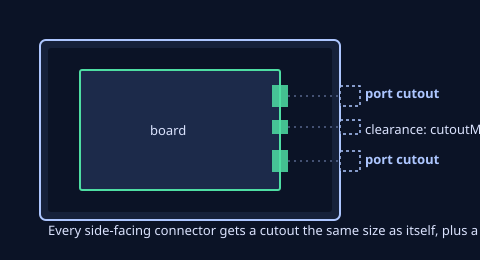
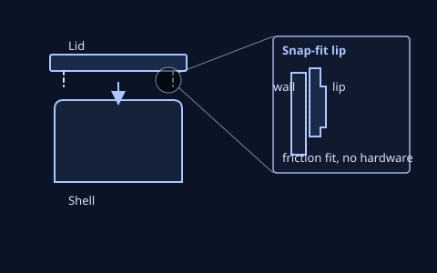
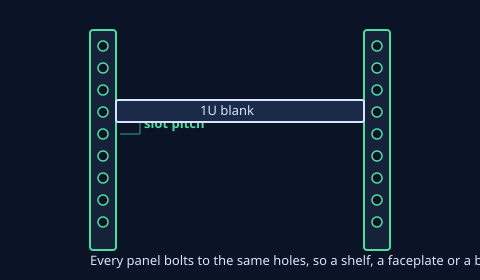
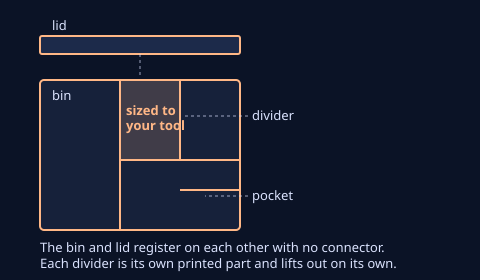
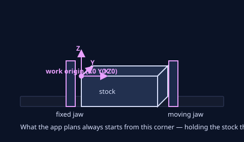
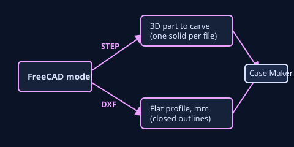

# User Manual

What Case Maker makes, with a worked example for each, the main options, and the questions that
come up most. For a first run in ten minutes, see **Getting Started** instead.

## Install, files and export

Case Maker runs in a browser at **<https://electricrv.ca/casemaker>**, no install, or as a desktop
app you download and run — either way opens to the same welcome page. The desktop app adds
offline use and, on a machine with a CNC attached, direct control of the cut.

**Saving and loading.** **Save** writes a project file holding the whole parametric model — board,
case parameters, ports, external assets — or, for a CNC job, the stock, the cutter and every
operation. **Load** reopens one. A project opens fine on a machine that doesn't have the exact
board installed; it carries its own copy.

**Exporting.** Three formats, for the 3D capabilities (cases, racks, toolboxes):

| Format | When to use |
| :--- | :--- |
| **STL (ASCII)** | The default — human-readable, so a fresh export is something you can open and check, not just trust. |
| **STL (binary)** | Smaller and faster to write; switch to it once you're past checking exports by eye. |
| **3MF** | Carries units and, on a two-colour part, the extruder assignment — nothing to pair up by hand. |

Always use the app's own **Export**, not a browser save of the preview — Export forces a rebuild
first, so the file matches what's on screen. The CNC side exports a program (G-code) instead; see
**Cut it on the CNC** below.

**Settings.** The **App settings** panel covers the embedded server's port (desktop builds,
default **8000**) and whether it's reachable from other devices on the network, plus the default
export format and layout. A port change applies the next time the app starts, and the panel says
so while it's pending.

---

## Cases that fit the board

Pick a board and the shell grows around its ports, holes and standoffs.

### Worked example: a Raspberry Pi case

1. On the welcome page, click **Cases that fit the board**.
2. Search for a board — "rpi-4b" finds the Raspberry Pi 4B — and click its card. The detail panel
   shows its connectors, mounting holes and where its measurements came from.
3. Click **★ Create from quickstart**. The shell generates around the board's real geometry: wall
   around the PCB outline, bosses under the mounting holes, a cutout behind every connector that
   faces an outer wall.

   
   *Port cutouts line up with the connectors behind them.*
4. In the sidebar, open **Case parameters** and drag **Wall thickness** — the shell rebuilds live
   as you move it, usually in under 100 ms.
5. Under **Port cutouts**, turn off anything you don't need — a header pin block hidden under a
   HAT, say.
6. Under **Case parameters → Joint type**, choose a joint for the lid:

   
   *The snap-fit lid's lip drops inside the case wall.*

   - **Flat lid** — sits flat on top of the rim; easiest to print, no recess.
   - **Snap-fit** — cantilever barbs on the lid flex into a catch on the case wall; no fasteners.
   - **Screw-down** — the lid is fastened to the case via screws that engage corner bosses.
7. Open **Export** and choose a format. The file is upright, in millimetres, ready for a slicer —
   no rotation needed.

### Main options

All dimensions are in millimetres; the model is Z-up, with the board sitting at the wall-plus-
clearance offset from the origin.

| Parameter | Default | Range | What it does |
| :--- | :--- | :--- | :--- |
| Wall thickness | 2.0 mm | 1–6 | Outer-wall thickness on all four sides |
| Floor thickness | 2.0 mm | 1–6 | Bottom-floor thickness |
| Lid thickness | 2.0 mm | 1–6 | Top-lid thickness |
| Internal clearance | 2.0 mm | 0–5 | Gap between the board's edge and the inner cavity wall |
| Z-clearance | 5.0 mm | 0–50 | Headroom above the board — raise this for tall connectors or an add-on board |
| Joint type | Flat lid | — | Flat lid, Snap-fit, or Screw-down (see above) |
| Fit | tight | — | Printed clearance for snap interfaces and tabs: tight (as designed), standard (+0.10 mm) or loose (+0.25 mm). Print a fit coupon before trusting a grade on a new printer. |
| Mounting bosses | on | — | Posts at the board's hole positions, for self-tapping screws, heat-set inserts, or a plain pass-through hole |
| Ventilation | off | — | Vent slots or a hex grid cut through one wall |

**Board library.** The picker merges three sources: built-in profiles, boards you've imported or
saved yourself, and any online library you've added under **Sources**. Every card states its
origin, so an imported board is never mistaken for a built-in one. Profiles are measured by
people and printers vary — treat a first print as a test article and check the critical
dimensions against your own board.

**Magnet pockets and the nameplate.** The **Features** panel cuts pockets for disc magnets into
any face, held by glue, a press fit, or captured under a thin skin the print pauses for. A
**nameplate** is a separate magnetic plate carrying text, matched to pockets on the case so it
seats home on its own magnets. A clash with a port, a standoff or another feature is stated with
its size and location, and the panel offers the nearest clear spot — nothing moves until you
choose to.

**Stacking connector.** A printed key locks two cases together, one on top of the other, through a
dovetail socket on the walls you choose. A **registration ring** on the lid and a matching groove
on the floor square a stack with no key fitted yet; the key still does the holding. A base plate
can carry the same sockets, for a case that sits on something other than another case.

**Floor grid and dividers.** A grid of blind sockets in the floor takes drop-in dividers that
split the inside into bays — each divider is its own printed part, liftable later. The grid skips
sockets under the board or a standoff, with room to spare, and a divider that runs into something
is stated and offered a nearby line that clears it.

**External assets.** Import an STL or 3MF mesh and use it as a reference overlay, subtract it from
the shell (a custom cutout), or add it to the shell (a stiffener or extension).

### Common questions

**Why doesn't my board's connector line up with the cutout?** Profiles are measured, not
guaranteed — check the board's measurement source in the detail rail, and compare a critical
dimension against your real board before committing a print.

**The snap-fit lid won't click shut, or falls out too easily.** The default fit is a starting
point. Print a fit coupon, then choose standard or loose (looser drops in more easily) under
**Case parameters → Fit**.

**Can I reuse a board I've customised?** Yes — **Clone & edit** any built-in board to get an
editable copy, or **Export JSON** your own profile to share it.

---

## Racks sized to your gear

A snap-together rack, resized to fit the hardware going in it.

### Worked example: a 10″ U-mount rack

1. On the welcome page, click **Racks sized to your gear**, or enable the **Rack** panel from the
   sidebar on an existing project.
2. Under **Rack family**, choose **10″ U-mount — 44.45 mm per U** to build to the standard rack-gear
   pitch, or **Printed-shelf — 16.5 mm side-column pitch** for a smaller, fully custom rack.

   
   *The rail's hole pitch sets where every panel mounts.*
3. Set the rack's size. U-mount has **Rack units** (1–12 U) and **Depth** — its width is fixed at
   236.525 mm, the standard's own hole spacing, so ecosystem gear always fits. Printed-shelf has
   **Width**, **Depth** and **Height** (in slots) instead, each free to size.
4. Set **Mounting**: freestanding, wall — screw ears, or wall — french cleat.
5. Export. The **assembled export** toggle (shown only when the whole rack fits your selected
   printer) switches between one fused part and the rack's separate panels.

### Main options

- **Rack family** picks the pitch everything else is built to: U-mount's 44.45 mm standard, or the
  printed-shelf's 16.5 mm side-column pitch.
- **Rack units / Depth** (U-mount) or **Width / Depth / Height** (printed-shelf) set the size; a
  printer-fit banner and an **N/M slots used** line tell you what the current size actually holds
  and whether your printer can build it.
- **Mounting** switches between freestanding and the two wall-mounted modes; wall modes thicken the
  sides' rear band for the added load.

### Common questions

**What should I print a rack in?** PETG, not hardwood or PLA — a rack carries real load (5–10 kg
of gear) and needs more heat resistance and creep resistance than an enclosure does. Use a gyroid
or cubic infill (near-isotropic, so it doesn't matter which part is loaded which way): 40% for the
side panels that carry the mounting bosses, 30–40% for the bottom plate and shelf decks, 25% for a
one-piece fused export. Run 4–5 perimeters — a rack's thin sections are beams, and the perimeters
are their flanges — and don't skimp on layer adhesion: it's where a loaded rack actually fails,
more than the infill percentage ever will.

**Why won't my rack fit on my printer?** Watch the printer-fit banner and the **N/M slots used**
line as you adjust the size — they state directly whether the current rack fits your selected
printer's bed, before you commit to a print.

---

## Toolboxes that stack

Bins and lids that register on each other with no connector, and inserts pocketed to your own
tools.

### Worked example: a toolbox with dividers

1. On the welcome page, click **Toolboxes that stack**, or enable the **Toolbox** panel from the
   sidebar.
2. Set the **Footprint** (width and depth) and the **Module height** — the bin and its lid resize
   together.
3. Turn on **Floor grid** if you want the floor divided into a grid rather than left open.
4. Add **Dividers** to split the bin into bays sized to your own tools — a socket set, a
   screwdriver, a wrench. Each divider is its own printed part.

   
   *The bin's dividers pocket it to whatever you're storing.*
5. Export. The bin, the lid, and each divider export as separate parts — they print without
   supports and assemble by registering on each other, no connector needed.

### Main options

- **Footprint** (width and depth) and **Module height** set the bin and lid's overall size; both
  resize together.
- **Floor grid** divides the floor into a grid instead of leaving it open.
- **Dividers** are added one at a time, each its own part, sized to split the bin into bays for
  your own tools.

### Common questions

**Do the bins need a clip or a catch to stay stacked?** No — the parts register on each other by
their own geometry. Nothing fastens them; lifting the top one off is a plain lift.

**Can I size a toolbox for a specific set of tools?** Yes — add a divider per tool or group of
tools; there's no fixed layout.

---

## Cut it on the CNC

Carve hardwood on the CNC — a name plate, a coaster, a pocket, an engraving.

> The CNC side is withheld on the public site unless the address carries `?BETA=yes`
> (`https://electricrv.ca/casemaker/?BETA=yes`) — dev builds and the desktop build show it without
> the switch. The switch does not let a browser reach a machine; only the desktop build can.

### Worked example: a first cutting job

1. On the welcome page, click **Cut it on the CNC**. This opens a four-step wizard: **Machine**,
   **What are you making?**, **Stock**, **Holding**.
2. On **Machine**, the shop's machines are listed with a picture of the bed as it is now and one
   plain state line. Pick the machine — the one you used last is already picked — and, if the bed
   is not holding what the picture shows, press **Change what's on the bed…**. The check never
   blocks: the job can be written, checked and simulated now, and the machine is needed at Cut.
3. On **What are you making?**, pick the card that matches the job — **A sign or name plate**,
   **A part from a 3D model**, **Cut out a shape**, **A pocket or tray**, **A design from a
   file**, **A circuit board**, or **Something else…** for the full operation list. The card
   opens its own questions in place, and a file dropped anywhere on the step opens the card it
   belongs to. **Start with an empty job**, at the bottom, is the deliberate way to begin from
   nothing.
4. On **Stock**, the blank is proposed from the work and the part is drawn on it with its margins
   dimensioned. Take the proposal, a blank from the shop's shelf, or **Other size…**; the material
   list is the shop's own and the size types in millimetres or inches.
5. On **Holding**, check how the stock is held — the recommended seat says why it is recommended —
   and the picture shows the part on the blank. Press **Create the job**.
6. In the Job panel, click **Generate**. The app plans the toolpath, checks it against the stock
   and the holding, then runs a simulated pass so you can watch it sweep across the block before
   anything real happens.
7. Once it's checked out, the job is ready to post as a program for a CNC machine — the CNC
   equivalent of the **Export** button on the other three capabilities.

### The question step — what are you making?

The step is a row of illustrated cards, because the operation names are the panel's vocabulary,
not the answer a person starts with. Each card asks only its own questions.

| Card | What it asks | What it makes |
| :--- | :--- | :--- |
| **A sign or name plate** | the text, a letter size (or none), the font | Engraved letters on a plate sized from the line |
| **A part from a 3D model** | the file — STL, 3MF, STEP or OBJ | A rough-and-finish pass over the mesh |
| **Cut out a shape** | a rectangle or circle, its size | A through cut, held by tabs |
| **A pocket or tray** | a rectangle or circle, its size and depth | A flat-floored recess |
| **A design from a file** | the file — SVG, DXF or a picture | An outline cut, a pocket or a carved relief |
| **A circuit board** | the Gerber and drill files, or the board's zip | The copper, holes and outline of a board |
| **Something else…** | the full list of operation types | Any single operation the panel knows |
| **On a rod** (when a rotary is owned) | the dowel's text and reading, faces, or the relief's mesh | A job on the 4th axis, with the chuck chosen for you |

**A file can come first.** Drop a file anywhere on the step and the card it belongs to opens with
the file already read: a mesh or a picture opens the 3D-part card, an SVG or DXF opens the design
card with **Cut it out**, **Pocket it** or **Carve it (V)**, a PrusaSlicer project opens the stock
and design route, and a Gerber set opens the board card. The card shows a picture of what was read
beside the numbers it found, so a file that read wrongly is caught here rather than at Generate.

**The sign's letter size.** The size starts unchosen: the line is fitted to the house's stick and
no plate is asked for. Choosing **Small · 20 mm**, **Medium · 35 mm** or **Large · 60 mm** asks
for a plate sized from the line — the chosen size is the target, never larger than the fitted
line, with a 10 mm margin around it — and the label is re-seated centred on the plate whenever the
blank changes. The font is chosen beside the text.

**On a rod.** When the shop owns a rotary module, its intents join the cards in their own *On a
rod* group, first in the list when the module is on the pins: **Name on a dowel**, **Faces on a
rod** and **A relief on a rod**. Picking one sets the rotary frame, proposes the rod and
pre-selects the chuck on Holding.

**Something else.** The sixteen operation types stay under **Something else…** — Engrave,
V-carve, Pocket, Profile, Chamfer, Hole, Bore, Thread, Surface a mesh, Texture, Flute, Raise a
prism and the rest. They are the same operations the Design panel's **Add** offers.

### Main options

**The blank.** Every job states a stock block (material, width, length, thickness). The Stock
step opens with **Pick a blank** — **From your design** first, then the blanks the shop actually
holds, then **Other size…** — and a shelf blank within a millimetre of the proposal in either
orientation is already selected. Blanks in another material are shown greyed with the material to
choose, rather than hidden, so the shelf stays visible. Hardwood is the default material; picking
a different one adjusts the feeds the app plans for it. The form is a row of pictures — sheet,
plate, block, disc, rod — and the size types in millimetres or inches while the job itself stays
in millimetres. A piece typed here can be put on the shelf in the same step.

**Work origin and holding.** A job's zero point sits at a known corner of the stock, and the
holding is shown alongside it, in the mount's own words, so what the app plans matches where the
material actually sits on the machine.

*Work origin and holding: where zero is, and what's holding the stock.*

**Generating.** Pressing **Generate** while the app is still building its preview (or the plan's
measured pick) does not fail: the progress line says "waiting for the measured pick to finish — the
worker is busy", and the run continues as soon as the worker is free. The app's own stall watchdog
starts only after the generate itself has spoken.

**Where Generate runs.** When the house service can run the engine — the desktop app's own service,
or the shop's — **Generate** happens there: the page sends the job, the service plans, posts,
verifies and simulates it, and the progress line streams its stages while you can press **Cancel**.
With no service able to run it (a browser connected to an older service, or none), the page plans
the job itself exactly as before; nothing in the run, the plan or the Cut step changes either way.

**The programs, and the comparison.** The cutting programs are the owned plan — the one cut with
the location's own bits — and Generate hands them over as soon as that plan has planned, posted,
verified and simulated. The comparison with every bit the app knows is planned afterwards, on its
own worker, so it never holds up the simulation or the sweep: the Cut step reads "comparing the
plans…" until the tradeoff — or "no material difference" — lands. On the tray the programs are
ready in about 2.5–7 minutes.

**Simulating.** Generate always runs a full simulated pass before a job is considered ready — a
pass that doesn't match the design, or that the chosen cutter can't physically reach, is refused
rather than silently produced.

**The cleaning pass and the air walk.** Both are on by default: before the first program an *air
walk* traces the stock's outline in the air at a safe height, and after every program a *cleaning
pass* sweeps the stock to clear chips. They are ordinary verified programs the release plays
(named `<job>-airwalk.nc` and `<job>-clean.nc`), their time is included in the plan's estimate
("The plan (N min); cleaning and air walk: ~3 min"), and the Cut step offers **Clean now** for a
sweep on demand. A shop that wants neither turns them off in the shop defaults
(`run.airWalkBeforeCut`, `run.cleanAfterProgram`).

**While a program runs.** The viewport shows the uncut blank with the live tool at the machine's
position, and darkens the area the program has already cut. The Cut step states how far the program
is, and — once it has run for a few seconds — about how long is left; pauses and bit changes are
not counted, and the controller's own elapsed field is never used as a clock.

### Holding: what holds and what locates

The Holding step's rows say how the stock is held, and the picture and the fold beside them use
that mount's own words: a vise job keeps its jaw terms, while a taped or bracketed job speaks of
the bed, the bracket's corner and its clamps.

- **In the vise.** Three seats — on the jaw ledge, on a board on the ledge, or on the vise body
  gripped as a block. The recommended seat is chosen from the work: the deepest cut, whether the
  cut goes through, and how near it comes to the gripped edge. It says why — "Recommended: on the
  jaw ledge — the cut goes 2 mm down and stays 6 mm inside the blank's edge; the ledge keeps
  1.2 mm proud" — and a seat the work refuses says so on its own row ("The cut goes 19.1 mm down
  and comes within 4 mm of the blank's edge; on this seat the jaws stand … above its floor
  there."). A through cut is never recommended for a vise seat.
- **Tape on the bed.** The taped row asks **Located against** — the bed's front edge, or the
  bracket's corner at anchor 1 or 2 — and **Tape goes on** — the blank itself, or a board under
  it. The bracket's corner is the default when the bracket is on the pins, and it squares the
  blank; the Where row appears only when nothing fences the tape.
- **The bracket.** On the bed, clamped in the bracket's corner at its anchor, with the clamps the
  job states — none when the bracket only fences the blank, up to the shop's limit otherwise
  (4 on a fresh shop), and going past the limit is refused by name.
- **In the rotary chuck.** A rod's own mount, with its grip, stick-out, tailstock, jaws and neck
  fields; the fold names **Chuck end** and **Text reads** (along the rod or around it).

Nothing in the step points at an option the machine state does not offer: a row that needs another
bed carries its own action ("Put the vise on the pins — **Change the machine…**"), and a row that
cannot hold the piece at all is not drawn enabled. What holds the stock and what locates it are
separate answers — tape holds, and the bed's front edge or the bracket's corner locates.

### Before a routine moves the machine

Every press that moves a machine — a registration, the registration routines' own walks, a centre
find, the tool change's Continue — first shows its own lines.

- **What will be sent.** The card lists the exact sequence the press will send, line by line, with
  the motion guard's verdict on each line; a refused line is named in place. The list shown is the
  list sent.
- **A first run says so.** A shape this machine has never completed is marked: "This measurement
  has not run on this machine before — stay at the Stop." The press stays held until you tick your
  own statement — that you are at the machine, the probe or bit is fitted, the head is clear and
  you will stay at the Stop.
- **No unattended first run.** When the app is being driven automatically against a real
  controller, a first run is refused in words: "a routine's first run has to be started by a
  person at the machine."
- **The machine guard.** No routine travels in X or Y while the head is below the session's safe
  height: it lifts, travels at the safe height and descends only at the point it will touch. A
  line that would break that rule is refused before it is sent.
- **The tool change.** When the machine stops at a tool change, **The machine is waiting for you**
  card names the bit and carries **Continue — the bit is in** and **Stop**. On a first run the
  Continue is held by the statement above; on a shape this machine has already completed, a guard
  refusal stays visible but does not take away the only way on.
- **The centre find.** **Find the centre** shows its own routine the same way, and a bore's
  search waits for a face beside it to read.
- **A probe that touches down only.** A probe recorded as top-touches-only never gets a sideways
  touch, a corner routine or an edge find that needs one; the plan and the Register card say
  "<probe name> · top touches only" and say what was planned instead. Its top touches also stay
  the probe's stated lateral uncertainty plus its tip radius clear of an edge.

### The jaw touch is measured in Manage

The vise's jaw top is a **bed-setup measurement**, not something a job measures: a job never
descends beside the blank to find a jaw. It is measured once in **Manage › the machine**, where
the bed's setup is recorded, and every job reads it. When the vise's place is not on file, the
Setups row refuses in words and offers **Set up the vise in Manage**, which opens the bed setup;
no control in a job moves the machine for it.

### The Cut screen's cards

The Cut screen states the run's condition in cards rather than one long column. While a program
plays, a card follows the program's percent and the time left — the app's own clock, started when
the machine first reports progress, and on a job with several programs the WHOLE run's remaining
rather than the current file's (the firmware's own `P:` third field is used for nothing) — another
names the next program that needs a different bit, and the waiting card owns the tool-change
recovery. The Job panel above shows one **Program ready · N min** line once a run has passed, and
the cutter list states its count once — in the Cutters group's summary — rather than repeating
every missing name under the rows. On a job with several programs the card's **Start** is the
release's own: it uploads every program and plays them in order, so the one press begins the
whole cut. The background plan comparison says what it is doing — the owned plan (the shop's own
bits) against the catalogue ideal with every bit the app knows — that Cut can go on meanwhile, and
where the answer appears.

### A run that survives a reload and a new build

A generated run is kept with the job, so a reload — or an update of the app — does not throw the
programs away. The Cut step says which build generated them ("These programs were generated by
build …"), and the app re-checks the stored programs before they are offered. While nothing has
been started, it also plans the job once in the background and compares the two plans: matching
plans say nothing, and a different one is offered, never forced — "This build plans this job
differently (N of M programs changed) — keep the programs you have, or use the new plan", with
**Keep these programs** and **Use the new plan**. Keeping is the default, and only a new
**Generate** replaces the stored run's origin line.

### Jobs with several programs

A job can post more than one program — one per cutter or setup the plan runs, in cut order. With more
than one program the file bar offers **Save all (N programs)…** instead of a single Save: it writes
every file the machine plays, in cut order, into a folder you choose (or one `<job>-programs.zip`
where the browser has no folder picker). The names are the sheet's own — `<job>-p01.nc`,
`<job>-p02.nc`, … with the number zero-padded to the last program's width, so `p10` sorts after
`p09` on the machine's file list — and a program that produced an air-trace frame has
`<job>-pNN-frame.nc` beside it. The run sheet lists each program with its own cut, its cutter and
its own **Save** row, so one file can still be saved on its own; the run record travels with the set
and lists every program's name and hash.

### What the run sheet says it costs

The run sheet prints what the plan chose and what that choice costs, in words, beside the steps:

- **The plan's cycle, with the bit changes priced as they were applied** — "this plan's cycle is
  <h m s>: cutting and rapids <h m s>, bit changes <h m s> in <n> changes; a bit change is priced
  from the program before it: <attended> up to <a> min, <away> from <b> min on, and a smooth rise
  (3t² − 2t³) between". The four numbers are shop settings: a change while you are still there
  costs the attended time, a change after a long program costs the attended time plus your walk
  back, and the rise between is the curve the sentence names.
- **What a near-equal set gave up** — when two sets of cutters leave within 0.5 % of the surface
  of each other, the faster one is chosen and the sheet says so: "The cutters chosen leave <X> mm²
  more than the most thorough set would, and save about <Y> min."
- **What the tall rule kept** — material standing more than 1 mm (the shop's `plan.leftoverTallMm`)
  is never traded for speed; when that kept a faster set out, the sheet says: "A set of cutters
  about <N> min faster was passed over: it would leave <X> mm² more standing over <T> mm tall.
  Material that tall is never traded for time (a shop setting)."
- **The run's own cycle** over every posted program, cutting and bit changes separated, so a
  multi-program run's figure is the whole run's and not the first program's plan.

A finishing pass may run past the stock's own edge by up to the cutter's radius, so the surface
at the edge is cut with the cutter's centre over air — the heights there come from the real model,
never an extrapolation, and nothing runs into a modelled fixture. A cutting feed further outside
the footprint than that allowance is a planning fault the verifier reports (`cut-outside-footprint`
in the CNC guide), not something to fix at the machine.

### Holding tabs

A cut-out that frees a part leaves holding tabs — material the cut never enters — so the part
cannot come loose under the cutter. Tabs sit in the middle of each side: the outline's longest
edges take one first, centred on the edge (on a rectangle, two tabs are the two long sides'
midpoints and four are every side's), a second tab comes to an edge only once every edge has one
and then divides that edge evenly, and no tab's span sits within `max(2 × tab width, 10 % of the
edge)` of a corner — an edge too short keeps none, and a round outline keeps equal spacing. No
stretch of the outline is left longer than the shop's `tabs.maxSpanMm` (80 mm on 6 mm stock or
thicker, 40 mm under 3 mm), so the planner may add centred tabs beyond the number asked: your
count is a minimum, not a cap. When a stretch still cannot take a corner-clear tab — a curve
drawn in short pieces — the planner places a tight tab inside the corner margin and the run sheet
names it, its distance from the nearest corner and how many joins of the outline it spans:
holding the part comes first, and the sheet says what was given up. A job that places fewer tabs
than asked says so on the sheet ("N asked, M placed — the remaining edges are too short for
another tab clear of the corners"), and one that gets more says why. The tab's height is
unchanged; when nothing can be placed the cut is refused (`tab-unplaceable` in the CNC guide).

### Two-sided jobs (the flip)

A two-sided job cuts some of the part from the stock's top and the rest from its underside, planned
from one job. Setup 1 cuts the top and leaves a **locating hold** in the stock's margin: two ⌀6
through holes, cut by their own program at the end of setup 1 — the sheet's setup-1 page says
"Setup 1 also bores the two ⌀6 locating holes side 2 registers on — program N, `<file>`; the probe
enters each hole from side 2 and touches its wall". Setup 2 cuts the turned blank, held by a **tab
band** so the part stays in the blank for the second side.

Turn the stock over exactly as setup 2's page says ("Turn the part over for setup 2 … about the
machine's Y axis (front to back)"), re-seat the edge against the same bracket arm, then press
**Register**. Side 2's card registers on the two bores: the probe enters each from the centre and
touches its wall — four sideways touches per bore, with a G38.5 release after every trigger — and
the corner Z touches check the carried side-2 top against the surface tolerance. A setup-2 file does
not run before that registration: the release refuses with "Program N did not start: setup 2 is not
registered — run the Register step for setup 2 first." The card also refuses by name when the job
cannot state its locating pins or its carried Z0, and when no probe tip is measured on the machine
("no probe tip is measured on this machine — measure it in Manage › Accessories, then register
side 2").

Last, free the part: the flipped setup's last step is the **hand-cut tabs** — "The part is held by
4 tabs — cut them with a flush-cut saw or knife after the machine is homed, then dress the stubs" —
with the tab centres printed in the setup's work frame (4 tabs · 8 mm wide · 2 mm thick on the
shop's default band). Cut them only after the machine is home and the program has ended.

### Rotary jobs

A rod job starts on the question step's **On a rod** cards when the shop owns a rotary module:
**Name on a dowel** (text read along the rod or around it), **Faces on a rod**, or **A relief on a
rod**. The rod is proposed, and the Holding step opens with the chuck selected.

A relief cut on the 4th axis is checked like any other goal: the goal check compares the swept
surface with the design and states **coverage** against the shop's 95 % pass line and the
**adjudicated cut-into** share (with the deepest cell and where it is), and the verdict fails when
either holds it. A relief placed where the axis runs outside the body, or too close to the axis
for any ball to cut, is the finding **`goal-rotary-unreachable`**: it states the share of the map
that met air, the share of the covered surface within 2 mm of the axis (with the X spans of its
pieces), and the share inside the finishing ball's radius with the closest approach and the ball's
diameter. The relief's finish also states the cusp it leaves beside the one the job asks for —
including when the job states no scallop, where the finish steps at the engine's default and the
sheet reports the result.

**The rotary's limits.** The jaws' keep-out past their tips (3 mm), the tailstock's band (10 mm),
the clearance above the stock before the rod may turn or travel (3 mm), and the tailstock's live
centre, body length and housing radius (12, 40 and 45 mm) are shop settings with recommended
values: at the recommended values every program, finding and sentence is exactly as before, a
measured value is used, and the numbers the shop actually uses are printed where they decide the
job. A rotary probing routine also descends in a region clear of the chuck — nothing moves at X
inside the jaws' keep-out at any height, and the A axis turns only where its floor allows. The
centre find is placed against the job's stated hold (its footprint, margin, band, body radius and
the modelled obstacles) and the chuck's keep-out; when that leaves it nowhere to go the step
refuses in words before it sends a line.

### Materials

Besides the woods, plastics and metals, the material list includes **Epoxy tooling board** — the
100 × 100 × 10 mm cast resin board the M1 stock uses. The run sheet and the receipt print the
material in the app's words ("Epoxy tooling board"), and the feeds come from Makera's own
`Epoxy Tooling` rows for that cutter; a cutter with no row in that material is stated unfeedable
rather than guessed.

The list is grouped from the shop's own vocabulary: the print and machining materials first
(softwood, hardwood, MDF, PLA and the bought engraving laminate), then every material the machine
profile declares — ABS, Acrylic, 6061 aluminium, 7075 aluminium, brass and copper on the Z1. A
profile material is cut on **Makera's own numbers for that exact cutter and material**, from the
catalogue the shop synced; with no catalogue row for the pair the job is refused and the missing
row is named. A material with no row and no app vocabulary (Delrin, polycarbonate, PCB and the
rest of the vendor's list) is not offered at all, rather than offered and then refused.

### Exporting from FreeCAD

A part modelled in FreeCAD imports cleanly if it's exported the right way:

*FreeCAD's two export paths: STEP for a 3D part, DXF for a flat one.*

- **A 3D part to carve** — export **STEP**: select the Body or Part, then *File → Export → STEP*.
  One solid per file; union an assembly into a single solid first. If STEP isn't available, 3MF is
  the fallback — it carries millimetres correctly. Only use STL or OBJ when the mesh is fine
  enough to hold the detail you need (roughly 0.01 mm deviation or better); either format loses
  the exact surfaces STEP and 3MF keep.
- **A flat profile, pocket or engraving** — export **DXF**, in millimetres, with closed outlines.
  SVG works too, but check its pixel scale carries over correctly.
- **Before you export**, put the side you want cut facing +Z — or use **Lay it flat** or
  place-on-face after importing. Set your model's units to millimetres; Case Maker states the
  units it assumed on import, so check that line matches what you exported.

Most other CAD tools export the same two formats the same way: Fusion 360 and SolidWorks both
offer STEP directly from their export menu for 3D parts, and DXF for sketches; Inkscape exports
DXF for flat vector work if you set its document units to millimetres first.

### Common questions

**Why was my Generate refused?** The app checks the planned cut against the stock, the cutter's
reach, the holding, and a planning budget before it will call a job ready — the message names
which of those it failed. A detailed goal can be refused for being too big to plan at its current
resolution; the message then offers named presses to fix it — coarser detail, thicker layers, or
splitting the goal into two setups.

**My imported part looks right but won't carve correctly — why?** Check that the side you want
cut is facing +Z, and that the unit Case Maker reports on import matches what you actually
exported — a model exported in inches read as millimetres is 25× too large.

---

## Coordinate system and undo

Every capability shares the same ground rules once you're past the welcome page.

**Coordinate system.** Z is always up. For the 3D capabilities, the model's origin sits at one
corner, with the part spanning positive X, Y and Z from there — what you see on screen is exactly
what exports, with no rotation needed for a slicer. For a CNC job, the work origin is a stated
corner of the stock, shown alongside the holding that's meant to match it.

**Undo and redo.** `Ctrl+Z` undoes, `Ctrl+Shift+Z` (or `Ctrl+Y`) redoes, with a deep history of
project changes — UI selection itself isn't part of it. Both are suppressed while you're typing in
a text field.

**Tolerances.** Every printed fit in this manual — snap-fit, screw clearance, heat-set inserts,
divider pockets — is a starting point, not a guarantee. Print one test piece and measure it with
callipers before committing a full build; the fit grade (tight, standard, loose) in each panel is
there so you don't have to redesign anything to try a looser one.
